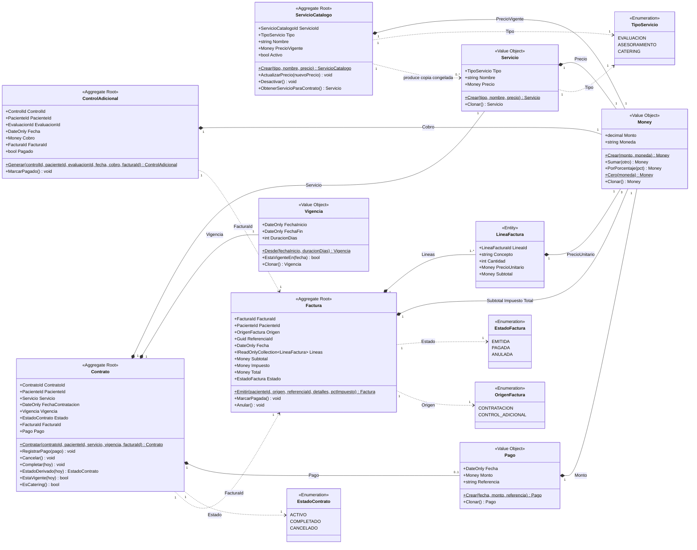

# ms-contratos-facturacion

Microservicio **BC3 — Contratos y Facturación** del sistema **NUR-TRICENTER**.
Entrega de la Actividad 3 (capa de dominio).

## 1. Qué es

`ms-contratos-facturacion` gestiona el catálogo de servicios, contrata en
nombre del paciente y **factura cada contratación en el mismo acto**: no
existe un contrato sin factura ni por un instante.

Es un **subdominio genérico** — contratar, facturar y cobrar es un problema
que el mercado ya resolvió, no aporta ventaja competitiva propia — pero es
**el contexto que habilita a los demás**: el evento `ServicioContratado` que
publica dispara la consulta inicial en BC1 (Gestión de Pacientes), la
creación del plan alimenticio en BC2 (Planificación Nutricional) y el
calendario de entregas en BC4 (Gestión de Catering). Sin una contratación
registrada aquí, ningún otro contexto tiene por qué actuar.

## 2. Funcionalidades

| HU | Funcionalidad |
|---|---|
| **HU-19** | Registrar la contratación de un servicio para un paciente y generar automáticamente su factura. |
| **HU-20** | Gestionar el catálogo de servicios y sus precios para mantenerlos actualizados. |
| **HU-21** | Consultar las facturas emitidas de un paciente, para llevar un registro de sus gastos. |
| **HU-22** | Registrar el pago de un control de seguimiento para pacientes sin catering. |
| **HU-23** | Consultar el listado de contratos activos por período, para análisis financiero. |
| **HU-24** | Generar automáticamente el cobro de un control adicional cuando un nutricionista programa una evaluación a un paciente sin catering vigente. |

## 3. Diagrama de clases del dominio

Solo la capa `src/Contratos.Domain`: los cuatro agregados, la entidad hija,
los value objects y las enumeraciones, tal como existen en el código.



**Notas de lectura.** El rombo lleno (`*--`) es composición dentro del límite
del agregado; la flecha punteada (`..>`) es referencia por identificador o
dependencia de tipo, nunca una relación de objetos entre agregados —
`Contrato ..> Factura` es un `FacturaId`, no una instancia de `Factura`. Los
IDs tipados (`ContratoId`, `FacturaId`, `PacienteId`, etc.) no se dibujan como
clases aparte: son `sealed record` de un solo campo `Guid` y aquí se muestran
como el tipo de cada atributo, igual que en el código. `Moneda` tampoco es una
clase: es un conjunto cerrado de códigos (`{ BOB, USD }`) validado dentro del
propio `Money`, no un enum de C#. `PacienteConocido` (read model de
`Contratos.Application`) y los eventos de dominio quedan fuera a propósito:
esta es solo la capa `Contratos.Domain`.

## 4. Invariantes (C1–C22)

Doce se hacen cumplir dentro de `Contratos.Domain`. Las once restantes son de
**orquestación** (§6.1 de `docs/DESIGN.md`): cruzan agregados, el repositorio
o la réplica `PacienteConocido`, y ningún agregado puede garantizarlas por sí
solo — viven en `Contratos.Application` (fase 3).

### Invariantes de dominio

| Código | RN | Regla de negocio | Dónde se hace cumplir |
|---|---|---|---|
| **C6** | RN-18 | `Factura` pasa a `PAGADA` o `ANULADA` solo desde `EMITIDA`; ambos son terminales. | Agregado `Factura` |
| **C11** | RN-25 | Subtotal, impuesto y total **se calculan siempre**; ningún importe se recibe desde fuera. | Agregado `Factura` |
| **C12** | RN-20 | Un contrato se completa solo si estaba `ACTIVO` y su vigencia ya terminó (cierre perezoso). | Agregado `Contrato` |
| **C13** (unicidad) | RN-18 | Un contrato registra a lo sumo un `Pago`. | Agregado `Contrato` |
| **C14** | RN-20 | `CANCELADO` es terminal: no admite pago ni una segunda cancelación. | Agregado `Contrato` |
| **C15** | RN-26 | El contrato copia el precio vigente del catálogo; el catálogo exige nombre y solo cambia precio si está activo. | Agregado `ServicioCatalogo` |
| **C17** | RN-01 | Vigencia coherente: `FechaFin = FechaInicio + DuracionDias − 1`. | VO `Vigencia` |
| **C18** | RN-25, §8 maestro | `Money` nunca negativo, moneda en la lista cerrada `{ BOB, USD }`, solo se suma entre la misma moneda. | VO `Money` |
| **C19** | RN-25 | `LineaFactura` exige concepto y `Cantidad > 0`; su `Subtotal` se calcula, nunca se recibe. | Entidad `LineaFactura` |
| **C20** | RN-18 | `Pago` exige `Monto > 0`; una referencia nula se normaliza a cadena vacía. | VO `Pago` |
| **C21** | RN-06, RN-18 | `ControlAdicional` nace con `Cobro > 0` y sin pagar; se paga una sola vez. | Agregado `ControlAdicional` |
| **C22** | — | Ningún identificador tipado admite `Guid.Empty`. | VOs de ID |

### Invariantes de orquestación (Application, fase 3)

| Código | RN | Regla de negocio | Dónde se hace cumplir |
|---|---|---|---|
| **C1** | RN-05 | Solo se contrata para un paciente conocido (réplica `PacienteConocido`). | `ContratarServicioCommandHandler` |
| **C2** | RN-03, RN-01b | Contratar `CATERING` exige plan alimenticio activo replicado. | `ContratarServicioCommandHandler` |
| **C3** | RN-19 | Máximo un contrato `CATERING` `ACTIVO` por paciente, con solape de vigencia; no aplica a `EVALUACION` ni `ASESORAMIENTO`. | `ContratarServicioCommandHandler` + índice único en base de datos |
| **C4** | RN-01b, RN-01 | La vigencia del catering se deriva del plan activo; `DuracionDias ∈ {15, 30}`. | `ContratarServicioCommandHandler` |
| **C5** | RN-05 | Toda contratación emite su factura en el mismo commit; no existe contrato sin factura ni por un instante. | `ContratarServicioCommandHandler` + `UnitOfWork` |
| **C7** | RN-06 | Se genera `ControlAdicional` cobrable solo si la evaluación es `CONTROL` y el paciente no tiene catering vigente ese día. | `ProcesarEvaluacionRegistradaCommandHandler` |
| **C8** | RN-18 | Cancelar un contrato anula su factura solo si sigue `EMITIDA`. | `CancelarContratoCommandHandler` |
| **C9** | RN-01 | No se contrata un servicio inactivo en el catálogo. | `ContratarServicioCommandHandler` |
| **C10** | §9.5/§10 maestro | Máximo un `ControlAdicional` por `evaluacionId`. | `ProcesarEvaluacionRegistradaCommandHandler` + índice único en base de datos |
| **C13** (monto exacto) | RN-18 | El pago cubre exactamente el total de la factura, en su misma moneda. | `RegistrarPagoCommandHandler` |
| **C16** | RN-12, §12.9 maestro | `pacienteNombre` y `nroIdentificacion` salen de la réplica local, nunca de una consulta a BC1. | `PublicarServicioContratadoHandler` |

## 5. Puesta en marcha

```bash
docker compose up -d          # PostgreSQL — contenedor nur-tricenter-postgres, puerto 5432
dotnet build
dotnet test
```

`dotnet test` corre hoy `tests/Contratos.Domain.Tests` (un test por cada
invariante de dominio, incluido el rechazo de `"EUR"` en `Money`). API en
`http://localhost:5030/swagger` una vez construida la capa `WebApi`.
