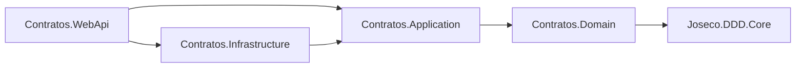

# ms-contratos-facturacion

Microservicio **BC3 — Contratos y Facturación** del sistema **NUR-TRICENTER**.
Entrega de la Actividad 4 (arquitectura completa: dominio, aplicación,
infraestructura y WebApi, con sus eventos de integración y demo end-to-end).

## 1. Qué es

`ms-contratos-facturacion` gestiona el catálogo de servicios, contrata en
nombre del paciente y **factura cada contratación en el mismo acto**: no
existe un contrato sin factura ni por un instante.

Es un **subdominio genérico** — contratar, facturar y cobrar es un problema
que el mercado ya resolvió, no aporta ventaja competitiva propia — pero es
**el contexto que habilita a los demás**: el evento `ServicioContratado` que
publica dispara la consulta inicial en BC1 (Gestión de Pacientes), la
creación del plan alimenticio en BC2 (Planificación Nutricional) y el
calendario de entregas en BC4 (Gestión de Catering). Sin una contratación
registrada aquí, ningún otro contexto tiene por qué actuar.

## 2. Funcionalidades

| HU | Funcionalidad |
|---|---|
| **HU-19** | Registrar la contratación de un servicio para un paciente y generar automáticamente su factura. |
| **HU-20** | Gestionar el catálogo de servicios y sus precios para mantenerlos actualizados. |
| **HU-21** | Consultar las facturas emitidas de un paciente, para llevar un registro de sus gastos. |
| **HU-22** | Registrar el pago de un control de seguimiento para pacientes sin catering. |
| **HU-23** | Consultar el listado de contratos activos por período, para análisis financiero. |
| **HU-24** | Generar automáticamente el cobro de un control adicional cuando un nutricionista programa una evaluación a un paciente sin catering vigente. |

## 3. Arquitectura

Cuatro capas, cada una con su responsabilidad y sin mezclarse:

| Capa | Contenido |
|---|---|
| `Contratos.Domain` | Los cuatro agregados, la entidad hija, los value objects (`Money` primero) y los catálogos de error `*Errors`. Solo referencia `Joseco.DDD.Core`. |
| `Contratos.Application` | Commands, queries (records), handlers, políticas, `IntegrationEvents/` (entrantes y salientes), `ReadModels/` y los puertos (`IContratoRepository`, `IFacturaRepository`, etc.). |
| `Contratos.Infrastructure` | `DbContext`, configuraciones EF Core, repositorios, `PacienteConocidoStore`, `UnitOfWork`, `Queries/` (los handlers de las queries) y el publicador de eventos de integración. |
| `Contratos.WebApi` | Controllers, `Program.cs` y el middleware de traducción de excepciones a HTTP. |

**Regla de dependencias**, verificada contra las referencias reales de cada
`.csproj`:

- `Contratos.Domain` no referencia ningún otro proyecto propio.
- `Contratos.Application` → `Contratos.Domain`.
- `Contratos.Infrastructure` → `Contratos.Application` (y a `Domain` solo
  transitivamente).
- `Contratos.WebApi` → `Contratos.Application` **y** `Contratos.Infrastructure`,
  las dos directamente: `Program.cs` registra MediatR escaneando ambos
  ensamblados (`typeof(ContratarServicioCommand).Assembly` y
  `typeof(ContratosDbContext).Assembly`), porque los `record` de las queries
  viven en Application pero sus handlers en `Infrastructure/Queries/`.



Las flechas se leen "depende de". Ninguna capa depende de una capa que la
envuelve: `Domain` no conoce EF Core, HTTP ni MediatR (salvo los
`record : DomainEvent`), y `Application` no conoce PostgreSQL ni ASP.NET Core.

## 4. Diagrama de clases del dominio

Solo la capa `src/Contratos.Domain`: los cuatro agregados, la entidad hija,
los value objects y las enumeraciones, tal como existen en el código.


**Notas de lectura.** El rombo lleno (`*--`) es composición dentro del límite
del agregado; la flecha punteada (`..>`) es referencia por identificador o
dependencia de tipo, nunca una relación de objetos entre agregados —
`Contrato ..> Factura` es un `FacturaId`, no una instancia de `Factura`. Los
IDs tipados (`ContratoId`, `FacturaId`, `PacienteId`, etc.) no se dibujan como
clases aparte: son `sealed record` de un solo campo `Guid` y aquí se muestran
como el tipo de cada atributo, igual que en el código. `Moneda` tampoco es una
clase: es un conjunto cerrado de códigos (`{ BOB, USD }`) validado dentro del
propio `Money`, no un enum de C#. `PacienteConocido` (read model de
`Contratos.Application`) y los eventos de dominio quedan fuera a propósito:
esta es solo la capa `Contratos.Domain`.

## 5. Invariantes (C1–C22)

Doce se hacen cumplir dentro de `Contratos.Domain`. Las once restantes son de
**orquestación** (§6.1 de `docs/DESIGN.md`): cruzan agregados, el repositorio
o la réplica `PacienteConocido`, y ningún agregado puede garantizarlas por sí
solo — viven en `Contratos.Application`.

### Invariantes de dominio

| Código | RN | Regla de negocio | Dónde se hace cumplir |
|---|---|---|---|
| **C6** | RN-18 | `Factura` pasa a `PAGADA` o `ANULADA` solo desde `EMITIDA`; ambos son terminales. | Agregado `Factura` |
| **C11** | RN-25 | Subtotal, impuesto y total **se calculan siempre**; ningún importe se recibe desde fuera. | Agregado `Factura` |
| **C12** | RN-20 | Un contrato se completa solo si estaba `ACTIVO` y su vigencia ya terminó (cierre perezoso). | Agregado `Contrato` |
| **C13** (unicidad) | RN-18 | Un contrato registra a lo sumo un `Pago`. | Agregado `Contrato` |
| **C14** | RN-20 | `CANCELADO` es terminal: no admite pago ni una segunda cancelación. | Agregado `Contrato` |
| **C15** | RN-26 | El contrato copia el precio vigente del catálogo; el catálogo exige nombre y solo cambia precio si está activo. | Agregado `ServicioCatalogo` |
| **C17** | RN-01 | Vigencia coherente: `FechaFin = FechaInicio + DuracionDias − 1`. | VO `Vigencia` |
| **C18** | RN-25, §8 maestro | `Money` nunca negativo, moneda en la lista cerrada `{ BOB, USD }`, solo se suma entre la misma moneda. | VO `Money` |
| **C19** | RN-25 | `LineaFactura` exige concepto y `Cantidad > 0`; su `Subtotal` se calcula, nunca se recibe. | Entidad `LineaFactura` |
| **C20** | RN-18 | `Pago` exige `Monto > 0`; una referencia nula se normaliza a cadena vacía. | VO `Pago` |
| **C21** | RN-06, RN-18 | `ControlAdicional` nace con `Cobro > 0` y sin pagar; se paga una sola vez. | Agregado `ControlAdicional` |
| **C22** | — | Ningún identificador tipado admite `Guid.Empty`. | VOs de ID |

### Invariantes de orquestación (Application)

| Código | RN | Regla de negocio | Dónde se hace cumplir |
|---|---|---|---|
| **C1** | RN-05 | Solo se contrata para un paciente conocido (réplica `PacienteConocido`). | `ContratarServicioCommandHandler` |
| **C2** | RN-03, RN-01b | Contratar `CATERING` exige plan alimenticio activo replicado. | `ContratarServicioCommandHandler` |
| **C3** | RN-19 | Máximo un contrato `CATERING` `ACTIVO` por paciente, con solape de vigencia; no aplica a `EVALUACION` ni `ASESORAMIENTO`. | `ContratarServicioCommandHandler` + índice único en base de datos |
| **C4** | RN-01b, RN-01 | La vigencia del catering se deriva del plan activo; `DuracionDias ∈ {15, 30}`. | `ContratarServicioCommandHandler` |
| **C5** | RN-05 | Toda contratación emite su factura en el mismo commit; no existe contrato sin factura ni por un instante. | `ContratarServicioCommandHandler` + `UnitOfWork` |
| **C7** | RN-06 | Se genera `ControlAdicional` cobrable solo si la evaluación es `CONTROL` y el paciente no tiene catering vigente ese día. | `ProcesarEvaluacionRegistradaCommandHandler` |
| **C8** | RN-18 | Cancelar un contrato anula su factura solo si sigue `EMITIDA`. | `CancelarContratoCommandHandler` |
| **C9** | RN-01 | No se contrata un servicio inactivo en el catálogo. | `ContratarServicioCommandHandler` |
| **C10** | §9.5/§10 maestro | Máximo un `ControlAdicional` por `evaluacionId`. | `ProcesarEvaluacionRegistradaCommandHandler` + índice único en base de datos |
| **C13** (monto exacto) | RN-18 | El pago cubre exactamente el total de la factura, en su misma moneda. | `RegistrarPagoCommandHandler` |
| **C16** | RN-12, §12.9 maestro | `pacienteNombre` y `nroIdentificacion` salen de la réplica local, nunca de una consulta a BC1. | `PublicarServicioContratadoHandler` |

## 6. Endpoints de la API

Controllers finos que arman el command o la query y lo envían por MediatR.
Convención de toda la API: **todo happy path responde `200 OK`** (sin `201`
ni `204`), y los errores comparten un único formato:

```json
{ "codigo": "C3_CATERING_YA_ACTIVO", "mensaje": "El paciente ya tiene un contrato de catering activo y vigente." }
```

### Catálogo de servicios — `api/servicios` (HU-20)

| Verbo | Ruta | Qué hace |
|---|---|---|
| `POST` | `/api/servicios` | Crea un servicio del catálogo (`CrearServicioCatalogoCommand`) |
| `GET` | `/api/servicios?activos=true` | Lista el catálogo, opcionalmente solo activos (`GetServiciosQuery`) |
| `PUT` | `/api/servicios/{id}/precio` | Actualiza el precio vigente (`ActualizarPrecioCommand`), solo si el servicio está activo |
| `DELETE` | `/api/servicios/{id}` | **Desactiva, no borra** (`DesactivarServicioCommand`) — idempotente |

### Contratos — `api/contratos` (HU-19, HU-23)

| Verbo | Ruta | Qué hace |
|---|---|---|
| `POST` | `/api/contratos` | Contrata un servicio y emite su factura en el mismo commit (`ContratarServicioCommand`) |
| `POST` | `/api/contratos/{id}/pago` | Registra el pago del contrato (`RegistrarPagoCommand`) — el monto debe coincidir exactamente con el total de la factura (C13) |
| `POST` | `/api/contratos/{id}/cancelar` | Cancela el contrato (`CancelarContratoCommand`); anula la factura solo si sigue `EMITIDA` (C8) |
| `GET` | `/api/contratos?desde=&hasta=&estado=` | Lista contratos por período y estado **derivado** (`GetContratosQuery`) |
| `GET` | `/api/contratos/{id}` | Detalle de un contrato (`GetContratoByIdQuery`) |

### Facturas y controles del paciente — `api/pacientes` (HU-21, HU-22)

| Verbo | Ruta | Qué hace |
|---|---|---|
| `GET` | `/api/pacientes/{pacienteId}/facturas` | Facturas del paciente, de cualquier origen (`GetFacturasByPacienteQuery`) — lista vacía y `200` si no tiene |
| `GET` | `/api/pacientes/{pacienteId}/controles` | Controles adicionales del paciente (`GetControlesByPacienteQuery`) — lista vacía y `200` si no tiene |

### Controles adicionales — `api/controles` (HU-22)

| Verbo | Ruta | Qué hace |
|---|---|---|
| `POST` | `/api/controles/{id}/pago` | Paga el control (`RegistrarPagoControlCommand`), **sin cuerpo**: el importe ya está fijado en la factura del control |

### Integración entrante — `api/integracion`

Los tres reciben exactamente el contrato de evento de §9 del maestro y son
**idempotentes**:

| Verbo | Ruta | Origen | Idempotencia |
|---|---|---|---|
| `POST` | `/api/integracion/paciente-registrado` | BC1 → BC3 | Operación absoluta (upsert por `pacienteId`) |
| `POST` | `/api/integracion/plan-asignado` | BC2 → BC3 | Operación absoluta (upsert por `pacienteId` + `planId`) |
| `POST` | `/api/integracion/evaluacion-registrada` | BC1 → BC3, implementa HU-24 | Detección explícita por `evaluacionId` (C10) + índice único en base de datos |

Los tres devuelven `200` incluso cuando no producen ningún efecto (reproceso,
o —en el tercero— una evaluación que RN-06 decide no cobrar): BC3 no puede
rechazar por decisión comercial propia un hecho ya ocurrido en otro contexto.

## 7. Eventos de integración

### Publica

| Evento | Destino | Se dispara |
|---|---|---|
| `ServicioContratado` | BC3 → BC1, BC2, BC4 | En el mismo commit que crea el contrato (`ContratarServicioCommandHandler`), una sola vez por contrato |
| `FacturaEmitida` | BC3 → consumidor externo (hoy sin consumidor real) | En el mismo commit que emite la factura, tanto en una contratación como en un control adicional |

### Consume

| Evento | Origen | Endpoint | Qué hace BC3 al recibirlo |
|---|---|---|---|
| `PacienteRegistrado` | BC1 → BC3 | `POST /api/integracion/paciente-registrado` | Crea o actualiza la réplica `PacienteConocido` con nombre y número de identificación |
| `PlanAlimenticioAsignado` | BC2 → BC3 | `POST /api/integracion/plan-asignado` | Guarda `fechaInicio` y `duracionDias` en la réplica; es lo que después deriva la vigencia del catering (RN-01b) |
| `EvaluacionRegistrada` | BC1 → BC3 | `POST /api/integracion/evaluacion-registrada` | Si es tipo `CONTROL` y el paciente no tiene catering vigente ese día, genera un `ControlAdicional` cobrable con su factura (HU-24) |

## 8. Puesta en marcha

```bash
docker compose up -d          # PostgreSQL — contenedor nur-tricenter-postgres, puerto 5432
dotnet build
dotnet test
dotnet run --project src/Contratos.WebApi     # http://localhost:5030/swagger
```

`dotnet test` corre `tests/Contratos.Domain.Tests` (un test por cada
invariante de dominio, incluido el rechazo de `"EUR"` en `Money`) y
`tests/Contratos.Application.Tests` (orquestación, idempotencia y contratos
de eventos). Las migraciones se aplican automáticamente al arrancar en
`Development`.

### Demo

Con la API corriendo, abrir `demo/demo.http` (extensión REST Client de VS
Code, o cualquier cliente `.http`) y ejecutar sus 20 pasos **en orden, de
arriba abajo, contra base de datos limpia**: el archivo mismo advierte que el
orden es parte de lo que demuestra. Cubre el camino feliz completo —
catálogo, contratación de `CATERING` con vigencia derivada del plan, pago,
cancelación, y el cobro automático de un control adicional (HU-24)— y los
casos negativos C1, C2, C3, C4, C8, C10, C13, C18 y C21, cada uno con su
código de error y su HTTP esperado documentados en el propio archivo.
