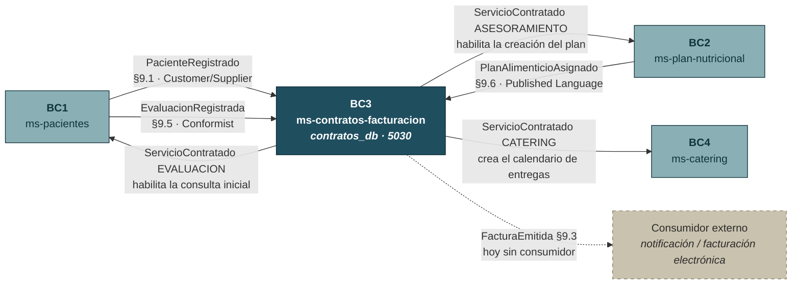
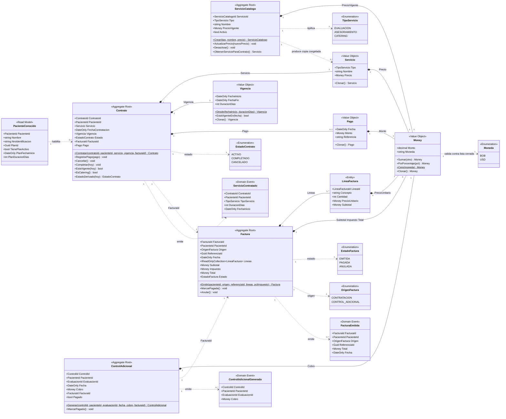
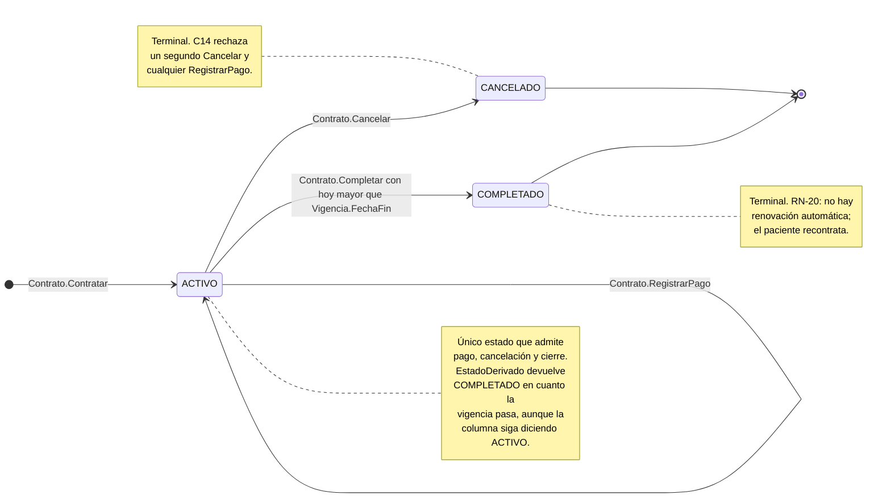
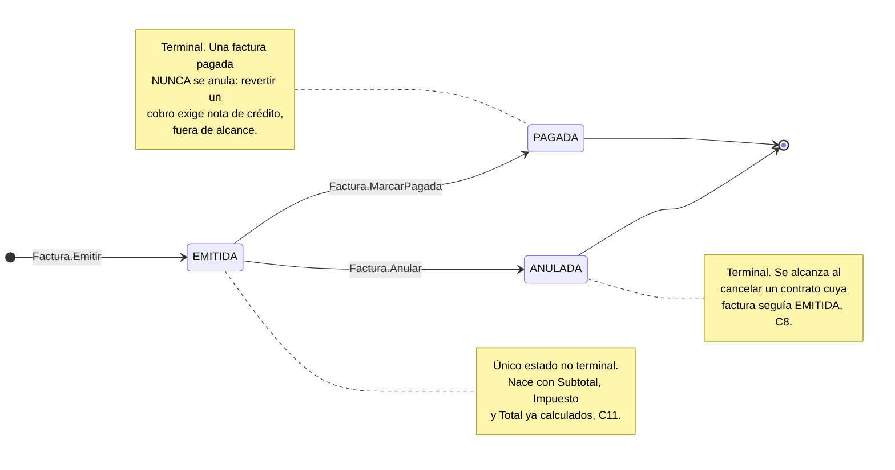
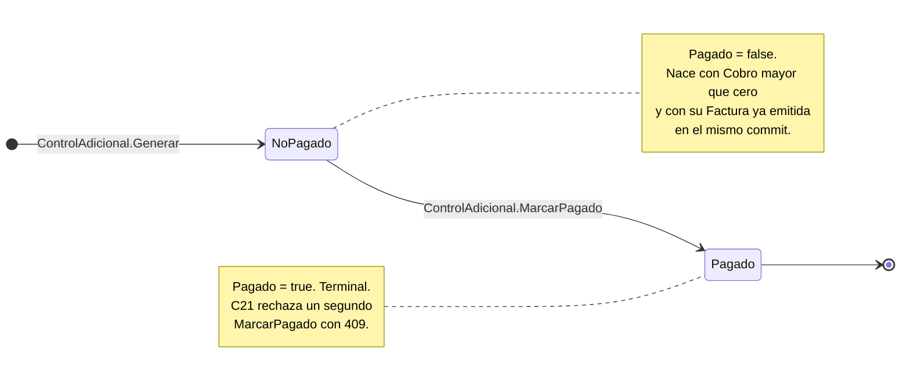
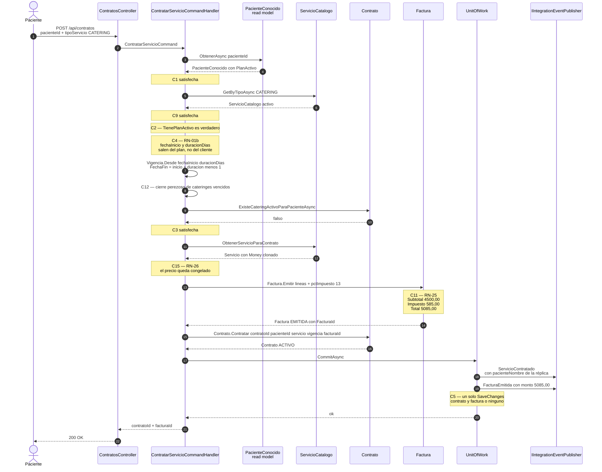
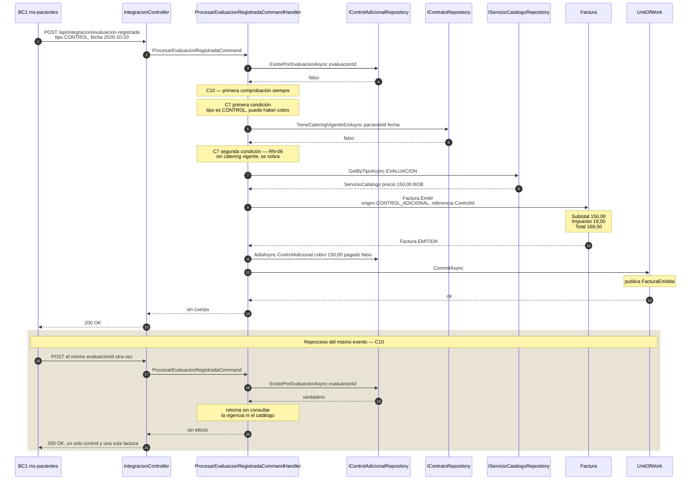
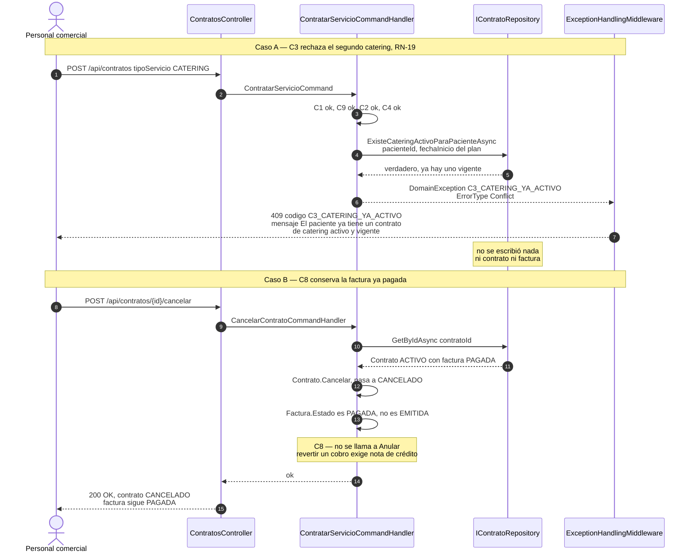
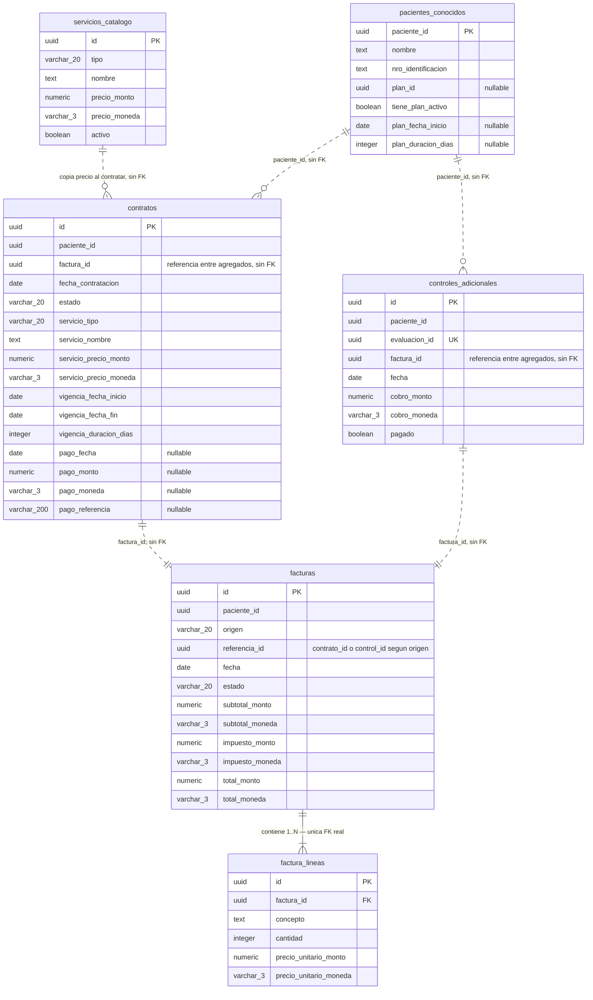

# ms-contratos-facturacion — Diseño del microservicio

**Bounded Context:** BC3 — Contratos y Facturación
**Subdominio:** Genérico · **Base de datos:** `contratos_db` · **Puerto:** 5030
**Prefijo de invariantes:** `C` · **Aggregate Roots:** `ServicioCatalogo`, `Contrato`, `Factura`, `ControlAdicional`

Este documento es la **especificación táctica completa** de `ms-contratos-facturacion`. Con él y con `docs/SISTEMA.md` en la mano, el microservicio se reconstruye desde cero sin preguntar nada.

Las decisiones de alcance sistémico —reglas de negocio `RN-xx`, historias `HU-xx`, contratos de los catorce eventos de integración, convenciones técnicas transversales, estrategia de pruebas y plataforma local— viven en **`SISTEMA.md`** y son vinculantes. Nada de lo que sigue las contradice: se citan por número de sección (`§12.5 del maestro`) y nunca se reescriben.

Este documento es **vinculante**: describe el diseño correcto. Donde el código realmente implementado se aparta de él, la desviación está registrada en §19 con su severidad; no se silencia ni se adapta el documento al código.

---

## Índice

| § | Contenido |
|---|---|
| [1](#1-propósito) | Propósito |
| [2](#2-ubicación-en-el-sistema) | Ubicación en el sistema |
| [3](#3-lenguaje-ubicuo) | Lenguaje ubicuo |
| [4](#4-historias-de-usuario) | Historias de usuario |
| [5](#5-modelo-de-dominio) | Modelo de dominio |
| [6](#6-invariantes) | Invariantes |
| [7](#7-máquinas-de-estado) | Máquinas de estado |
| [8](#8-eventos-de-dominio-y-políticas) | Eventos de dominio y políticas |
| [9](#9-integración-con-otros-contextos) | Integración con otros contextos |
| [10](#10-diseño-cqrs) | Diseño CQRS |
| [11](#11-api-rest) | API REST |
| [12](#12-flujos-principales) | Flujos principales |
| [13](#13-catálogo-de-errores) | Catálogo de errores |
| [14](#14-persistencia) | Persistencia |
| [15](#15-plan-de-pruebas) | Plan de pruebas |
| [16](#16-trazabilidad) | Trazabilidad |
| [17](#17-guía-de-reconstrucción) | Guía de reconstrucción |
| [18](#18-decisiones-de-diseño) | Decisiones de diseño |
| [19](#19-desviaciones-detectadas-entre-la-especificación-y-el-código) | Desviaciones detectadas |
| [20](#20-fuera-de-alcance) | Fuera de alcance |

---

## 1. Propósito

BC3 es el **contexto que habilita a los demás**. Ningún servicio de Nur-Tricenter se presta sin contratarse aquí, y cada contratación desbloquea el siguiente eslabón de la cadena descrita en §5.1 del maestro: la contratación de `EVALUACION` habilita la consulta inicial en BC1, la de `ASESORAMIENTO` habilita la elaboración del plan en BC2, y la de `CATERING` crea el calendario de entregas en BC4.

La frase del caso de estudio que gobierna todo el contexto es literal:

> «Cada servicio tiene un costo definido el cual es facturado al momento de la contratación. Los controles se cobran a parte si es que no se contrató servicio de catering.»

De ahí salen las dos reglas estructurales del microservicio: **factura en el mismo acto que el contrato** (RN-05, invariante C5) y **control adicional cobrable solo sin catering vigente** (RN-06, invariante C7).

**Por qué es un bounded context propio.** Contratar, tasar, facturar y cobrar tienen un lenguaje que no aparece en ningún otro contexto —catálogo, precio vigente, vigencia, subtotal, impuesto, origen de factura, control adicional— y un ciclo de vida que no depende del clínico ni del operativo: una factura vive, se paga y se anula sin que nadie mida a un paciente ni prepare una comida. Fusionar la contratación con BC1 obligaría a que el registro de un paciente conociera precios; fusionarla con BC4 obligaría a que el calendario supiera de impuestos. La frontera está donde el caso de estudio la pone: en el acto comercial.

**Subdominio genérico y su consecuencia de diseño.** §2.1 del maestro clasifica BC3 como **genérico**: contratación, facturación y cobro son un problema resuelto por el mercado y no aportan ventaja competitiva. La consecuencia es explícita y se aplica en todo este documento: **patrones simples y estandarizados**, ninguna sofisticación que no exija una regla del enunciado, y comunicación con el resto del sistema **estrictamente por eventos de integración** (§9 del maestro), nunca por acceso a modelos ajenos. Un reemplazo futuro de BC3 por un ERP de terceros es una opción legítima que el diseño no debe bloquear; por eso el microservicio no expone su modelo interno a nadie y todo lo que otros contextos necesitan viaja por los dos eventos publicados.

Esa misma clasificación explica dos ausencias deliberadas frente a BC2 (núcleo): aquí no hay agregados que se coordinen entre sí en un mismo caso de uso más allá del par contrato–factura, y no hay estructuras anidadas de tres niveles con `jsonb` (§12.4 del maestro no aplica en este contexto).

**Responsabilidades**

- Catálogo de los tres servicios de RN-01 con su precio vigente y su estado activo/inactivo.
- Contratación de los tres servicios, con emisión de la factura en el mismo commit (RN-05) y copia del precio del catálogo (RN-26).
- Derivación de la vigencia del catering a partir del plan alimenticio activo replicado (RN-01b).
- Cálculo del total de la factura —subtotal más impuesto configurable— y registro del pago al contado (RN-25, RN-18).
- Generación y cobro de controles adicionales para pacientes sin catering vigente (RN-06).
- Publicación de `ServicioContratado` y `FacturaEmitida` con los contratos congelados de §9.2 y §9.3 del maestro.
- Custodia del Value Object `Money` y de la validación de moneda contra la lista cerrada `{ BOB, USD }` (§8 del maestro): **este es el único microservicio del sistema que maneja montos**.

**Lo que no hace**

- No conoce el detalle clínico del paciente: mantiene la réplica mínima `PacienteConocido` alimentada por eventos (§12.9 del maestro).
- No elabora planes alimenticios ni decide su duración: la **recibe** de BC2 (RN-01b).
- No gestiona calendarios, producción ni entregas.
- No procesa pagos electrónicos: **registra que el pago ocurrió**, no lo ejecuta.
- No emite notas de crédito ni factura electrónicamente ante la administración tributaria.

### 1.1 Tabla de identidad

| Atributo | Valor |
|---|---|
| Bounded Context | BC3 — Contratos y Facturación |
| Microservicio | `ms-contratos-facturacion` |
| Subdominio | Genérico (§2.1 del maestro) |
| Aggregate Roots | `ServicioCatalogo`, `Contrato`, `Factura`, `ControlAdicional` — **cuatro**, el número más alto del sistema |
| Entidad hija | `LineaFactura` (dentro de `Factura`) |
| Read model | `PacienteConocido` (no es agregado, §12.9 del maestro) |
| Prefijo de invariantes | `C` — C1 … C22 |
| Base de datos | `contratos_db` (PostgreSQL 16) |
| Puerto | 5030 |
| Historias cubiertas | HU-19, HU-20, HU-21, HU-22, HU-23, HU-24 |
| Reglas de las que es responsable | RN-01b, RN-03, RN-05, RN-06, RN-18, RN-20, RN-25, RN-26 y, junto a BC2 y BC4, RN-19 |
| Eventos publicados | `ServicioContratado` (§9.2), `FacturaEmitida` (§9.3) |
| Eventos consumidos | `PacienteRegistrado` (§9.1), `PlanAlimenticioAsignado` (§9.6), `EvaluacionRegistrada` (§9.5) |
| Solución | `Contratos.sln` → `Contratos.Domain`, `Contratos.Application`, `Contratos.Infrastructure`, `Contratos.WebApi` + `Contratos.Domain.Tests`, `Contratos.Application.Tests` |

**Cuatro aggregate roots no es una acumulación: es lo que exige el enunciado.** El catálogo tiene un ciclo de vida propio e independiente de cualquier contrato (RN-26); la factura nace de dos orígenes distintos, uno de los cuales no tiene contrato (RN-06); y el control adicional existe precisamente cuando no hay contrato de catering. Las justificaciones completas están en §5.2.

---

## 2. Ubicación en el sistema



### 2.1 Dependencias entrantes

| Evento | Origen | Patrón DDD | Qué habilita en BC3 | Invariante que lo usa |
|---|---|---|---|---|
| `PacienteRegistrado` | BC1 | Customer/Supplier | Sin la réplica no se puede contratar. Aporta `nombre` y `nroIdentificacion`, que después viajan en `ServicioContratado` para que BC4 pueda etiquetar paquetes sin consultar a BC1 (RN-12). | C1, C16 |
| `PlanAlimenticioAsignado` | BC2 | Published Language | Habilita contratar catering **y aporta la vigencia que el catering hereda**: `fechaInicio` y `duracionDias` (RN-01b). | C2, C4 |
| `EvaluacionRegistrada` | BC1 | Conformist | Dispara la política de control adicional cobrable (RN-06). BC3 se conforma al contrato de BC1 sin negociarlo. | C7, C10 |

### 2.2 Dependencias salientes

| Evento | Destino | Patrón DDD | Efecto en el destino |
|---|---|---|---|
| `ServicioContratado` | BC1, BC2, BC4 | Customer/Supplier | `EVALUACION` habilita la consulta inicial en BC1; `ASESORAMIENTO` habilita la creación del plan en BC2; `CATERING` crea el calendario de entregas en BC4, que valida por su cuenta RN-19 y RN-24. |
| `FacturaEmitida` | Consumidor externo | Event Notification | Habilitaría la notificación al paciente y la facturación electrónica. Hoy **nadie lo consume**: se publica igualmente con su contrato definitivo (§6.10 del maestro). |

Esta es la lista **completa y verificada** contra §7 (context map) y §9.15 (matriz de integración) del maestro: BC3 publica exactamente dos eventos de integración y consume exactamente tres. **No** consume `ConsultaInicialRealizada` (va solo a BC2), ni `IncidenciaEntregaRegistrada` (va a BC1 y BC4), ni `PlanAlimenticioActualizado` (va solo a BC5): un cambio en el detalle de días de un plan no altera la vigencia comercial ya contratada ni el precio ya facturado.

### 2.3 Qué pasa si un vecino todavía no existe

Los contratos de §9 del maestro están congelados, así que BC3 se construye y se demuestra sin que BC1, BC2 ni BC4 existan. La mecánica está en §10 del maestro: los tres eventos entrantes se simulan con `POST /api/integracion/*`, cuyo cuerpo es **exactamente** el payload del evento; los dos salientes se entregan a `IIntegrationEventPublisher`, cuya única implementación hoy es `LoggingIntegrationEventPublisher`, que serializa a JSON y escribe en el log.

Las consecuencias operativas de que falte un vecino son deterministas y están cubiertas por invariantes, no por fallos:

| Vecino ausente | Consecuencia | Cómo se manifiesta |
|---|---|---|
| BC1 no ha registrado al paciente | No se puede contratar nada | C1 → `C1_PACIENTE_DESCONOCIDO`, 400 |
| BC2 no ha activado el plan | No se puede contratar catering; sí evaluación y asesoramiento | C2 → `C2_SIN_PLAN_ACTIVO`, 400 |
| BC4 no existe | La contratación de catering funciona igual; el calendario simplemente no se crea | `ServicioContratado` queda en el log |
| Nadie consume `FacturaEmitida` | Ninguna | Documentado en §20 |

**La duración del catering no se elige: se deriva del plan activo (RN-01b).** El personal comercial no introduce fechas al contratar catering; se copian de la réplica del plan. Es lo que garantiza que nunca se venda un día de catering sin recetas asignadas, y lo que mantiene alineados el contrato (BC3), el plan (BC2) y el calendario de entregas (BC4), que trabajan los tres sobre las mismas fechas absolutas.

---

## 3. Lenguaje ubicuo

El dominio se escribe **en español**, con estos nombres exactos en clases, métodos, propiedades, eventos y códigos de error. No se traducen ni se abrevian (§15 del maestro).

### 3.1 Términos del maestro (§6.4)

| Término | Definición |
|---|---|
| **Contratación** | Proceso formal mediante el cual el paciente adquiere uno de los tres servicios de la empresa. |
| **Servicio** | Oferta comercial de la empresa: Evaluación Corporal, Asesoramiento Nutricional o Catering. |
| **Costo** | Precio definido para cada servicio contratado, copiado al contrato en el momento de contratar (RN-26). |
| **Factura** | Documento que registra los servicios y montos, emitido al momento de la contratación (RN-05). Estados: `EMITIDA / PAGADA / ANULADA`. |
| **Control Adicional** | Evaluación de seguimiento cobrada por separado cuando el paciente no tiene catering activo (RN-06). |
| **Pago** | Registro del abono realizado por el paciente al momento de la contratación; único, al contado. |
| **Vigencia** | Par de fechas inicio/fin que delimita un contrato; en el catering se deriva del plan activo (RN-01b). |

### 3.2 Términos internos de este microservicio

| Término | Clase / concepto | Definición |
|---|---|---|
| **Servicio del Catálogo** | `ServicioCatalogo` | Uno de los tres servicios ofrecidos, con su precio vigente y su estado activo/inactivo en el catálogo comercial. Es un agregado, no una tabla de parámetros. |
| **Servicio contratado** | `Servicio` (VO) | Fotografía del servicio en el instante de contratar: tipo, nombre y precio. Inmutable por construcción (RN-26). |
| **Precio vigente** | `ServicioCatalogo.PrecioVigente` | El precio que hoy tiene el catálogo. Cambiarlo **no** toca ningún contrato ya emitido. |
| **Línea de factura** | `LineaFactura` | Concepto facturado con cantidad y precio unitario. Su `Subtotal` siempre se calcula, nunca se recibe ni se persiste. |
| **Subtotal / Impuesto / Total** | `Factura` | Los tres importes de la factura. Los tres se **calculan** dentro del agregado (RN-25). |
| **Tasa de impuesto** | `FacturacionOptions.PorcentajeImpuesto` | Porcentaje configurable aplicado al subtotal, **13 por defecto** (RN-25). Vive en configuración, nunca en el dominio. |
| **Origen de la factura** | `OrigenFactura` | Qué generó la factura: una `CONTRATACION` o un `CONTROL_ADICIONAL`. Determina qué significa `ReferenciaId`. |
| **Referencia de la factura** | `Factura.ReferenciaId` | `Guid` crudo que apunta al `ContratoId` o al `ControlId` según `Origen`. |
| **Estado derivado** | `Contrato.EstadoDerivado(hoy)` | Estado que se **calcula** con la fecha: `CANCELADO` si lo está, `COMPLETADO` si la vigencia pasó, `ACTIVO` en otro caso. |
| **Cierre perezoso** | `Contrato.Completar(hoy)` | Materialización de `COMPLETADO` en la columna `estado`, ejecutada justo antes de recontratar el mismo servicio para el mismo paciente. |
| **Paciente conocido** | `PacienteConocido` | Réplica local de solo lectura con lo mínimo que BC3 necesita del paciente: identidad y vigencia de su plan activo. **No es un agregado.** |
| **Catering vigente** | `IContratoRepository.TieneCateringVigenteEnAsync` | Pregunta binaria: ¿el paciente tiene un contrato de catering `ACTIVO` cuya vigencia cubre esa fecha? Es el eje de RN-06. |

### 3.3 Términos que se confunden entre sí

| Par | Diferencia | Consecuencia de confundirlos |
|---|---|---|
| `ServicioCatalogo` (agregado) vs `Servicio` (VO) | El primero es el artículo del catálogo, mutable en su precio. El segundo es la **copia congelada** dentro de un contrato. | Referenciar el agregado desde el contrato haría que un cambio de precio alterara retroactivamente facturas ya emitidas: RN-26 rota. |
| `PrecioVigente` vs `Servicio.Precio` | El primero es «cuánto cuesta hoy». El segundo, «cuánto costó cuando este paciente contrató». | El mismo error que arriba, visto desde el otro lado. |
| `Subtotal` vs `Total` | `Subtotal` es la suma de las líneas; `Total` incluye el impuesto. El evento `FacturaEmitida` transporta **siempre el Total** (§9.3 del maestro). | Publicar el subtotal como `monto` haría que cualquier consumidor externo cobrara de menos. |
| `Contrato.Estado` (columna) vs `EstadoDerivado(hoy)` | La columna puede decir `ACTIVO` en un contrato cuya vigencia ya venció. El derivado nunca miente. | Un informe financiero (HU-23) que lea la columna contaría como activos contratos ya terminados. |
| `EstadoContrato.COMPLETADO` vs `EstadoContrato.CANCELADO` | `COMPLETADO` es el paso del tiempo; `CANCELADO` es una decisión. | `CANCELADO` no se puede derivar: si se derivara, cancelar no tendría efecto persistente. |
| `Pago` (VO del contrato) vs `EstadoFactura.PAGADA` | El `Pago` es el registro del acto de cobro; `PAGADA` es el estado del documento. Cambian juntos, en el mismo commit. | Marcar la factura sin registrar el pago deja el cobro sin trazabilidad; lo contrario deja el documento sin saldar. |
| **Control Adicional** vs **Evaluación Quincenal** | El primero se cobra (no hay catering); la segunda está incluida en el precio del catering (RN-06). | Cobrar una quincenal es facturar dos veces el mismo servicio. |

---

## 4. Historias de usuario

Cobertura vinculante según §6.9 del maestro: a `ms-contratos-facturacion` le corresponden **HU-19 a HU-24**, ni una más ni una menos. Los códigos no se renumeran ni se reutilizan.

| HU | Descripción | Endpoint o caso de uso que la implementa | Estado | Invariantes que toca |
|---|---|---|---|---|
| **HU-19** | Como administrador, quiero registrar la contratación de un servicio para un paciente y generar automáticamente su factura. | `POST /api/contratos` → `ContratarServicioCommand`. Soporte: `POST /api/contratos/{id}/pago` y `POST /api/contratos/{id}/cancelar`. | Implementada | C1, C2, C3, C4, C5, C9, C11, C12, C15, C17, C18, C19 |
| **HU-20** | Como administrador, quiero gestionar el catálogo de servicios y sus precios para mantenerlos actualizados. | `POST /api/servicios`, `PUT /api/servicios/{id}/precio`, `DELETE /api/servicios/{id}`, `GET /api/servicios` → `CrearServicioCatalogoCommand`, `ActualizarPrecioCommand`, `DesactivarServicioCommand`, `GetServiciosQuery`. | Implementada | C15, C18 |
| **HU-21** | Como paciente, quiero consultar mis facturas emitidas para llevar un registro de mis gastos. | `GET /api/pacientes/{pacienteId}/facturas` → `GetFacturasByPacienteQuery`. | Implementada | — (lectura pura) |
| **HU-22** | Como administrador, quiero registrar el pago de un control de seguimiento para pacientes sin catering. | `POST /api/controles/{id}/pago` → `RegistrarPagoControlCommand`. Soporte: `GET /api/pacientes/{pacienteId}/controles`. | Implementada | C6, C21 |
| **HU-23** | Como administrador, quiero consultar el listado de contratos activos por período para análisis financiero. | `GET /api/contratos?desde=&hasta=&estado=` → `GetContratosQuery`, que filtra por **estado derivado**. | Implementada | — (usa `EstadoDerivado`, §5.7) |
| **HU-24** | Como sistema, quiero generar automáticamente el cobro de controles adicionales cuando un nutricionista programa una evaluación a un paciente sin catering. | `POST /api/integracion/evaluacion-registrada` → `ProcesarEvaluacionRegistradaCommand`. | Implementada | C7, C10, C11, C21 |

**HU-22 y HU-24 son las dos mitades de la misma frase del caso de estudio.** HU-24 *genera* el cobro cuando llega `EvaluacionRegistrada` y el paciente no tiene catering vigente; HU-22 lo *cobra* cuando el paciente paga en mostrador. Ninguna de las dos existe si el paciente tiene catering vigente: en ese caso las evaluaciones quincenales están incluidas en el precio del catering (RN-06) y no hay nada que facturar.

**Ninguna historia de BC3 está fuera de alcance.** Las dos historias del sistema marcadas fuera de alcance (HU-12 y HU-43, notificaciones, §6.10 del maestro) pertenecen a BC1 y BC6. BC3 contribuye a habilitarlas publicando `FacturaEmitida` con su contrato definitivo, listo para que un consumidor externo lo tome; ese evento y su ausencia de consumidor están documentados en §9.1 y §20.

---

## 5. Modelo de dominio

### 5.1 Diagrama de clases



**Cómo leer el diagrama con cuatro raíces.** Las tres columnas se leen de izquierda a derecha en el orden en que ocurren: `ServicioCatalogo` fija el precio, `Contrato` lo copia, `Factura` lo cobra; `ControlAdicional` es la cuarta raíz y entra por abajo, cuando no hay contrato de catering. El rombo lleno (`*--`) marca **composición dentro del límite del agregado**: lo que cuelga de él vive y muere con su raíz. La flecha punteada (`..>`) marca **referencia por identificador o dependencia de tipo**: nunca una relación de objetos entre agregados. `Contrato ..> Factura` es exactamente eso: un `FacturaId`, no una instancia.

### 5.2 Límites de los agregados

**`ServicioCatalogo` — el catálogo comercial.** Es raíz porque tiene un ciclo de vida propio, independiente de cualquier contratación: se crea, cambia de precio muchas veces y se desactiva sin que ningún contrato lo sepa. Dentro de sus límites vive solo su `Money PrecioVigente`. Su único método de salida hacia el resto del dominio es `ObtenerServicioParaContrato()`, que devuelve un `Servicio` con el precio **clonado**: el límite del agregado se cruza con una copia, nunca con una referencia compartida.

**`Contrato` — el acuerdo por un servicio.** Es raíz porque es la unidad sobre la que se evalúan RN-19 (un catering activo por paciente) y RN-20 (no hay renovación automática). Dentro de sus límites viven el `Servicio` copiado, la `Vigencia` y el `Pago` opcional. Fuera quedan la factura (referenciada por `FacturaId`) y el paciente (referenciado por `PacienteId`).

**`Factura` — el documento monetario.** Es raíz por tres razones, en orden de peso:

1. **Tiene dos orígenes distintos.** Una factura nace de una `CONTRATACION` o de un `CONTROL_ADICIONAL` (`OrigenFactura`). El control adicional existe **precisamente cuando no hay contrato de catering vigente** (RN-06): si `Factura` viviera dentro de `Contrato`, no habría agregado al que colgar la factura de un control. La forma del modelo la dicta el caso de estudio, no la comodidad del mapeo.
2. **Tiene su propio ciclo de vida.** `EMITIDA → PAGADA | ANULADA` (RN-18) es independiente del ciclo del contrato: un contrato `CANCELADO` puede tener una factura que sigue `PAGADA` (C8).
3. **Límite transaccional correcto.** El invariante que hay que proteger de forma atómica es «el total cuadra con las líneas» (C11), y ese vive completo dentro de `Factura`. Meterla en `Contrato` agrandaría el agregado sin proteger ninguna invariante adicional.

Dentro de sus límites viven la colección `LineaFactura` y los tres `Money` calculados.

**`ControlAdicional` — la evaluación cobrada aparte.** Es raíz por la misma razón que hace posible su existencia: aparece **cuando no hay contrato de catering**, de modo que no hay agregado padre al que pertenecer. Guarda la `EvaluacionId` que lo originó —que además es su clave de idempotencia (§9.5 del maestro)—, el cobro, el `FacturaId` de su factura y si fue pagado.

#### Los dos pares que parecen un solo agregado y no lo son

**`Contrato` + `Factura`.** Parecen uno porque RN-05 exige que nazcan juntos y porque hoy toda factura de contratación tiene exactamente una línea con el servicio contratado. No lo son por la razón 1 de arriba: el otro origen de factura no tiene contrato. Lo que sí comparten es el **límite transaccional**, y esa es una decisión deliberada, registrada en §18: `ContratarServicioCommandHandler` escribe los dos agregados en un único `SaveChanges`.

```
ContratarServicioCommandHandler
  ├─ factura  = Factura.Emitir(...)                        // primero: el contrato necesita su FacturaId
  ├─ contrato = Contrato.Contratar(..., factura.FacturaId)
  ├─ facturaRepository.AddAsync(factura)
  ├─ contratoRepository.AddAsync(contrato)
  └─ unitOfWork.CommitAsync()                              // un solo SaveChanges → C5
```

Modificar **dos agregados en una transacción** es una excepción consciente a la heurística «un agregado por transacción», tomada porque la regla de negocio (RN-05: «facturado al momento de la contratación») es más fuerte que la heurística de diseño. Lo que sí es eventual —y por eso viaja por eventos— es la reacción de **otros bounded contexts**. La misma decisión aplica al par `ControlAdicional` + `Factura` en la política de HU-24.

**`ControlAdicional` + `Factura`.** Parecen uno porque el control siempre tiene exactamente una factura y nunca más de una. No lo son porque la factura de un control comparte estado, transiciones y consultas con la factura de un contrato: HU-21 devuelve las dos juntas, distinguibles solo por `Origen`. Fusionarlas obligaría a duplicar el ciclo `EMITIDA / PAGADA / ANULADA` en dos sitios.

### 5.3 IDs tipados

Todos son `record` de un solo campo `Guid`, con constructor privado, `New()` para generar y `From(Guid)` para reconstruir. `From` rechaza `Guid.Empty` (C22). Se mapean con `ValueConverter` directo a una columna `uuid` (§12.3 del maestro).

| ID tipado | Identifica | Se genera en | Se recibe de |
|---|---|---|---|
| `ServicioCatalogoId` | `ServicioCatalogo` | `CrearServicioCatalogoCommandHandler` | — |
| `ContratoId` | `Contrato` | `ContratarServicioCommandHandler`, **antes** de emitir la factura | — |
| `FacturaId` | `Factura` | `Factura.Emitir` | — |
| `LineaFacturaId` | `LineaFactura` (entidad hija) | `LineaFactura` al construirse | — |
| `ControlId` | `ControlAdicional` | `ProcesarEvaluacionRegistradaCommandHandler`, antes de emitir la factura | — |
| `PacienteId` | Paciente (agregado de BC1) | — | `PacienteRegistrado.pacienteId`, cuerpo de las peticiones |
| `EvaluacionId` | Evaluación (agregado de BC1) | — | `EvaluacionRegistrada.evaluacionId` |

**`ContratoId` y `ControlId` se generan antes que su factura, no después.** La factura necesita el `ReferenciaId` en su constructor y el contrato necesita el `FacturaId` en el suyo: sin generar el id de la raíz por adelantado, uno de los dos tendría que admitir un campo mutable, y una referencia entre agregados que se puede reasignar es una referencia que se puede desalinear.

**En consultas LINQ se compara el id tipado completo, nunca su `.Value`** (§12.5 del maestro). La forma correcta es `entidad.PacienteId == PacienteId.From(guid)`; la forma que rompe en ejecución con «could not be translated» es `entidad.PacienteId.Value == guid`. Este microservicio convierte el `Guid` del comando o de la ruta a su tipo en la **primera línea** del handler o del query handler, y a partir de ahí todas las comparaciones son entre tipos completos.

### 5.4 Value Objects

| VO | Campos | Qué valida | Cómo se mapea |
|---|---|---|---|
| `Money` | `Monto` (decimal), `Moneda` (string) | Monto ≥ 0; **moneda contra la lista cerrada `{ BOB, USD }`** de §8 del maestro; `Sumar` exige la misma moneda (C18) | **`OwnsOne`: dos columnas `*_monto` y `*_moneda`. Nunca una sola** (§12.3 del maestro) |
| `Servicio` | `Tipo` (`TipoServicio`), `Nombre`, `Precio` (`Money`) | Nombre obligatorio (C15) | `OwnsOne` con `Money` anidado: cuatro columnas |
| `Vigencia` | `FechaInicio`, `FechaFin`, `DuracionDias` | `DuracionDias > 0`; `FechaFin ≥ FechaInicio`; **`FechaFin = FechaInicio + DuracionDias − 1`** (C17) | `OwnsOne`, tres columnas |
| `Pago` | `Fecha`, `Monto` (`Money`), `Referencia` | Monto > 0; referencia nula se normaliza a cadena vacía (C20) | `OwnsOne` **opcional** con `Money` anidado |
| IDs tipados | `Guid` | `Guid.Empty` prohibido (C22) | `ValueConverter` a una columna |

**`Money` y la lista cerrada de monedas.** §8 del maestro es explícito: «El Value Object `Money` valida su moneda contra la lista cerrada `{ BOB, USD }` y rechaza cualquier otro código al construirse. Esta validación vive en `ms-contratos-facturacion`, único microservicio que maneja montos.» La validación es del **VO**, no del handler: un `Money` mal formado no debe llegar a existir. La comparación es exacta y sensible a mayúsculas: `"bob"` no es `BOB`, porque §12.11 del maestro fija que los códigos viajan en mayúsculas.

```csharp
private static readonly HashSet<string> MonedasValidas = ["BOB", "USD"];

if (string.IsNullOrWhiteSpace(moneda) || !MonedasValidas.Contains(moneda))
    throw new DomainException(MoneyErrors.MonedaInvalida());   // C18_MONEY_MONEDA_INVALIDA
if (monto < 0)
    throw new DomainException(MoneyErrors.MontoNegativo());    // C18_MONEY_MONTO_NEGATIVO
```

`Money` expone además `Sumar(otro)` —que exige misma moneda—, `PorPorcentaje(pct)` —que redondea a dos decimales con `MidpointRounding.AwayFromZero`—, la factoría `Cero(moneda)` y `Clonar()`.

**`Money` se mapea con `OwnsOne` a dos columnas, jamás a una.** Lo fija §12.3 del maestro y aquí es especialmente sensible: una factura es un documento monetario, y un importe sin moneda es un dato corrupto. El mapeo aplica a `ServicioCatalogo.PrecioVigente`, `Servicio.Precio`, `LineaFactura.PrecioUnitario`, `Factura.Subtotal`, `.Impuesto`, `.Total`, `Pago.Monto` y `ControlAdicional.Cobro`: **ocho instancias de `Money` en cinco tablas**.

**Todo VO de varios campos expone `Clonar()` y se clona al cambiar de dueño** (§12.3 del maestro, regla crítica de owned types). En este microservicio el caso real es el precio, y recorre tres dueños:

```
ServicioCatalogo.PrecioVigente ──Clonar()──> Servicio.Precio ──Clonar()──> LineaFactura.PrecioUnitario
```

Reutilizar la misma instancia de `Money` entre esos tres dueños deja las columnas en `null` para dos de ellos, sin error visible hasta que PostgreSQL rechaza el `NOT NULL`, y **ningún test unitario en memoria lo detecta**. Por eso el clonado es una regla de escritura explícita y no una expectativa: `ObtenerServicioParaContrato()` clona, y el handler vuelve a clonar al construir la línea de factura.

**`Vigencia` y la aritmética de los bordes.** `FechaFin = FechaInicio + DuracionDias − 1` es la única definición correcta: un catering de 15 días que empieza el 1 termina el 15, no el 16. `Vigencia.Desde(fechaInicio, duracionDias)` es la factoría que se usa siempre; el constructor completo existe para reconstruir desde la base y valida la coherencia de los tres campos. `EstaVigenteEn(fecha)` devuelve verdadero en **ambos bordes**.

### 5.5 Enumeraciones

| Enum | Valores | Propietario | Uso en BC3 |
|---|---|---|---|
| `TipoServicio` | `EVALUACION`, `ASESORAMIENTO`, `CATERING` | **BC3** (§8 del maestro) | Tipifica el catálogo y el contrato; viaja en `ServicioContratado` |
| `OrigenFactura` | `CONTRATACION`, `CONTROL_ADICIONAL` | **BC3** (§8 del maestro) | Desambigua `Factura.ReferenciaId`; viaja en `FacturaEmitida` |
| `EstadoFactura` | `EMITIDA`, `PAGADA`, `ANULADA` | **BC3** (§8 del maestro, RN-18) | Ciclo de vida de `Factura` |
| `Moneda` | `BOB`, `USD` | **BC3** (§8 del maestro) | Lista cerrada contra la que `Money` valida. Se modela como conjunto cerrado de códigos dentro de `Money`, no como columna propia: lo que se persiste es el código ISO en `*_moneda` |
| `EstadoContrato` | `ACTIVO`, `COMPLETADO`, `CANCELADO` | Local a BC3 | Ciclo de vida de `Contrato`. No aparece en ningún contrato de evento |
| `TipoEvaluacion` | `INICIAL`, `QUINCENAL`, `CONTROL` | BC1 (§8 del maestro) | **Consumido, no modelado.** Llega como campo `tipo` de `EvaluacionRegistrada` y solo se usa en la política de C7 |

Todos viajan **como string en mayúsculas**, nunca como ordinal (§12.11 del maestro), y se persisten con `HasConversion<string>()`.

**`TipoEvaluacion` no se modela como enum del dominio de BC3 a propósito.** Es vocabulario de BC1: BC3 solo necesita responder «¿es de tipo `CONTROL`?». Declararlo aquí crearía un segundo propietario del mismo enum y obligaría a sincronizar dos listas cada vez que BC1 añada un tipo. La comparación se hace sobre el string entrante, **sin distinguir mayúsculas** (`StringComparison.OrdinalIgnoreCase`): un evento de otro contexto no debe rechazarse por la caja de las letras.

### 5.6 Métodos de negocio

Esta es la tabla que demuestra que el modelo no es anémico: cada agregado y cada VO defiende sus propias reglas, y ninguna regla que un agregado pueda garantizar por sí mismo vive en un handler.

| Método | Qué hace | Invariantes que hace cumplir | Evento que emite |
|---|---|---|---|
| `ServicioCatalogo.Crear(tipo, nombre, precio)` | Crea el artículo del catálogo activo | C15 (nombre obligatorio), C18 vía `Money` | — |
| `ServicioCatalogo.ActualizarPrecio(nuevoPrecio)` | Cambia el precio vigente **sin tocar ningún contrato** | C15 (solo si está activo) | `PrecioActualizado` |
| `ServicioCatalogo.Desactivar()` | Marca el artículo como no contratable. Idempotente | — | — |
| `ServicioCatalogo.ObtenerServicioParaContrato()` | Devuelve un `Servicio` con el precio **clonado** | C15 (RN-26: la copia es lo que congela el precio) | — |
| `Contrato.Contratar(contratoId, pacienteId, servicio, vigencia, facturaId)` | Crea el contrato `ACTIVO` con su servicio copiado, su vigencia y su factura | C5 (nace con `FacturaId`), C17 vía `Vigencia` | `ServicioContratado` |
| `Contrato.RegistrarPago(pago)` | Registra el cobro único | C13 (un solo pago), C14 (solo si `ACTIVO`) | `PagoRegistrado` |
| `Contrato.Cancelar()` | Pasa a `CANCELADO` | C14 (solo desde `ACTIVO`) | `ContratoCancelado` |
| `Contrato.Completar(hoy)` | Materializa `COMPLETADO` cuando la vigencia venció (cierre perezoso) | C12 (solo si `ACTIVO` y vencido) | `ContratoCompletado` |
| `Contrato.EstadoDerivado(hoy)` | Calcula el estado real sin escribir | — (consulta pura) | — |
| `Contrato.EstaVigente(hoy)` | `ACTIVO` **y** dentro de la vigencia | — | — |
| `Contrato.EsCatering()` | Discrimina el tipo de servicio | — | — |
| `Factura.Emitir(pacienteId, origen, referenciaId, lineas, pctImpuesto)` | **Calcula** subtotal, impuesto y total, y emite el documento | **C11** (nunca recibe importes), C18 vía `Money` | `FacturaEmitida` |
| `Factura.MarcarPagada()` | `EMITIDA → PAGADA` | C6 | — |
| `Factura.Anular()` | `EMITIDA → ANULADA` | C6 | — |
| `ControlAdicional.Generar(controlId, pacienteId, evaluacionId, fecha, cobro, facturaId)` | Crea el control sin pagar | C21 (cobro > 0) | `ControlAdicionalGenerado` |
| `ControlAdicional.MarcarPagado()` | Marca el cobro efectuado | C21 (una sola vez) | — |
| `Money.Sumar(otro)` | Suma dos importes | C18 (misma moneda) | — |
| `Money.PorPorcentaje(pct)` | Calcula un porcentaje redondeado a 2 decimales | C18 | — |
| `Money.Clonar()` | Copia profunda para cambiar de dueño | §12.3 del maestro | — |
| `Vigencia.Desde(fechaInicio, duracionDias)` | Construye la vigencia derivando `FechaFin` | C17 | — |
| `Vigencia.EstaVigenteEn(fecha)` | Pregunta de pertenencia, bordes incluidos | — | — |
| `LineaFactura.Subtotal` (propiedad calculada) | `Cantidad × PrecioUnitario` | C19 (nunca se recibe ni se persiste) | — |

**Las tres piezas donde se concentra el comportamiento.** `Factura.Emitir` es el corazón de RN-25: recibe **líneas y porcentaje**, y devuelve un documento con tres importes que nadie de fuera pudo elegir. `ServicioCatalogo.ObtenerServicioParaContrato` es el corazón de RN-26: la única puerta por la que un precio sale del catálogo, y sale clonado. `Vigencia.Desde` es el corazón de RN-01b junto con el handler: el agregado no sabe de dónde vienen las fechas, pero garantiza que el rango sea coherente con la duración.

**Las fechas «de hoy» las sella el agregado; las reglas temporales reciben `hoy` como parámetro.** `FechaContratacion` y `Factura.Fecha` se fijan dentro del agregado en el momento del acto —nadie las evalúa después—, mientras que `EstadoDerivado(hoy)`, `EstaVigente(hoy)`, `Completar(hoy)` y `Vigencia.EstaVigenteEn(fecha)` reciben la fecha explícitamente. Así toda la lógica que un test necesita fijar es fijable, sin inyectar un reloj en todo el dominio.

### 5.7 Decisiones de modelado que se prestan a discusión

**«¿Por qué `LineaFactura` es una entidad y no un Value Object?»** Porque §12.2 del maestro enumera explícitamente `Factura.lineas` entre las colecciones que se mapean con `HasMany(typeof(TEntity), "_items")` más `Ignore` de la propiedad pública, y ese mapeo exige un tipo entidad con clave propia. Modelarla como entidad con `LineaFacturaId` generado por el cliente también permite referenciar una línea concreta en el futuro —descuentos, notas de crédito— sin rehacer el mapeo. La alternativa, `OwnsMany` con clave sombra `int` autogenerada, contradice además `ValueGeneratedNever()` de §12.5 del maestro.

**«Hoy toda factura tiene una sola línea. ¿Por qué modelar una colección?»** Porque C11 se enuncia sobre la **suma de las líneas**, no sobre un importe único: el invariante que hay que proteger es «el total cuadra con lo facturado», y con un solo campo no hay nada que cuadrar. Un documento fiscal es multilínea por naturaleza, y una futura contratación de dos servicios en un mismo acto no cambiaría el dominio.

**«¿Por qué `Factura.ReferenciaId` es un `Guid` crudo y no un ID tipado?»** Porque es un `ContratoId` **o** un `ControlId` según `Origen`, y no existe un tipo único que capture ambos sin acoplar `Factura` a los dos agregados. La alternativa —dos columnas nulables `contrato_id` y `control_id`— permitiría el estado imposible «ninguna de las dos», que ninguna invariante podría descartar. `Origen` desambigua siempre y es obligatorio.

**«¿Por qué el catálogo no guarda historial de precios?»** Porque RN-26 ya está garantizada por la copia: el contrato no depende del catálogo para conocer su precio. Un historial sería auditoría, no invariante, y este es un subdominio genérico donde no se añade estructura que ninguna regla exija. Queda anotado en §20 como extensión natural.

**«¿Por qué `COMPLETADO` se deriva en vez de almacenarse siempre?»** Un contrato está completado cuando `hoy > Vigencia.FechaFin`; eso es aritmética, no un hecho que alguien decida. Las consultas usan `EstadoDerivado(hoy)` y nunca la columna. Pero la columna **sí se materializa en un momento concreto**: justo antes de contratar de nuevo el mismo servicio para el mismo paciente, el handler cierra con `Completar(hoy)` los contratos vencidos de ese paciente y tipo. Ese **cierre perezoso** (C12) es lo que hace viable el respaldo físico de RN-19 que §12.5 del maestro declara obligatorio: un índice único filtrado por `estado = 'ACTIVO'` solo es correcto si `ACTIVO` significa de verdad «vigente hoy» en el instante en que importa, que es justo el de recontratar. `CANCELADO`, en cambio, no se deriva nunca: es una decisión, no el paso del tiempo.

**«¿Por qué el precio del catering es uno solo, si el plan puede durar 15 o 30 días?»** Porque la duración no es una elección comercial (RN-01b): se hereda del plan. Un artículo de catálogo por duración implicaría que alguien elige la duración al contratar, que es exactamente lo que RN-01b prohíbe. Si el negocio quisiera precios diferenciados, el cambio sería añadir un segundo `ServicioCatalogo` de tipo `CATERING` y elegir por duración; el modelo lo admite, la regla de hoy no lo pide.

**«¿Por qué `PacienteConocido` no es un agregado?»** Porque no tiene ninguna invariante de dominio propia: su corrección depende enteramente de la idempotencia de los dos eventos que lo alimentan (§12.9 del maestro). No pasa por `IRepository<T>`, se accede por `IPacienteConocidoStore` y persiste con su propio `SaveChangesAsync`, fuera del `UnitOfWork`, porque no emite eventos de dominio y el recorrido del `ChangeTracker` no le aporta nada.

---

## 6. Invariantes

Prefijo `C`, numeración estable y no reutilizable (§0.2 y §15 del maestro). Para cada una: enunciado, dónde se hace cumplir, qué `RN` implementa, código de error y su `ErrorType` con el HTTP resultante.

| # | Invariante | Dónde se hace cumplir | RN | Error · `ErrorType` · HTTP |
|---|---|---|---|---|
| **C1** | Solo se contrata para un **paciente conocido**: debe existir su `PacienteConocido`, alimentado por `PacienteRegistrado`. | Handler `ContratarServicioCommandHandler` — Application | RN-05 | `C1_PACIENTE_DESCONOCIDO` · `Validation` · 400 |
| **C2** | Contratar `CATERING` exige que el paciente tenga **plan alimenticio activo** replicado. | Handler `ContratarServicioCommandHandler` — Application | RN-03, RN-01b | `C2_SIN_PLAN_ACTIVO` · `Validation` · 400 |
| **C3** | Máximo **un contrato `CATERING` `ACTIVO` por paciente**, comprobando además que la vigencia **solape**. **No aplica a `EVALUACION` ni a `ASESORAMIENTO`**: RN-19 exige la unicidad solo para catering, y un paciente puede contratar varias evaluaciones (§6.1, INC-S10). | Handler `ContratarServicioCommandHandler` — Application **y** índice único filtrado en base de datos | RN-19 | `C3_CATERING_YA_ACTIVO` · `Conflict` · 409 |
| **C4** | La **vigencia del catering se deriva del plan activo**: `fechaInicio` y `duracionDias` se copian de la réplica; el cliente no envía fechas. `DuracionDias ∈ {15, 30}`. | Handler `ContratarServicioCommandHandler` — Application | RN-01b, RN-01 | `C4_DURACION_INVALIDA` · `Validation` · 400 |
| **C5** | **Toda contratación emite su factura en el mismo commit**, con el precio copiado del catálogo. No existe contrato sin factura ni por un instante. | Handler `ContratarServicioCommandHandler` + `UnitOfWork` — Application | RN-05 | — (garantía estructural: falla el commit completo) |
| **C6** | La factura pasa a `PAGADA` **solo desde** `EMITIDA`, y a `ANULADA` **solo desde** `EMITIDA`. Ambos son terminales. | Agregado `Factura` — **Domain** | RN-18 | `C6_ESTADO_FACTURA_INVALIDO` · `Conflict` · 409 |
| **C7** | Se genera `ControlAdicional` cobrable **solo si** el tipo de evaluación es `CONTROL` **y** el paciente **no** tiene catering vigente en la fecha de la evaluación. | Handler `ProcesarEvaluacionRegistradaCommandHandler` — Application | RN-06 | — (no generar no es error: responde 200) |
| **C8** | Cancelar un contrato anula su factura **solo si está `EMITIDA`**. Una factura `PAGADA` permanece `PAGADA`. | Handler `CancelarContratoCommandHandler` — Application | RN-18 | — (rama condicional, no error) |
| **C9** | No se contrata un servicio **inactivo** en el catálogo. | Handler `ContratarServicioCommandHandler` — Application | RN-01 | `C9_SERVICIO_INACTIVO` · `Validation` · 400 |
| **C10** | Máximo **un `ControlAdicional` por `evaluacionId`**: reprocesar `EvaluacionRegistrada` no duplica el cobro. | Handler `ProcesarEvaluacionRegistradaCommandHandler` — Application **y** índice único sobre `evaluacion_id` | §9.5 y §10 del maestro | — (segunda vez: 200 sin efecto) |
| **C11** | El total **siempre se calcula**: `Subtotal = Σ líneas`, `Impuesto = Subtotal × pct / 100`, `Total = Subtotal + Impuesto`. La factura exige al menos una línea y `0 ≤ pct ≤ 100`. **Ninguno de los tres importes se recibe desde fuera.** | Agregado `Factura` — **Domain** | RN-25 | `C11_FACTURA_SIN_LINEAS`, `C11_PORCENTAJE_IMPUESTO_INVALIDO` · `Validation` · 400 |
| **C12** | Un contrato solo se **completa** si estaba `ACTIVO` y su vigencia ya terminó (cierre perezoso previo a recontratar). | Agregado `Contrato` — **Domain**, invocado por `ContratarServicioCommandHandler` | RN-20 | `C12_CONTRATO_NO_COMPLETABLE` · `Conflict` · 409 |
| **C13** | El pago es **único y exacto**: un contrato registra a lo sumo un `Pago`, y su monto y moneda coinciden con el total de la factura. No hay pagos parciales ni cuotas. | Monto y moneda: handler `RegistrarPagoCommandHandler` — Application. Unicidad: agregado `Contrato` — **Domain** | RN-18 | `C13_PAGO_NO_COINCIDE_CON_TOTAL` · `Validation` · 400 · `C13_PAGO_YA_REGISTRADO` · `Conflict` · 409 |
| **C14** | Un contrato `CANCELADO` es **terminal**: no admite pago ni una segunda cancelación. | Agregado `Contrato` — **Domain** | RN-20 | `C14_CONTRATO_ESTADO_INVALIDO`, `C14_CONTRATO_NO_CANCELABLE` · `Conflict` · 409 |
| **C15** | El contrato **copia** el precio vigente del catálogo al contratar; un cambio posterior no lo altera. El servicio del catálogo exige nombre y solo admite cambio de precio si está activo. | Agregado `ServicioCatalogo` — **Domain**, vía `ObtenerServicioParaContrato()` con `Money.Clonar()` | RN-26 | `C15_SERVICIO_NOMBRE_REQUERIDO` · `Validation` · 400 · `C15_SERVICIO_CATALOGO_INACTIVO` · `Conflict` · 409 |
| **C16** | Al publicar `ServicioContratado`, `pacienteNombre` y `nroIdentificacion` salen **de la réplica local**, nunca de una consulta a BC1. Si la réplica falta, es un fallo interno, no del cliente. | Política `PublicarServicioContratadoHandler` — Application | RN-12, §12.9 del maestro | `PACIENTE_SIN_REPLICA` · `Failure` · 400 |
| **C17** | `Vigencia` es coherente: `DuracionDias > 0`, `FechaFin ≥ FechaInicio` y **`FechaFin = FechaInicio + DuracionDias − 1`**. | VO `Vigencia` — **Domain** | RN-01 | `C17_VIGENCIA_FECHAS_INVALIDAS`, `C17_VIGENCIA_DURACION_INCOHERENTE` · `Validation` · 400 |
| **C18** | `Money` nunca es negativo, su **moneda pertenece a la lista cerrada `{ BOB, USD }`**, y solo se suma entre la misma moneda. | VO `Money` — **Domain** | RN-25, §8 del maestro | `C18_MONEY_MONTO_NEGATIVO`, `C18_MONEY_MONEDA_INVALIDA`, `C18_MONEY_MONEDAS_INCOMPATIBLES` · `Validation` · 400 |
| **C19** | `LineaFactura` exige concepto y `Cantidad > 0`; su `Subtotal` **se calcula** y no se recibe ni se persiste. | Entidad `LineaFactura` — **Domain** | RN-25 | `C19_LINEA_CONCEPTO_REQUERIDO`, `C19_LINEA_CANTIDAD_INVALIDA` · `Validation` · 400 |
| **C20** | `Pago` exige `Monto > 0`; una referencia nula se normaliza a cadena vacía, nunca a `null`. | VO `Pago` — **Domain** | RN-18 | `C20_PAGO_MONTO_INVALIDO` · `Validation` · 400 |
| **C21** | `ControlAdicional` nace con `Cobro > 0` y sin pagar, y **se paga una sola vez**. | Agregado `ControlAdicional` — **Domain** | RN-06, RN-18 | `C21_CONTROL_COBRO_INVALIDO` · `Validation` · 400 · `C21_CONTROL_YA_PAGADO` · `Conflict` · 409 |
| **C22** | Ningún identificador tipado admite `Guid.Empty`. | VOs de ID — **Domain** | — | `ID_VACIO` · `Validation` · 400 |

### 6.1 Invariantes de orquestación: las que el agregado no garantiza

**C1, C2, C3, C4, C5, C7, C8, C9, C10, C16 y la mitad de C13** son invariantes de orquestación: cruzan agregados, consultan el repositorio o dependen del read model. Ningún agregado puede garantizarlas por sí mismo, porque ninguno ve más allá de sus propios límites.

| Invariante | Por qué el agregado no puede | Qué necesita |
|---|---|---|
| C1 | `Contrato` no conoce la réplica de pacientes | Lectura de `IPacienteConocidoStore` |
| C2, C4 | La vigencia del catering vive en la réplica del plan, no en el contrato | Lectura de `IPacienteConocidoStore` |
| C3 | Es una regla sobre **el conjunto** de contratos de un paciente | `IContratoRepository.ExisteCateringActivoParaPacienteAsync` / `ExisteContratoActivoParaPacienteYTipoAsync` |
| C5 | Es una regla sobre dos agregados a la vez | Un solo `UnitOfWork.CommitAsync` |
| C7 | Cruza `ControlAdicional`, `Contrato` y `ServicioCatalogo` | Tres repositorios |
| C8 | Cruza `Contrato` y `Factura` | Dos repositorios |
| C9 | El estado del catálogo no está en el contrato | `IServicioCatalogoRepository.GetByTipoAsync` |
| C10 | Es una regla sobre el conjunto de controles | `IControlAdicionalRepository.ExistePorEvaluacionAsync` |
| C13 (monto exacto) | El total está en `Factura`, el pago en `Contrato` | Dos repositorios |
| C16 | El agregado no tiene acceso a réplicas de otros contextos | `IPacienteConocidoStore` |

**Su error se cataloga igualmente en el vocabulario `C` del dominio.** §12.1 del maestro lo admite de forma explícita: «Es válido que un `*Errors` declare errores que solo se lanzan desde handlers de Application. Que un error esté catalogado en el dominio **no** significa que el agregado lo garantice». La razón para catalogarlos con el mismo prefijo es la trazabilidad: `C3_CATERING_YA_ACTIVO` se lee en un log y se encuentra en un segundo en esta tabla, en la de §13 y en la de §16, sin que haga falta saber en qué capa vive. Lo que este documento sí hace es decir, para cada invariante, **dónde** se hace cumplir realmente: la columna «Dónde se hace cumplir» de §6 es normativa.

Las clases que los declaran viven en `Contratos.Application`: `ContratosErrors` (C1, C2, C3, C4, C13 parcial), `CatalogoErrors` (C9), `ControlesErrors` y `FacturasErrors` (búsquedas). Las de `Contratos.Domain` son `ContratoErrors`, `FacturaErrors`, `ServicioCatalogoErrors`, `ControlAdicionalErrors`, `MoneyErrors`, `VigenciaErrors`, `PagoErrors`, `LineaFacturaErrors` y `ServicioErrors`.

### 6.2 Las cuatro invariantes que hay que entender bien

**C5 — facturación al momento de contratar (RN-05).** Es la frase literal del caso de estudio. No es una política asíncrona ni un trabajo nocturno: la factura se construye **antes** que el contrato —porque el contrato necesita su `FacturaId`— y ambos se confirman en un único `SaveChanges`. Si algo falla, no queda ni contrato ni factura. Este es el motivo por el que `ContratarServicioCommandHandler` toca dos agregados en una transacción (§5.2).

**C7 — el control se cobra aparte solo sin catering (RN-06).** Sostiene HU-22 y HU-24, y tiene **dos condiciones que se confunden con facilidad**:

- El **tipo** de evaluación decide si *puede* haber cobro: solo `CONTROL`. Una `INICIAL` pertenece a la consulta inicial, que ya se facturó como `EVALUACION` al contratar (paso 2 de §5.1 del maestro). Una `QUINCENAL` es por definición una evaluación incluida en un catering vigente —BC1 lo garantiza con su invariante `P7_QUINCENAL_REQUIERE_CATERING`, citada en §12.1 del maestro—, así que no se cobra nunca; y si llegara una `QUINCENAL` sin catering, BC3 tampoco la cobra: sería un dato inconsistente del upstream, no una venta.
- La **vigencia del catering en la fecha de la evaluación** decide si el cobro *existe*: con catering vigente no se genera nada.

**RN-06 es una lectura binaria, no un contador.** El error de modelado más tentador es implementar «15 días → 1 evaluación incluida, 30 días → 2» como un contador de evaluaciones consumidas y cobrar la tercera. **RN-06 del maestro lo dice así desde el 5-sep-2026** (INC-S9 del barrido, hallazgo A-4): mientras haya catering vigente en la fecha, **nunca** se cobra, sin importar cuántas evaluaciones lleve el paciente. La frase del enunciado es «los controles se cobran a parte **si es que no se contrató** servicio de catering»: la condición es la contratación, no un cupo. La duración del plan **acota** cuántas quincenales caben —quince días dan margen para una, treinta para dos—, pero eso es aritmética de la vigencia, no una cuota que haya que llevar. Antes de esa fecha, esta especificación contradecía al maestro por escrito; ahora los dos dicen lo mismo y la decisión vive arriba, como exige §0.1.

El resultado de «no cobrar» es un **200 sin efecto**, no un error: BC3 no puede rechazar un hecho ya ocurrido en BC1 por una decisión comercial propia, y un bus real reintentaría indefinidamente un 4xx.

**C4 — RN-01b, la duración no se elige.** `ContratarServicioCommand` **no tiene campos de fecha para catering**. El handler lee `PlanFechaInicio` y `PlanDuracionDias` de `PacienteConocido` y construye `Vigencia.Desde(fechaInicio, duracionDias)`. Si la duración replicada no es 15 ni 30, falla con `C4_DURACION_INVALIDA` en vez de crear una vigencia arbitraria: un catering de 22 días sería catering sin recetas para siete de ellos. Es la invariante que mantiene alineados BC2, BC3 y BC4. El cálculo exacto está en §9.2.

**C3 — RN-19, un contrato activo por paciente y servicio.** Se valida en el handler, que da el mensaje correcto, **y** se respalda con un índice único filtrado en base de datos, que cubre la carrera entre dos contrataciones concurrentes (§12.5 del maestro, defensa en profundidad). El índice es viable porque el cierre perezoso de C12 garantiza que ningún contrato vencido conserve `estado = 'ACTIVO'` en el instante en que se intenta recontratar. Para catering el handler comprueba además el **solape de vigencias**, porque la pregunta comercial real es «¿tiene catering el día en que empezaría el nuevo?», más estricta que la del índice.

---

## 7. Máquinas de estado

### 7.1 `Contrato` — `EstadoContrato`



| Transición | Método | Guarda | Error si no se cumple |
|---|---|---|---|
| `[*] → ACTIVO` | `Contratar` | Vigencia coherente (C17), factura ya emitida (C5) | Falla el commit completo |
| `ACTIVO → CANCELADO` | `Cancelar` | `Estado == ACTIVO` (C14) | `C14_CONTRATO_NO_CANCELABLE`, 409 |
| `ACTIVO → COMPLETADO` | `Completar(hoy)` | `Estado == ACTIVO` y `hoy > Vigencia.FechaFin` (C12) | `C12_CONTRATO_NO_COMPLETABLE`, 409 |
| `ACTIVO → ACTIVO` | `RegistrarPago` | `Estado == ACTIVO` y `Pago is null` (C13, C14) | `C14_CONTRATO_ESTADO_INVALIDO` / `C13_PAGO_YA_REGISTRADO`, 409 |

**`COMPLETADO` se lee derivado y se escribe perezosamente.** `EstadoDerivado(hoy)` devuelve `CANCELADO` si lo está, `COMPLETADO` si `hoy > Vigencia.FechaFin`, y `ACTIVO` en otro caso: es lo que usan todas las consultas. La columna solo se actualiza cuando el handler de contratación cierra los contratos vencidos del mismo paciente y tipo antes de crear el nuevo. Ver §5.7 y la decisión correspondiente en §18.

### 7.2 `Factura` — `EstadoFactura`



| Transición | Método | Guarda | Error si no se cumple |
|---|---|---|---|
| `[*] → EMITIDA` | `Emitir` | Al menos una línea, `0 ≤ pct ≤ 100` (C11) | `C11_FACTURA_SIN_LINEAS` / `C11_PORCENTAJE_IMPUESTO_INVALIDO`, 400 |
| `EMITIDA → PAGADA` | `MarcarPagada` | `Estado == EMITIDA` (C6) | `C6_ESTADO_FACTURA_INVALIDO`, 409 |
| `EMITIDA → ANULADA` | `Anular` | `Estado == EMITIDA` (C6) | `C6_ESTADO_FACTURA_INVALIDO`, 409 |

**`PAGADA` y `ANULADA` son terminales, y eso es exactamente lo que sostiene C8.** Al cancelar un contrato cuya factura ya está `PAGADA`, la factura no se toca: anular un documento ya cobrado crearía un descuadre contable silencioso. El resultado por estado está en §12.3.

### 7.3 `ControlAdicional`



`ControlAdicional` no tiene un enum de estado propio: su ciclo es un booleano `Pagado` con una sola transición irreversible. Modelar un enum de dos valores no aportaría nada que el booleano no exprese, y el estado del documento —el que realmente importa para contabilidad— vive en `Factura.Estado`, que es su única fuente de verdad.

### 7.4 Entidades sin ciclo de vida

| Elemento | Por qué no tiene estados |
|---|---|
| `ServicioCatalogo` | Tiene un `bool Activo` con dos transiciones triviales e idempotentes; `Desactivar()` llamado dos veces no falla. No hay secuencia que proteger, así que no hay máquina de estados. |
| `LineaFactura` | **Inmutable por construcción.** Se crea con la factura y nunca cambia: modificar una línea después de emitir el documento descuadraría el total que C11 ya garantizó. |
| `Money`, `Servicio`, `Vigencia`, `Pago` | Son Value Objects: no tienen identidad y por definición no tienen ciclo de vida. Un cambio produce una instancia nueva, nunca una mutación. |
| `PacienteConocido` | Es un read model, no un agregado. Sus campos se sobrescriben por upsert idempotente; no hay transiciones legales que definir porque no hay reglas que violar. |

---

## 8. Eventos de dominio y políticas

### 8.1 Eventos de dominio

Los emiten los agregados con `AddDomainEvent` y los publica MediatR desde `UnitOfWork.CommitAsync`, **antes** de `SaveChangesAsync` (§12.6 del maestro).

| Evento de dominio | Quién lo emite | Cuándo | Payload | Quién reacciona |
|---|---|---|---|---|
| `ServicioContratado` | `Contrato.Contratar` | Al crear el contrato | `ContratoId`, `PacienteId`, `TipoServicio`, `DuracionDias` (`int`, no nulable), `FechaInicio` | `PublicarServicioContratadoHandler` |
| `FacturaEmitida` | `Factura.Emitir` | Al emitir la factura | `FacturaId`, `PacienteId`, `Origen`, `ReferenciaId`, `Total` (`Money`), `Fecha` | `PublicarFacturaEmitidaHandler` |
| `PagoRegistrado` | `Contrato.RegistrarPago` | Al registrar el cobro | `ContratoId`, `Pago` | — (interno) |
| `ContratoCancelado` | `Contrato.Cancelar` | Al cancelar | `ContratoId`, `FacturaId` | — (interno) |
| `ContratoCompletado` | `Contrato.Completar` | Al cerrar por vencimiento | `ContratoId`, `PacienteId`, `TipoServicio`, `FechaFin` | — (interno) |
| `ControlAdicionalGenerado` | `ControlAdicional.Generar` | Al generar el control | `ControlId`, `PacienteId`, `EvaluacionId`, `Cobro` | — (interno) |
| `PrecioActualizado` | `ServicioCatalogo.ActualizarPrecio` | Al cambiar un precio | `ServicioId`, `PrecioAnterior`, `PrecioNuevo` | — (interno) |

Los cinco últimos son **estrictamente internos**: hoy no cruzan ninguna frontera de contexto y no tienen handler. Existen como punto de enganche auditable y como registro explícito de qué hechos del dominio son significativos. `PrecioActualizado`, en particular, es el hecho que RN-26 vuelve inofensivo: lleva precio anterior y nuevo, y ningún contrato lo escucha.

### 8.2 Políticas

| Política | Escucha | Qué hace |
|---|---|---|
| `PublicarServicioContratadoHandler` | `ServicioContratado` | Compone el evento de integración de §9.2 del maestro combinando el evento de dominio con la réplica `PacienteConocido` (C16), convierte los enums a string y anula `duracionDias` para todo tipo que no sea `CATERING`. Entrega el resultado a `IIntegrationEventPublisher`. |
| `PublicarFacturaEmitidaHandler` | `FacturaEmitida` | Aplana `Total` (`Money`) en `monto` + `moneda`, convierte `Origen` a string y publica el evento de §9.3 del maestro. |

**Ninguna de las dos muta estado.** Son traductoras puras, y por eso el orden de `CommitAsync` (§12.6 del maestro: publicar **antes** de `SaveChangesAsync`) no las afecta. Es importante haberlo verificado: una política que necesitara datos ya persistidos —por ejemplo, releer la factura recién guardada— no funcionaría con este orden, y la solución no sería reordenar el commit sino mover el efecto a un handler posterior o al patrón Outbox de la fase futura.

Hay una consecuencia que sí depende del orden y que conviene tener presente: si `SaveChangesAsync` fallara después de que la política ya escribió el evento en el log, el log tendría un evento de una transacción que no ocurrió. Es la razón exacta por la que §10 del maestro señala el patrón Outbox como el paso siguiente; con el publicador actual —que solo escribe en el log— el coste de esa ventana es nulo.

### 8.3 Evento de dominio ≠ evento de integración

Lo que emite el agregado no es el objeto que cruza la frontera. El dominio no tiene acceso a réplicas de otros contextos ni conoce las reglas de nulidad del contrato externo, así que solo emite lo que puede calcular por sí mismo; `Application` compone el resto.

| Diferencia | Evento de dominio | Evento de integración | Por qué |
|---|---|---|---|
| `pacienteNombre`, `nroIdentificacion` | Ausentes | Presentes | Viven en la réplica, no en el agregado `Contrato` (C16). |
| `duracionDias` | `int`, siempre presente | `int?`, nulo salvo `CATERING` | Todo contrato tiene una `Vigencia` con duración —una evaluación dura un día—; la nulidad es una regla del **contrato externo**, no del dominio. |
| `Total` | `Money` | `monto` + `moneda` separados | §9.3 del maestro fija dos campos planos. |
| Enums | Tipos .NET | String en mayúsculas | §12.11 del maestro. |
| `Fecha` | `DateOnly` | `date` serializado `YYYY-MM-DD` | §12.11 del maestro. |

---

## 9. Integración con otros contextos

### 9.1 Eventos publicados

#### `ServicioContratado` — BC3 → BC1, BC2, BC4 (§9.2 del maestro)

**Cuándo se publica exactamente:** dentro de `UnitOfWork.CommitAsync` de `ContratarServicioCommandHandler`, después de que `Contrato.Contratar` haya registrado el evento de dominio y antes de `SaveChangesAsync`. Un contrato publica su evento **una sola vez**, en el commit que lo crea.

| Campo | Tipo | De dónde sale el valor |
|---|---|---|
| `contratoId` | guid | `ServicioContratado.ContratoId.Value` (evento de dominio) |
| `pacienteId` | guid | `ServicioContratado.PacienteId.Value` |
| `pacienteNombre` | string | **`PacienteConocido.Nombre`** — réplica local (C16) |
| `nroIdentificacion` | string | **`PacienteConocido.NroIdentificacion`** — réplica local (C16) |
| `tipoServicio` | `TipoServicio` | `ServicioContratado.TipoServicio.ToString()` |
| `duracionDias` | int? | `TipoServicio == CATERING ? DuracionDias : null` — la nulidad la impone la política, no el dominio |
| `fechaInicio` | date | `ServicioContratado.FechaInicio`. Para `CATERING`, la fecha de inicio del plan; para los otros dos, la fecha de contratación. **Nunca nulo** |

**`fechaInicio` obligatorio incluso para servicios que no son catering.** §9.2 del maestro lo declara obligatorio porque BC4 no puede crear el calendario sin él. Un contrato de evaluación no crea calendario, pero el contrato del evento es uno solo para los tres tipos: rellenarlo con la fecha de contratación es correcto y evita un campo nulable que ningún consumidor sabría interpretar.

#### `FacturaEmitida` — BC3 → consumidor externo (§9.3 del maestro)

**Cuándo se publica exactamente:** en el mismo `CommitAsync`, tanto en la contratación como en la generación de un control adicional. Toda factura publica su evento al nacer.

| Campo | Tipo | De dónde sale el valor |
|---|---|---|
| `facturaId` | guid | `FacturaEmitida.FacturaId.Value` |
| `pacienteId` | guid | `FacturaEmitida.PacienteId.Value` |
| `origen` | `OrigenFactura` | `Origen.ToString()`: `CONTRATACION` o `CONTROL_ADICIONAL` |
| `referenciaId` | guid | `ContratoId` si el origen es `CONTRATACION`; `ControlId` si es `CONTROL_ADICIONAL` |
| `monto` | decimal | **`Total.Monto`** — el total con impuesto incluido, nunca el subtotal |
| `moneda` | string | `Total.Moneda`: `BOB` o `USD` |
| `fecha` | date | `Factura.Fecha` |

**Hoy nadie lo consume.** Es el evento que habilitaría la notificación al paciente (HU-12 y HU-43 son de otros contextos, pero la notificación de facturación es del mismo tipo) y la facturación electrónica. Se publica igualmente con su contrato definitivo, como exige §6.10 del maestro: el consumidor externo puede aparecer sin que BC3 cambie una línea.

**`moneda` es `string`, no el enum `Moneda` de §5.5, a propósito (INC-3).** `SISTEMA.md` §8 cataloga `Moneda` como enumeración cerrada `{BOB, USD}`, pero la tabla literal de `SISTEMA.md` §9.3 tipa el campo `moneda` de este evento como `string`. Esta tabla sigue la fuente más específica —la que de hecho define el JSON que viaja por el bus— y no el catálogo general de §8. No se cambia a enum sin que el maestro lo pida primero.

### 9.2 Eventos consumidos

#### `PacienteRegistrado` — BC1 → BC3 (§9.1 del maestro)

**Endpoint:** `POST /api/integracion/paciente-registrado`

| Campo | Tipo | Qué hace BC3 con él |
|---|---|---|
| `pacienteId` | guid | Clave primaria de la réplica |
| `nombre` | string | Se guarda; viaja después en `ServicioContratado` |
| `nroIdentificacion` | string | Se guarda; requerido por RN-12 para la etiqueta de BC5 |
| `contacto` | `Contacto` | **Se deserializa y se descarta** |

**Qué hace el handler, paso a paso:**

1. Convierte `pacienteId` a `PacienteId` (C22 rechaza `Guid.Empty`).
2. Busca la fila de `PacienteConocido` por clave primaria.
3. Si existe, sobrescribe `Nombre` y `NroIdentificacion`; si no, inserta la fila con esos dos campos y los del plan en `null`.
4. Persiste con su propio `SaveChangesAsync`.

**Qué rechaza:** solo un `pacienteId` vacío. No rechaza un reprocesamiento —es su comportamiento normal— ni un nombre distinto: el último gana.

**`contacto` se acepta porque el contrato lo incluye, y se descarta porque BC3 no lo necesita.** Deserializarlo igualmente es lo que hace que un cambio del contrato rompa la compilación en vez de fallar en ejecución. §9 del maestro lo exige: «todo campo listado aquí, incluidos los opcionales, debe existir en el DTO del consumidor, aunque hoy ese consumidor no use su valor».

#### `PlanAlimenticioAsignado` — BC2 → BC3 (§9.6 del maestro)

**Endpoint:** `POST /api/integracion/plan-asignado`

| Campo | Tipo | Qué hace BC3 con él |
|---|---|---|
| `planId` | guid | Se guarda en la réplica: distingue «reprocesan el mismo plan» de «llegó un plan distinto» |
| `pacienteId` | guid | Localiza la fila de la réplica |
| `fechaInicio` | date | **Se guarda: es la fecha de inicio del futuro catering (RN-01b)** |
| `duracionDias` | int | **Se guarda: es la duración del futuro catering (RN-01b)** |
| `detalle` | `DiaDetalle[]` | **Se deserializa completo, con sus tres niveles, y se descarta** |

**Qué hace el handler, paso a paso:**

1. Convierte `pacienteId` a `PacienteId`.
2. Busca la fila de la réplica; si no existe, la crea con identidad vacía (ver «Orden de llegada» más abajo).
3. Escribe `PlanId`, `TienePlanActivo = true`, `PlanFechaInicio` y `PlanDuracionDias`.
4. Persiste.

**Qué rechaza:** un `pacienteId` vacío. **No** valida que `duracionDias` sea 15 o 30: esa comprobación pertenece a C4, en el momento de contratar, porque rechazar el evento dejaría a BC3 sin réplica y convertiría un dato dudoso de BC2 en una caída de BC3.

**El cálculo exacto de la vigencia del catering (RN-01b).** Este es el punto donde BC3 traduce el plan en un contrato:

```
fechaInicio    := PacienteConocido.PlanFechaInicio          // copiada de PlanAlimenticioAsignado.fechaInicio
duracionDias   := PacienteConocido.PlanDuracionDias         // copiada de PlanAlimenticioAsignado.duracionDias
si duracionDias ∉ {15, 30}  →  C4_DURACION_INVALIDA         // 400, no se contrata
vigencia       := Vigencia.Desde(fechaInicio, duracionDias)
                  ⇒ FechaInicio  = fechaInicio
                  ⇒ DuracionDias = duracionDias
                  ⇒ FechaFin     = fechaInicio + (duracionDias − 1) días
```

Ejemplo con los valores del caso típico: plan de **15 días** que empieza el **2026-09-07** produce una vigencia `2026-09-07 … 2026-09-21`, quince días contados con ambos bordes incluidos. Un plan de **30 días** desde la misma fecha produce `2026-09-07 … 2026-10-06`.

**El `−1` no es un detalle de implementación: es la definición de la regla.** Sin él, un catering de 15 días abarcaría dieciséis fechas y el último día no tendría recetas asignadas en el plan de BC2, que es exactamente lo que RN-01b existe para impedir. `EstaVigenteEn` devuelve verdadero en `FechaInicio` y en `FechaFin`, y falso el día siguiente.

**El `detalle` se deserializa tipado y completo, con sus tres niveles.** Aceptarlo como `JsonElement` opaco haría que un cambio del contrato de §9.6 del maestro pasara desapercibido hasta fallar en ejecución, en lugar de romper la compilación. Los records `DiaDetalle`, `TiempoDetalle` y `RecetaDetalle` existen en `Application/IntegrationEvents/Entrantes/` por esa única razón.

#### `EvaluacionRegistrada` — BC1 → BC3 (§9.5 del maestro)

**Endpoint:** `POST /api/integracion/evaluacion-registrada`

| Campo | Tipo | Qué hace BC3 con él |
|---|---|---|
| `pacienteId` | guid | Localiza los contratos del paciente para preguntar por la vigencia del catering |
| `evaluacionId` | guid | **Clave de idempotencia (C10)** y campo persistido en `ControlAdicional` |
| `fecha` | date | Fecha contra la que se evalúa la vigencia del catering, y fecha del control |
| `tipo` | `string` | Primera condición de C7: solo `CONTROL` puede generar cobro. Llega como `string`, no como el enum `TipoEvaluacion` de BC1 — la excepción está razonada en §5.5/§5.6 (INC-4) |

**Qué hace el handler, paso a paso:**

1. Convierte `evaluacionId` a `EvaluacionId`.
2. **C10:** ¿existe ya un `ControlAdicional` con esa `EvaluacionId`? Si sí, retorna sin efecto. Esta comprobación va **primero**, antes que cualquier otra: el segundo intento no debe ni consultar la vigencia del catering ni tocar el catálogo.
3. **C7, primera condición:** si `tipo` no es `CONTROL` —comparación sin distinguir mayúsculas—, retorna sin efecto.
4. Convierte `pacienteId` a `PacienteId`.
5. **C7, segunda condición:** `TieneCateringVigenteEnAsync(pacienteId, fecha)`. Si es verdadero, retorna sin efecto (RN-06: la evaluación está incluida).
6. Resuelve del catálogo el servicio `EVALUACION` y toma su `PrecioVigente` clonado como cobro. Si el catálogo no lo tiene, `CATALOGO_MAL_CONFIGURADO` (`Failure`).
7. Genera `ControlId`, emite la `Factura` con `Origen = CONTROL_ADICIONAL` y `ReferenciaId = ControlId`, y crea el `ControlAdicional`.
8. Un solo `CommitAsync`: se publica `FacturaEmitida` y se persiste todo.

**Qué rechaza:** un `evaluacionId` o un `pacienteId` vacíos (C22), y el catálogo sin servicio `EVALUACION`. **No rechaza nada más**: ni el reprocesamiento, ni un tipo distinto de `CONTROL`, ni la existencia de catering. Los tres son 200 sin efecto.

**El monto del control es el precio vigente del servicio `EVALUACION` del catálogo.** Un control de seguimiento es, comercialmente, una evaluación suelta: cobrarla al precio del artículo «Evaluación corporal y consulta» es coherente con RN-05 («cada servicio tiene un costo definido») y evita inventar un cuarto artículo que el enunciado no menciona. A diferencia de la contratación, aquí **no** hay copia congelada del precio en un contrato: el control guarda su `Cobro` y su factura queda emitida, que es donde el importe se congela.

### 9.3 Correlación e idempotencia

| Endpoint | Clave de idempotencia (§9.15 del maestro) | Cómo se implementa la detección |
|---|---|---|
| `POST /api/integracion/paciente-registrado` | `pacienteId` | **Sin detección explícita.** Operación absoluta: `FindAsync(pacienteId)` y sobrescribe los dos campos, o inserta. Reprocesar deja el mismo estado (*last-write-wins*). No puede duplicar porque `paciente_id` es la clave primaria de la réplica. |
| `POST /api/integracion/plan-asignado` | `pacienteId` + `planId` | **Sin detección explícita.** Operación absoluta sobre la misma fila. Reprocesar el mismo `planId` no cambia nada; un `planId` distinto reemplaza la vigencia replicada, que es lo correcto: el paciente tiene un solo plan activo (RN-19, garantizado por BC2). |
| `POST /api/integracion/evaluacion-registrada` | `evaluacionId` | **Detección explícita.** `IControlAdicionalRepository.ExistePorEvaluacionAsync(evaluacionId)` como primera instrucción del handler, **más** el índice único `ux_controles_evaluacion_id` sobre `evaluacion_id` como respaldo físico (C10). |

**Por qué la detección explícita solo hace falta en el tercero.** Los dos primeros son operaciones absolutas y deterministas: reprocesarlas deja exactamente el mismo estado, así que la idempotencia sale gratis, tal como §10 del maestro autoriza («cuando la operación es absoluta y determinista, la idempotencia se logra sin detectar el duplicado»). El tercero **crea agregados nuevos con identidad propia**: sin detección, el mismo evento entregado dos veces por un bus *at-least-once* cobraría dos veces la misma evaluación al paciente. La clave natural es la `evaluacionId` que §9.5 del maestro declara exactamente para eso.

**Nota sobre la clave `planId + dia` de §9.15 del maestro.** Esa clave corresponde a **BC5**, que replica el detalle del plan **por día**. BC3 ignora `detalle` y solo conserva la cabecera, de modo que su unidad de idempotencia es el plan completo: `pacienteId + planId`.

**Orden de llegada.** `plan-asignado` puede llegar antes que `paciente-registrado`: los eventos vienen de dos contextos distintos y no hay bus que garantice orden. La réplica se crea igualmente, con identidad vacía, y el evento de identidad la completa después. Los dos eventos son **conmutativos** porque escriben sobre grupos de campos disjuntos: uno toca `Nombre` y `NroIdentificacion`, el otro `PlanId`, `TienePlanActivo`, `PlanFechaInicio` y `PlanDuracionDias`. Contratar con la identidad todavía vacía no rompe nada, porque C1 exige la existencia de la fila y C16 detecta el caso degradado al publicar.

### 9.4 Read models

**`PacienteConocido`** — réplica local de solo lectura, la única de este microservicio (§12.9 del maestro).

| Campo | Alimentado por | Para qué se usa |
|---|---|---|
| `PacienteId` | `PacienteRegistrado.pacienteId` | Clave primaria; C1 |
| `Nombre` | `PacienteRegistrado.nombre` | C16 — viaja en `ServicioContratado` |
| `NroIdentificacion` | `PacienteRegistrado.nroIdentificacion` | C16 — requerido por RN-12 |
| `PlanId` | `PlanAlimenticioAsignado.planId` | Trazabilidad e idempotencia |
| `TienePlanActivo` | `PlanAlimenticioAsignado` | C2 |
| `PlanFechaInicio` | `PlanAlimenticioAsignado.fechaInicio` | **C4 — RN-01b** |
| `PlanDuracionDias` | `PlanAlimenticioAsignado.duracionDias` | **C4 — RN-01b** |

**Por qué no se consulta al origen.** Acoplar el acto de cobrar a la disponibilidad de BC1 y BC2 por HTTP sería el peor momento posible para una dependencia síncrona: si BC1 está caído, el personal comercial no puede facturar. Con la réplica, BC3 contrata mientras tenga los datos que ya recibió; si aún no llegaron, la respuesta es un error de negocio claro y accionable (`C1_PACIENTE_DESCONOCIDO`, «el evento `PacienteRegistrado` todavía no llegó»), no un tiempo de espera agotado.

**`PacienteConocido` no es un agregado.** No tiene invariantes de dominio, no pasa por `IRepository<T>` y se accede mediante `IPacienteConocidoStore`, que persiste directamente contra el `DbContext` con su propio `SaveChangesAsync`: no emite eventos de dominio y no necesita el `UnitOfWork`.

---

## 10. Diseño CQRS

Una **carpeta por caso de uso** en `Contratos.Application`, con el Command y su Handler juntos (§12.8 del maestro). Las queries son la excepción declarada: el `record` de la query vive en `Application`, pero su `IRequestHandler` vive en **`Contratos.Infrastructure/Queries/`**, porque necesita LINQ y EF Core directos. Poner ese handler en `Application` obligaría a que la capa de casos de uso conociera EF Core, que es exactamente lo que la regla de dependencias prohíbe.

Consecuencia de composición que hay que tener presente al montar el contenedor: **MediatR escanea dos assemblies**, `Contratos.Application` (commands, políticas) y `Contratos.Infrastructure` (query handlers). Sin el segundo escaneo, toda consulta responde con `No handler registered`.

Toda consulta usa `AsNoTracking()` y devuelve **DTOs**, nunca entidades de dominio.

### 10.1 Commands

| Command | Handler | Agregado que toca | Invariantes que valida el handler |
|---|---|---|---|
| `CrearServicioCatalogoCommand` | `CrearServicioCatalogoCommandHandler` | `ServicioCatalogo` (crea) | — (C15 y C18 las garantiza el dominio) |
| `ActualizarPrecioCommand` | `ActualizarPrecioCommandHandler` | `ServicioCatalogo` | Existencia del servicio (`SERVICIO_NO_ENCONTRADO`) |
| `DesactivarServicioCommand` | `DesactivarServicioCommandHandler` | `ServicioCatalogo` | Existencia del servicio |
| `ContratarServicioCommand` | `ContratarServicioCommandHandler` | `Contrato` (crea) + `Factura` (crea) + `ServicioCatalogo` (lee) | **C1, C2, C3, C4, C5, C9, C12** |
| `RegistrarPagoCommand` | `RegistrarPagoCommandHandler` | `Contrato` + `Factura` | **C13** (monto y moneda exactos), existencia de ambos |
| `RegistrarPagoControlCommand` | `RegistrarPagoControlCommandHandler` | `ControlAdicional` + `Factura` | Existencia de ambos |
| `CancelarContratoCommand` | `CancelarContratoCommandHandler` | `Contrato` + `Factura` | **C8** (la factura solo se anula si está `EMITIDA`) |
| `ProcesarPacienteRegistradoCommand` | `ProcesarPacienteRegistradoCommandHandler` | `PacienteConocido` (read model) | Idempotencia por `pacienteId` (§9.3) |
| `ProcesarPlanAsignadoCommand` | `ProcesarPlanAsignadoCommandHandler` | `PacienteConocido` (read model) | Idempotencia por `pacienteId + planId` (§9.3) |
| `ProcesarEvaluacionRegistradaCommand` | `ProcesarEvaluacionRegistradaCommandHandler` | `ControlAdicional` (crea) + `Factura` (crea) + `Contrato` (lee) + `ServicioCatalogo` (lee) | **C7, C10** |

**Entradas de cada command:**

| Command | Campos |
|---|---|
| `CrearServicioCatalogoCommand` | `Tipo` (`TipoServicio`), `Nombre`, `Precio` (decimal), `Moneda` |
| `ActualizarPrecioCommand` | `ServicioId`, `Precio`, `Moneda` |
| `DesactivarServicioCommand` | `ServicioId` |
| `ContratarServicioCommand` | `PacienteId`, `TipoServicio`, `FechaInicio?` |
| `RegistrarPagoCommand` | `ContratoId`, `Monto`, `Moneda`, `Referencia` |
| `RegistrarPagoControlCommand` | `ControlId` |
| `CancelarContratoCommand` | `ContratoId` |
| `ProcesarPacienteRegistradoCommand` | `PacienteId`, `Nombre`, `NroIdentificacion` |
| `ProcesarPlanAsignadoCommand` | `PacienteId`, `PlanId`, `FechaInicio`, `DuracionDias` |
| `ProcesarEvaluacionRegistradaCommand` | `PacienteId`, `EvaluacionId`, `Fecha`, `Tipo` |

**`ContratarServicioCommand` no recibe fechas para catering.** Recibe `PacienteId`, `TipoServicio` y una `FechaInicio` **opcional** que solo se usa para `EVALUACION` y `ASESORAMIENTO` —servicios puntuales, de un día, cuya vigencia por defecto empieza hoy—. Para `CATERING` la fecha se **ignora deliberadamente** y las fechas salen de la réplica del plan (C4). Es la traducción directa de RN-01b al contrato del comando: lo que no se puede enviar no se puede violar. Ignorarla en silencio, en vez de rechazar la petición, es lo correcto: no es un error del cliente, es que ese campo no aplica a ese tipo de servicio.

**`RegistrarPagoControlCommand` no lleva monto.** El importe de un control es el total de su factura, ya calculado; pedirlo abriría la puerta a un descuadre. El pago del contrato sí lo lleva, porque el cobro en mostrador se teclea, y por eso C13 lo contrasta contra el total de la factura antes de aceptarlo.

**`DesactivarServicioCommand` es idempotente.** Desactivar dos veces devuelve 200 sin efecto: `Desactivar()` no comprueba el estado previo. Un `DELETE` idempotente es lo que un cliente HTTP espera, y no hay ninguna invariante que proteger.

**Los tres commands de integración no son casos de uso del negocio**, sino adaptadores de entrada de §10 del maestro: existen para que un endpoint `/api/integracion/*` pueda simular el evento entrante. Viven en `Application/Integracion/`, separados de los casos de uso comerciales.

### 10.2 Queries

Recordatorio de §12.8 del maestro: el `record` en `Application`, el `IRequestHandler` en `Infrastructure/Queries/`.

| Query | Handler (en `Infrastructure/Queries/`) | DTO que devuelve |
|---|---|---|
| `GetServiciosQuery(SoloActivos?)` | `GetServiciosHandler` | `ServicioDto[]`: `servicioId`, `tipo`, `nombre`, `precio`, `moneda`, `activo` |
| `GetContratosQuery(Desde, Hasta, Estado?)` | `GetContratosHandler` | `ContratoResumenDto[]`: `contratoId`, `pacienteId`, `tipoServicio`, `fechaContratacion`, `vigenciaFechaInicio`, `vigenciaFechaFin`, `estado` **derivado** |
| `GetContratoByIdQuery(ContratoId)` | `GetContratoByIdHandler` | `ContratoDetalleDto`: contrato + `ServicioContratadoDto` + `VigenciaDto` + `FacturaResumenDto` + `PagoDto?` |
| `GetFacturasByPacienteQuery(PacienteId)` | `GetFacturasByPacienteHandler` | `FacturaDto[]`: `facturaId`, `origen`, `referenciaId`, `fecha`, `subtotal`, `impuesto`, `total`, `moneda`, `estado` |
| `GetControlesByPacienteQuery(PacienteId)` | `GetControlesByPacienteHandler` | `ControlDto[]`: `controlId`, `evaluacionId`, `fecha`, `cobro`, `moneda`, `pagado`, `facturaId` |

**`GetContratosQuery` filtra por estado derivado, no por la columna.** El período se filtra en SQL por `fecha_contratacion`; el estado se resuelve **en memoria** con `EstadoDerivado(hoy)` sobre el resultado, porque la columna `estado` puede decir `ACTIVO` en un contrato cuya vigencia ya pasó y que todavía no fue cerrado perezosamente (§5.7). Es una lista de análisis financiero acotada por fechas, no un listado masivo: el coste de materializar el rango es irrelevante y la alternativa —confiar en la columna— daría un informe incorrecto, que es el único resultado inaceptable para HU-23.

**`GetFacturasByPacienteQuery` devuelve las facturas de contratos y de controles juntas.** Para el paciente (HU-21) son todos sus gastos con la empresa; `origen` y `referenciaId` permiten distinguirlas. Un paciente sin facturas recibe **lista vacía y 200**, no 404: la ausencia de facturas es una respuesta legítima, no un recurso inexistente.

**Todos los query handlers convierten el `Guid` a su ID tipado en la primera línea** y comparan tipos completos dentro del `Where` (§12.5 del maestro). `PacienteId.From(request.PacienteId)` fuera de la expresión LINQ, y luego `f.PacienteId == pacienteId`.

---

## 11. API REST

Convenciones de §12.10 del maestro: controllers **finos** que arman el command o la query y lo envían por MediatR; rutas en plural y minúsculas; **todo happy path devuelve `200 OK`, incluidos los POST de creación** —no se usan `201 Created` ni `204 NoContent`—; los errores los traduce el middleware una sola vez a partir del `Error.Type`. Cuerpos en camelCase, enums como string en mayúsculas, `DateOnly` como `YYYY-MM-DD` (§12.11 del maestro). No hay CORS configurado.

**Formato del cuerpo de error, único para toda la API:**

```json
{ "codigo": "C3_CATERING_YA_ACTIVO", "mensaje": "El paciente ya tiene un contrato de catering activo y vigente." }
```

Lo produce `ExceptionHandlingMiddleware`, que **captura `DomainException` y, como única excepción documentada, `ArgumentException` → 400**, y mapea `Error.Type` según §12.1 del maestro:

> **Y `ArgumentException` → 400** (§12.1 del maestro, INC-S2). Es la **única** excepción nativa que el middleware traduce, y existe por una razón concreta: `Joseco.DDD.Core.Abstractions.Entity(Guid id)` lanza `ArgumentException` con `Guid.Empty` y el paquete no se puede modificar. Sin esa rama, un identificador vacío sale como **HTTP 500 sin cuerpo**. No es una licencia para dejar de lanzar `DomainException` desde el código propio: §12.1.1 del maestro exige `TryParse` en toda conversión, precisamente para que esta rama nunca tenga que actuar sobre código nuestro.
 `Validation` y `Failure` → 400, `NotFound` → 404, `Conflict` → 409, `Problem` → 422. Cualquier otra excepción cae al manejo por defecto de ASP.NET Core y **no** sale con este formato: no hay catch-all.

### 11.1 Catálogo de servicios — `api/servicios` (HU-20)

| Verbo | Ruta | Cuerpo | Respuesta | HTTP posibles |
|---|---|---|---|---|
| `POST` | `/api/servicios` | `{ "tipo": "CATERING", "nombre": "Catering de plan alimenticio", "precio": 4500.00, "moneda": "BOB" }` | `"3f2a…"` — guid del servicio | **200** · 400 `C15_SERVICIO_NOMBRE_REQUERIDO`, `C18_MONEY_MONTO_NEGATIVO`, `C18_MONEY_MONEDA_INVALIDA` |
| `GET` | `/api/servicios?activos=true` | — | `ServicioDto[]` | **200** |
| `PUT` | `/api/servicios/{id}/precio` | `{ "precio": 4950.00, "moneda": "BOB" }` | vacío | **200** · 400 `C18_*` · 404 `SERVICIO_NO_ENCONTRADO` · 409 `C15_SERVICIO_CATALOGO_INACTIVO` |
| `DELETE` | `/api/servicios/{id}` | — | vacío | **200** · 404 `SERVICIO_NO_ENCONTRADO` |

`DELETE` **desactiva, no borra**: los contratos ya emitidos conservan su copia del servicio y el histórico del catálogo no se pierde. Es idempotente. El servicio desactivado sigue apareciendo en `GET /api/servicios` sin filtro, con `activo: false`.

### 11.2 Contratos — `api/contratos` (HU-19, HU-23)

| Verbo | Ruta | Cuerpo | Respuesta | HTTP posibles |
|---|---|---|---|---|
| `POST` | `/api/contratos` | `{ "pacienteId": "…", "tipoServicio": "CATERING", "fechaInicio": null }` | `{ "contratoId": "…", "facturaId": "…" }` | **200** · 400 `C1_PACIENTE_DESCONOCIDO`, `C2_SIN_PLAN_ACTIVO`, `C4_DURACION_INVALIDA`, `C9_SERVICIO_INACTIVO`, `CATALOGO_MAL_CONFIGURADO` · 409 `C3_CATERING_YA_ACTIVO`, `C12_CONTRATO_NO_COMPLETABLE` |
| `POST` | `/api/contratos/{id}/pago` | `{ "monto": 5085.00, "moneda": "BOB", "referencia": "REC-0001" }` | vacío | **200** · 400 `C13_PAGO_NO_COINCIDE_CON_TOTAL`, `C20_PAGO_MONTO_INVALIDO`, `FACTURA_NO_ENCONTRADA` · 404 `CONTRATO_NO_ENCONTRADO` · 409 `C6_ESTADO_FACTURA_INVALIDO`, `C13_PAGO_YA_REGISTRADO`, `C14_CONTRATO_ESTADO_INVALIDO` |
| `POST` | `/api/contratos/{id}/cancelar` | — | vacío | **200** · 400 `FACTURA_NO_ENCONTRADA` · 404 `CONTRATO_NO_ENCONTRADO` · 409 `C14_CONTRATO_NO_CANCELABLE` |
| `GET` | `/api/contratos?desde=2026-09-01&hasta=2026-09-30&estado=ACTIVO` | — | `ContratoResumenDto[]` | **200** |
| `GET` | `/api/contratos/{id}` | — | `ContratoDetalleDto` | **200** · 400 `FACTURA_NO_ENCONTRADA` · 404 `CONTRATO_NO_ENCONTRADO` |

`fechaInicio` es opcional y **se ignora para `CATERING`** (C4). Para `EVALUACION` y `ASESORAMIENTO`, ausente significa hoy.

El `estado` del query string se contrasta contra el **estado derivado**, no contra la columna: `estado=ACTIVO` devuelve solo los contratos realmente vigentes hoy, y un contrato cuya vigencia pasó aparece como `COMPLETADO` aunque en base figure `ACTIVO`.

### 11.3 Facturas y controles del paciente — `api/pacientes` y `api/controles` (HU-21, HU-22)

| Verbo | Ruta | Cuerpo | Respuesta | HTTP posibles |
|---|---|---|---|---|
| `GET` | `/api/pacientes/{pacienteId}/facturas` | — | `FacturaDto[]` | **200** (lista vacía si no tiene) |
| `GET` | `/api/pacientes/{pacienteId}/controles` | — | `ControlDto[]` | **200** (lista vacía si no tiene) |
| `POST` | `/api/controles/{id}/pago` | — (sin cuerpo) | vacío | **200** · 400 `FACTURA_NO_ENCONTRADA` · 404 `CONTROL_NO_ENCONTRADO` · 409 `C6_ESTADO_FACTURA_INVALIDO`, `C21_CONTROL_YA_PAGADO` |

Los dos `GET` devuelven **lista vacía y 200**, nunca 404: la ausencia de facturas o controles es una respuesta legítima sobre un paciente que existe, no un recurso inexistente.

`POST /api/controles/{id}/pago` **no lleva cuerpo**: el importe ya está calculado en la factura del control (§10.1).

### 11.4 Integración entrante — `api/integracion` (§10 del maestro)

Los tres endpoints que §10 del maestro asigna a `ms-contratos-facturacion`. El cuerpo es **exactamente** el contrato del evento de §9 del maestro, sin campos añadidos ni omitidos. Los tres son **idempotentes** (§9.3 de este documento).

| Verbo | Ruta | Cuerpo | Respuesta | HTTP posibles |
|---|---|---|---|---|
| `POST` | `/api/integracion/paciente-registrado` | `{ "pacienteId", "nombre", "nroIdentificacion", "contacto": { "telefono", "email", "direccion" } }` (§9.1) | vacío | **200**, también al reprocesar · 400 `ID_VACIO` |
| `POST` | `/api/integracion/plan-asignado` | `{ "planId", "pacienteId", "fechaInicio", "duracionDias", "detalle": [ … ] }` con los tres niveles completos (§9.6) | vacío | **200**, también al reprocesar · 400 `ID_VACIO` |
| `POST` | `/api/integracion/evaluacion-registrada` | `{ "pacienteId", "evaluacionId", "fecha", "tipo" }` (§9.5) | vacío | **200**, genere o no cobro, y también al reprocesar · 400 `ID_VACIO`, `CATALOGO_MAL_CONFIGURADO` |

**Los tres devuelven 200 cuando no producen ningún efecto.** Es una decisión de diseño, no una omisión: BC3 no puede rechazar un hecho ya ocurrido en otro contexto por una decisión comercial propia, y un bus real reintentaría indefinidamente ante un 4xx. El único caso en que `evaluacion-registrada` falla es el catálogo mal configurado, que es un problema interno de BC3.

**`contacto` y `detalle` se aceptan y se descartan.** Existen en los DTO porque §9 del maestro lo exige y porque así un cambio del contrato rompe la compilación en vez de fallar en ejecución (§9.2 de este documento).

**Enums en el cuerpo.** `tipoServicio` y `tipo` llegan como string en mayúsculas. El binding lo resuelve `JsonStringEnumConverter`, registrado en `AddJsonOptions` de `Program.cs` (§12.11 del maestro); sin ese registro, un cuerpo con `"tipoServicio": "CATERING"` se rechazaría con 400 antes de llegar al handler. El `tipo` de `EvaluacionRegistrada` viaja como string libre y se compara **sin distinguir mayúsculas** (§5.5).

---

## 12. Flujos principales

Los tres flujos que se demuestran en la defensa. El segundo es el que sostiene RN-01b y RN-25; el tercero es el **camino negativo**.

### 12.1 Contratar `CATERING` con vigencia derivada del plan — HU-19, RN-01b, RN-05, RN-25, RN-26



**Para la defensa.** Tres cosas ocurren aquí que nadie puede deshacer: la vigencia se **derivó**, el precio se **copió** y el total se **calculó** — y en los tres casos el cliente HTTP no tuvo forma de aportar el dato. La factura se emite **antes** que el contrato porque este necesita su `FacturaId`, y ambos entran en el mismo `SaveChanges`.

### 12.2 Control adicional automático al llegar `EvaluacionRegistrada` — HU-24, RN-06



**Para la defensa.** **C10 va primero** y no es casual: si el duplicado se detectara después de consultar la vigencia, el reproceso dependería de que esa vigencia no hubiera cambiado entre las dos entregas. Y la segunda condición de C7 es una **lectura binaria**: hay catering vigente o no lo hay; no se cuentan evaluaciones.

### 12.3 Camino negativo — segundo catering activo y cancelación de un contrato ya cobrado



**Para la defensa.** El caso A muestra que una invariante de orquestación produce el HTTP correcto sin que el controller compruebe nada: el handler lanza `DomainException` y el middleware traduce `Conflict` a 409 una sola vez. El caso B muestra lo contraintuitivo: cancelar **no** siempre anula.

| Estado de la factura al cancelar | Resultado |
|---|---|
| `EMITIDA` | Contrato `CANCELADO`, factura `ANULADA` |
| `PAGADA` | Contrato `CANCELADO`, **factura sigue `PAGADA`** |
| `ANULADA` | Contrato `CANCELADO`, factura sin cambios |


---

## 13. Catálogo de errores

Nomenclatura `<INVARIANTE>_<SLUG_EN_MAYUSCULAS>` (§12.1 del maestro). Todos se lanzan como `DomainException(Error)`; el middleware traduce `Error.Type` a HTTP una sola vez. Los mensajes van en español y son accionables.

### 13.1 Errores de invariantes numeradas

| Código | Mensaje | `ErrorType` | HTTP | Dónde se lanza | Invariante |
|---|---|---|---|---|---|
| `C1_PACIENTE_DESCONOCIDO` | «El paciente no está registrado en este microservicio: el evento PacienteRegistrado de Pacientes todavía no llegó.» | `Validation` | 400 | `ContratarServicioCommandHandler` — Application | C1 |
| `C2_SIN_PLAN_ACTIVO` | «El paciente no tiene un plan alimenticio activo: primero debe contratarse el asesoramiento y activarse el plan.» | `Validation` | 400 | `ContratarServicioCommandHandler` — Application | C2 |
| `C3_CATERING_YA_ACTIVO` | «El paciente ya tiene un contrato de catering activo y vigente.» | `Conflict` | 409 | `ContratarServicioCommandHandler` — Application | C3 |
| ~~`C3_CONTRATO_YA_ACTIVO`~~ | **Retirado (INC-S10).** C3 aplica solo a `CATERING`, así que `C3_CATERING_YA_ACTIVO` cubre el único caso. El código **no se reutiliza** (§0.2 del maestro). | — | — | — | C3 |
| `C4_DURACION_INVALIDA` | «La duración del plan alimenticio debe ser de 15 o 30 días.» | `Validation` | 400 | `ContratarServicioCommandHandler` — Application | C4 |
| `C6_ESTADO_FACTURA_INVALIDO` | «La factura debe estar en estado EMITIDA para realizar esta operación.» | `Conflict` | 409 | `Factura.MarcarPagada`, `Factura.Anular` — **Domain** | C6 |
| `C9_SERVICIO_INACTIVO` | «No se puede contratar un servicio inactivo en el catálogo.» | `Validation` | 400 | `ContratarServicioCommandHandler` — Application | C9 |
| `C11_FACTURA_SIN_LINEAS` | «La factura debe tener al menos una línea.» | `Validation` | 400 | `Factura.Emitir` — **Domain** | C11 |
| `C11_PORCENTAJE_IMPUESTO_INVALIDO` | «El porcentaje de impuesto debe estar entre 0 y 100.» | `Validation` | 400 | `Factura.Emitir` — **Domain** | C11 |
| `C12_CONTRATO_NO_COMPLETABLE` | «Solo se completa un contrato ACTIVO cuya vigencia ya terminó.» | `Conflict` | 409 | `Contrato.Completar` — **Domain** | C12 |
| `C13_PAGO_NO_COINCIDE_CON_TOTAL` | «El pago debe cubrir exactamente el total de la factura, en su misma moneda: no hay pagos parciales.» | `Validation` | 400 | `RegistrarPagoCommandHandler` — Application | C13 |
| `C13_PAGO_YA_REGISTRADO` | «El contrato ya tiene un pago registrado.» | `Conflict` | 409 | `Contrato.RegistrarPago` — **Domain** | C13 |
| `C14_CONTRATO_ESTADO_INVALIDO` | «El contrato debe estar en estado ACTIVO para realizar esta operación.» | `Conflict` | 409 | `Contrato.RegistrarPago` — **Domain** | C14 |
| `C14_CONTRATO_NO_CANCELABLE` | «Solo se puede cancelar un contrato en estado ACTIVO.» | `Conflict` | 409 | `Contrato.Cancelar` — **Domain** | C14 |
| `C15_SERVICIO_NOMBRE_REQUERIDO` | «El nombre del servicio del catálogo es obligatorio.» | `Validation` | 400 | `ServicioCatalogo.Crear`, `Servicio` — **Domain** | C15 |
| `C15_SERVICIO_CATALOGO_INACTIVO` | «No se puede actualizar el precio de un servicio inactivo.» | `Conflict` | 409 | `ServicioCatalogo.ActualizarPrecio` — **Domain** | C15 |
| `C17_VIGENCIA_FECHAS_INVALIDAS` | «La fecha de fin no puede ser anterior a la fecha de inicio.» | `Validation` | 400 | `Vigencia` — **Domain** | C17 |
| `C17_VIGENCIA_DURACION_INCOHERENTE` | «La duración en días no coincide con el rango de fechas.» | `Validation` | 400 | `Vigencia` — **Domain** | C17 |
| `C18_MONEY_MONTO_NEGATIVO` | «El monto no puede ser negativo.» | `Validation` | 400 | `Money` — **Domain** | C18 |
| `C18_MONEY_MONEDA_INVALIDA` | «La moneda debe ser BOB o USD.» | `Validation` | 400 | `Money` — **Domain** | C18 |
| `C18_MONEY_MONEDAS_INCOMPATIBLES` | «No se pueden sumar montos de monedas distintas.» | `Validation` | 400 | `Money.Sumar` — **Domain** | C18 |
| `C19_LINEA_CONCEPTO_REQUERIDO` | «El concepto de la línea de factura es obligatorio.» | `Validation` | 400 | `LineaFactura` — **Domain** | C19 |
| `C19_LINEA_CANTIDAD_INVALIDA` | «La cantidad debe ser mayor a cero.» | `Validation` | 400 | `LineaFactura` — **Domain** | C19 |
| `C20_PAGO_MONTO_INVALIDO` | «El monto del pago debe ser mayor a cero.» | `Validation` | 400 | `Pago` — **Domain** | C20 |
| `C21_CONTROL_COBRO_INVALIDO` | «El cobro del control adicional debe ser mayor a cero.» | `Validation` | 400 | `ControlAdicional.Generar` — **Domain** | C21 |
| `C21_CONTROL_YA_PAGADO` | «El control adicional ya fue pagado.» | `Conflict` | 409 | `ControlAdicional.MarcarPagado` — **Domain** | C21 |

C5, C7, C8 y C10 **no tienen error**: C5 es una garantía estructural que se rompe fallando el commit entero, y C7, C8 y C10 son ramas condicionales cuyo camino «no hacer nada» responde 200.

### 13.2 Errores de búsqueda y de lectura

| Código | Mensaje | `ErrorType` | HTTP | Dónde se lanza | Invariante |
|---|---|---|---|---|---|
| `CONTRATO_NO_ENCONTRADO` | «No existe un contrato con el identificador indicado.» | `NotFound` | 404 | `RegistrarPagoCommandHandler`, `CancelarContratoCommandHandler`, `GetContratoByIdHandler` | — |
| `CONTROL_NO_ENCONTRADO` | «No existe un control adicional con el identificador indicado.» | `NotFound` | 404 | `RegistrarPagoControlCommandHandler` | — |
| `SERVICIO_NO_ENCONTRADO` | «No existe un servicio del catálogo con el identificador indicado.» | `NotFound` | 404 | `ActualizarPrecioCommandHandler`, `DesactivarServicioCommandHandler` | — |
| `FACTURA_NO_ENCONTRADA` | «No aparece la factura referenciada por este contrato o control; esto no debería ocurrir.» | `Failure` | 400 | Handlers de pago, cancelación y detalle | — |
| `CATALOGO_MAL_CONFIGURADO` | «El catálogo no tiene configurado un servicio activo para este tipo. Contacte al administrador.» | `Failure` | 400 | `ContratarServicioCommandHandler`, `ProcesarEvaluacionRegistradaCommandHandler` | — |
| `PACIENTE_SIN_REPLICA` | «El paciente no está en la réplica PacienteConocido al publicar el evento de integración; esto no debería ocurrir.» | `Failure` | 400 | `PublicarServicioContratadoHandler` | C16 |

### 13.3 Errores de Value Object

| Código | Mensaje | `ErrorType` | HTTP | Dónde se lanza | Invariante |
|---|---|---|---|---|---|
| `ID_VACIO` | «El identificador no puede estar vacío.» | `Validation` | 400 | `TypedIdValidator.ValidarNoVacio`, invocado desde todo `*.From(Guid)` | C22 |

Los demás errores de VO —`C17_*`, `C18_*`, `C19_*`, `C20_*` y `C15_SERVICIO_NOMBRE_REQUERIDO` cuando lo lanza `Servicio`— están en §13.1 junto a su invariante, porque cada uno implementa una invariante numerada y separarlos rompería la lectura de la tabla.

### 13.4 `ErrorType` según la capa que lo produce

Siguiendo §12.1 del maestro: **`Domain` solo usa `Validation` y `Conflict`**. **`Application` añade `NotFound`** cuando el identificador faltante lo proporcionó el cliente HTTP (`CONTRATO_NO_ENCONTRADO`, `CONTROL_NO_ENCONTRADO`, `SERVICIO_NO_ENCONTRADO`) y **`Failure`** cuando es una referencia interna que el sistema debería garantizar (`FACTURA_NO_ENCONTRADA`, `CATALOGO_MAL_CONFIGURADO`, `PACIENTE_SIN_REPLICA`). Ambos salen como 400 o 404, **nunca como 500**.

El caso que §12.1 del maestro señala expresamente se da aquí: `C15_SERVICIO_NOMBRE_REQUERIDO` es `Validation` porque lo lanza el agregado sobre una precondición del comando, y `SERVICIO_NO_ENCONTRADO` es `NotFound` porque lo lanza `Application` al buscar la raíz por repositorio. El tipo se decide en cada uso, nunca se copia de un código parecido.

---

## 14. Persistencia

PostgreSQL 16, base `contratos_db`, EF Core 10 con `Npgsql.EntityFrameworkCore.PostgreSQL`. Cadena de conexión `Host=localhost;Port=5432;Database=contratos_db;Username=postgres;Password=postgres`, bajo la clave `ConnectionStrings:ContratosDatabase`. Las migraciones se aplican **automáticamente al arrancar, solo en `Development`** (§12.12 del maestro), resolviendo el migrador desde un scope antes de configurar el pipeline HTTP.

### 14.1 Diagrama entidad-relación



**Solo hay una clave foránea real en toda la base: `factura_lineas.factura_id`.** Es la única relación que vive **dentro** de un agregado, y ahí la integridad referencial física es correcta y deseable. Todas las demás flechas del diagrama son referencias **entre** agregados —o hacia un agregado de otro bounded context, como `paciente_id`— y se materializan como columnas `uuid` sin restricción: una FK entre agregados obligaría a cargarlos juntos y convertiría dos límites transaccionales en uno.

### 14.2 Tablas

#### `servicios_catalogo` — agregado `ServicioCatalogo`

| Columna | Tipo SQL | Nulable | Comentario |
|---|---|---|---|
| `id` | `uuid` | No (PK) | `ValueGeneratedNever()`. `ServicioCatalogoId` se deriva del `Id` de la raíz, no se persiste aparte |
| `tipo` | `character varying(20)` | No | `TipoServicio` con `HasConversion<string>()` |
| `nombre` | `text` | No | |
| `precio_monto` | `numeric(18,2)` | No | `OwnsOne(PrecioVigente)` → `Money.Monto` |
| `precio_moneda` | `character varying(3)` | No | `OwnsOne(PrecioVigente)` → `Money.Moneda`, código ISO en mayúsculas |
| `activo` | `boolean` | No | `Desactivar()` lo pone en `false`; no hay borrado físico |

#### `contratos` — agregado `Contrato`

| Columna | Tipo SQL | Nulable | Comentario |
|---|---|---|---|
| `id` | `uuid` | No (PK) | `ValueGeneratedNever()` |
| `paciente_id` | `uuid` | No | `ValueConverter` de `PacienteId`. Agregado de BC1: sin FK |
| `factura_id` | `uuid` | No | `ValueConverter` de `FacturaId`. **Referencia entre agregados: sin FK.** Nunca nulo (C5) |
| `fecha_contratacion` | `date` | No | Sellada por el agregado en `Contratar` |
| `estado` | `character varying(20)` | No | `EstadoContrato` como string. Puede decir `ACTIVO` en un contrato vencido hasta el cierre perezoso (§5.7) |
| `servicio_tipo` | `character varying(20)` | No | `OwnsOne(Servicio)` → `Tipo`. **Nombre explícito en minúsculas porque el índice filtrado lo referencia** |
| `servicio_nombre` | `text` | No | `OwnsOne(Servicio)` → `Nombre` |
| `servicio_precio_monto` | `numeric(18,2)` | No | `OwnsOne(Servicio)` → `OwnsOne(Money)`. **Es el precio congelado de RN-26** |
| `servicio_precio_moneda` | `character varying(3)` | No | idem |
| `vigencia_fecha_inicio` | `date` | No | `OwnsOne(Vigencia)`. Para catering, la del plan (RN-01b) |
| `vigencia_fecha_fin` | `date` | No | `OwnsOne(Vigencia)`. Siempre `inicio + duracion − 1` |
| `vigencia_duracion_dias` | `integer` | No | `OwnsOne(Vigencia)`. Se persisten los tres campos aunque uno sea derivable: reconstruir el VO exige que su constructor valide la coherencia de los tres |
| `pago_fecha` | `date` | **Sí** | `OwnsOne(Pago)` opcional. Las cuatro columnas de pago en `null` significan «sin pago» |
| `pago_monto` | `numeric(18,2)` | **Sí** | `OwnsOne(Pago)` → `OwnsOne(Money)` |
| `pago_moneda` | `character varying(3)` | **Sí** | idem |
| `pago_referencia` | `character varying(200)` | **Sí** | Cadena vacía, nunca `null`, cuando hay pago sin referencia (C20) |

#### `facturas` — agregado `Factura`

| Columna | Tipo SQL | Nulable | Comentario |
|---|---|---|---|
| `id` | `uuid` | No (PK) | `ValueGeneratedNever()` |
| `paciente_id` | `uuid` | No | `ValueConverter` de `PacienteId` |
| `origen` | `character varying(20)` | No | `OrigenFactura` como string. **Desambigua `referencia_id`** |
| `referencia_id` | `uuid` | No | `Guid` crudo: `ContratoId` si `origen = CONTRATACION`, `ControlId` si `CONTROL_ADICIONAL` (§5.7) |
| `fecha` | `date` | No | Sellada por el agregado en `Emitir` |
| `estado` | `character varying(20)` | No | `EstadoFactura` como string |
| `subtotal_monto` / `subtotal_moneda` | `numeric(18,2)` / `character varying(3)` | No | `OwnsOne(Money)`. **Calculado** (C11) |
| `impuesto_monto` / `impuesto_moneda` | `numeric(18,2)` / `character varying(3)` | No | `OwnsOne(Money)`. **Calculado** |
| `total_monto` / `total_moneda` | `numeric(18,2)` / `character varying(3)` | No | `OwnsOne(Money)`. **Calculado**. Es el `monto` de `FacturaEmitida` |

La tasa de impuesto aplicada **no se persiste como columna**: es un dato de configuración del momento de emisión, y los tres importes ya guardados lo hacen reconstruible (`pct = impuesto / subtotal × 100`). Persistirla añadiría una columna que ninguna consulta usa.

#### `factura_lineas` — entidad hija `LineaFactura`

| Columna | Tipo SQL | Nulable | Comentario |
|---|---|---|---|
| `id` | `uuid` | No (PK) | `LineaFacturaId`, `ValueGeneratedNever()` (§12.5 del maestro) |
| `factura_id` | `uuid` | No (FK → `facturas.id`) | **Única FK real de la base**: vive dentro del agregado. `OnDelete: Cascade` |
| `concepto` | `text` | No | |
| `cantidad` | `integer` | No | Siempre > 0 (C19) |
| `precio_unitario_monto` | `numeric(18,2)` | No | `OwnsOne(Money)` anidado en la entidad hija |
| `precio_unitario_moneda` | `character varying(3)` | No | idem |

**`Subtotal` no se persiste**: `builder.Ignore(l => l.Subtotal)`. Es `Cantidad × PrecioUnitario`, se calcula siempre (C19). Persistirlo permitiría que la fila dijera un subtotal distinto del producto de sus propias columnas.

#### `controles_adicionales` — agregado `ControlAdicional`

| Columna | Tipo SQL | Nulable | Comentario |
|---|---|---|---|
| `id` | `uuid` | No (PK) | `ValueGeneratedNever()` |
| `paciente_id` | `uuid` | No | `ValueConverter` de `PacienteId` |
| `evaluacion_id` | `uuid` | No | `ValueConverter` de `EvaluacionId`. **Clave de idempotencia (C10)**, con índice único |
| `factura_id` | `uuid` | No | `ValueConverter` de `FacturaId`. Referencia entre agregados, sin FK. Nunca nulo: la factura se emite en el mismo commit |
| `fecha` | `date` | No | Fecha de la evaluación que lo originó, no la de creación |
| `cobro_monto` / `cobro_moneda` | `numeric(18,2)` / `character varying(3)` | No | `OwnsOne(Money)`. Copia del precio vigente de `EVALUACION` |
| `pagado` | `boolean` | No | Nace en `false` (C21) |

#### `pacientes_conocidos` — read model `PacienteConocido`

| Columna | Tipo SQL | Nulable | Comentario |
|---|---|---|---|
| `paciente_id` | `uuid` | No (PK) | `ValueConverter` de `PacienteId`, `ValueGeneratedNever()`. La PK es lo que hace idempotente el upsert |
| `nombre` | `text` | No | Cadena vacía si `plan-asignado` llegó primero (§9.3) |
| `nro_identificacion` | `text` | No | idem |
| `plan_id` | `uuid` | **Sí** | Nulo hasta el primer `PlanAlimenticioAsignado` |
| `tiene_plan_activo` | `boolean` | No | `false` por defecto |
| `plan_fecha_inicio` | `date` | **Sí** | Nulo hasta el primer plan. **Insumo de RN-01b** |
| `plan_duracion_dias` | `integer` | **Sí** | idem |

No es un agregado: no tiene `IRepository<T>`, no emite eventos y se persiste con su propio `SaveChangesAsync` desde `IPacienteConocidoStore`.

### 14.3 Índices y restricciones

| Índice | Definición | Tipo | Justificación |
|---|---|---|---|
| `ux_contratos_catering_activo_por_paciente` | `UNIQUE (paciente_id) WHERE servicio_tipo = 'CATERING' AND estado = 'ACTIVO'` | **Respalda una invariante** | Respaldo físico de **C3 / RN-19** que §12.5 del maestro declara obligatorio. Cubre la carrera entre dos contrataciones concurrentes que el handler no puede ver. Es viable porque el cierre perezoso de C12 garantiza que ningún contrato vencido conserve `estado = 'ACTIVO'` en el instante de recontratar |
| `ux_controles_evaluacion_id` | `UNIQUE (evaluacion_id)` | **Respalda una invariante** | Respaldo físico de **C10**: un control por evaluación, pase lo que pase con las entregas duplicadas de un bus *at-least-once* |
| `ux_servicios_catalogo_tipo_activo` | `UNIQUE (tipo) WHERE activo = true` | **Respalda una invariante** | Hace determinista `GetByTipoAsync`. Con dos servicios activos del mismo tipo, el precio contratado dependería del orden de inserción — un resultado que ninguna regla podría defender |
| `ix_contratos_paciente_id` | `(paciente_id)` | Acelera una consulta | `TieneCateringVigenteEnAsync` (C7) y `ExisteCateringActivoParaPacienteAsync` (C3) filtran por paciente en cada contratación y en cada evaluación recibida |
| `ix_contratos_fecha_contratacion` | `(fecha_contratacion)` | Acelera una consulta | `GetContratosQuery` (HU-23) acota por período en SQL |
| `ix_facturas_paciente_id` | `(paciente_id)` | Acelera una consulta | `GetFacturasByPacienteQuery` (HU-21) |
| `ix_facturas_referencia_id` | `(referencia_id)` | Acelera una consulta | Resolver la factura de un contrato o de un control sin recorrer la tabla |
| `ix_controles_adicionales_paciente_id` | `(paciente_id)` | Acelera una consulta | `GetControlesByPacienteQuery` (soporte de HU-22) |
| `IX_factura_lineas_factura_id` | `(factura_id)` | Acelera una consulta | Generado por la FK; sostiene el `Include(f => f.Lineas)` de `FacturaRepository.GetByIdAsync` |

**Los tres primeros no son optimizaciones: son la última línea de defensa.** Si se caen, una invariante se puede violar bajo concurrencia sin que ningún test lo detecte, porque ninguno de los tres se ejercita contra base real hoy (§15.4). Los seis restantes solo afectan al tiempo de respuesta: quitarlos degrada, no corrompe.

**Ninguna FK entre agregados.** `contratos.factura_id`, `controles_adicionales.factura_id`, `facturas.referencia_id`, `contratos.paciente_id` y `controles_adicionales.evaluacion_id` son columnas `uuid` sin restricción referencial. La integridad la garantiza el commit único de C5, no la base.

### 14.4 Reglas transversales aplicadas

| Regla del maestro | Cómo se aplica aquí | Línea concreta del mapeo |
|---|---|---|
| **§12.2 — Colecciones dentro de un agregado** | `Factura.Lineas` es la **única colección** del microservicio. Campo privado `_lineas`, propiedad pública `IReadOnlyCollection<LineaFactura>`, navegación por string e `Ignore` de la propiedad pública | `builder.HasMany(typeof(LineaFactura), "_lineas").WithOne().HasForeignKey("factura_id").OnDelete(DeleteBehavior.Cascade);` seguido de `builder.Ignore(f => f.Lineas);` en `FacturaConfig` |
| **§12.3 — VO de un solo valor** | Los siete IDs tipados y los tres enums propios | `builder.Property(c => c.PacienteId).HasConversion(id => id.Value, value => PacienteId.From(value));` y `builder.Property(c => c.Estado).HasConversion<string>().HasMaxLength(20);` |
| **§12.3 — VO de varios campos con `OwnsOne`** | `Money` (ocho instancias), `Servicio`, `Vigencia`, `Pago`. **`Money` siempre dos columnas, jamás una** | `builder.OwnsOne(f => f.Total, m => { m.Property(x => x.Monto).HasColumnName("total_monto").HasPrecision(18, 2); m.Property(x => x.Moneda).HasColumnName("total_moneda").HasMaxLength(3); });` |
| **§12.3 — VO opcionales** | `Contrato.Pago` es 0..1: sin configuración especial. Las cuatro columnas en `null` significan «sin instancia» | `builder.OwnsOne(c => c.Pago, pago => { … });` sin `IsRequired` |
| **§12.3 — Regla crítica de owned types y `Clonar()`** | El precio recorre tres dueños distintos (`ServicioCatalogo` → `Servicio` → `LineaFactura`) y **se clona en cada salto** | `ObtenerServicioParaContrato() => new(Tipo, Nombre, PrecioVigente.Clonar());` y `new LineaFactura(servicio.Nombre, 1, servicio.Precio.Clonar())` en el handler |
| **§12.4 — Estructuras profundamente anidadas** | **No aplica.** El anidamiento máximo es de dos niveles (`Servicio → Money`, `Pago → Money`) y no hay colecciones de VO dentro de entidades hijas. **Ninguna columna `jsonb` en este microservicio** | — |
| **§12.5 — `ValueGeneratedNever()` en toda PK `Guid`** | Las cinco tablas con PK `uuid`, **incluida `factura_lineas`** | `builder.Property(f => f.Id).HasColumnName("id").ValueGeneratedNever();` y `linea.Property(l => l.Id).ValueGeneratedNever();` |
| **§12.5 — Índice único filtrado para «máximo un X activo por paciente»** | `ux_contratos_catering_activo_por_paciente` respalda C3 / RN-19 | `builder.HasIndex(c => c.PacienteId).IsUnique().HasFilter("servicio_tipo = 'CATERING' AND estado = 'ACTIVO'").HasDatabaseName("ux_contratos_catering_activo_por_paciente");` |
| **§12.5 — IDs tipados en LINQ: comparar el tipo completo** | Todo handler y todo query handler convierte el `Guid` a su tipo **antes** de la expresión LINQ | `var pacienteId = PacienteId.From(request.PacienteId);` y después `.Where(f => f.PacienteId == pacienteId)`. **Nunca** `f.PacienteId.Value == request.PacienteId` |
| **§12.6 — Unidad de trabajo y eventos** | `UnitOfWork.CommitAsync` recorre el `ChangeTracker`, recoge los `DomainEvents`, los limpia, los publica por MediatR y **después** llama a `SaveChangesAsync` | `ContratosDbContext` ignora además el tipo `DomainEvent` para que no intente persistirlo |
| **§12.7 — Repositorios** | `IRepository<T>` solo aporta `GetByIdAsync` y `AddAsync`; todo lo que cruza agregados exige un método explícito (§14.5) | — |
| **§12.12 — Migraciones automáticas** | `app.ApplyMigrations()` dentro del bloque `IsDevelopment()`, resolviendo el `DbContext` desde un scope | `using var scope = app.ApplicationServices.CreateScope(); dbContext.Database.Migrate();` |

### 14.5 Repositorios

`IRepository<T>` del núcleo solo define `GetByIdAsync` y `AddAsync`. Toda invariante que cruce agregados exige un método declarado explícitamente en la interfaz específica del microservicio (§12.7 del maestro). **Estas cuatro interfaces se declaran en `Contratos.Application`**, no en `Contratos.Domain`: son el puerto que la fase 3 necesita para las invariantes de orquestación de §6.1, y es Application quien las consume desde los handlers; Infrastructure las implementa sin invertir la flecha de dependencias. Es la resolución de INC-1 (opción B, `docs/INCOHERENCIAS.md`), y coincide con §17 fase 3 paso 2 y con `docs/GUIA.md`:

| Método | Interfaz | Para qué |
|---|---|---|
| `GetByTipoAsync(tipo)` | `IServicioCatalogoRepository` | Resolver el servicio al contratar y al tasar un control (§5.7) |
| `ExisteContratoActivoParaPacienteYTipoAsync(pacienteId, tipo)` | `IContratoRepository` | C3 para servicios que no son catering |
| `ExisteCateringActivoParaPacienteAsync(pacienteId, fecha)` | `IContratoRepository` | C3 con solape de vigencia |
| `TieneCateringVigenteEnAsync(pacienteId, fecha)` | `IContratoRepository` | C7 — RN-06 |
| `GetActivosVencidosDePacienteYTipoAsync(pacienteId, tipo, hoy)` | `IContratoRepository` | C12 — cierre perezoso |
| `ExistePorEvaluacionAsync(evaluacionId)` | `IControlAdicionalRepository` | C10 |

`ExisteCateringActivoParaPacienteAsync` y `TieneCateringVigenteEnAsync` responden preguntas distintas aunque hoy compartan implementación: la primera es «¿hay solape con la vigencia que voy a crear?» y la segunda «¿estaba cubierto ese día concreto?». Se declaran por separado porque §12.7 del maestro prohíbe duplicar firmas con la misma semántica, no firmas con semánticas distintas que hoy coinciden; si mañana C3 pasara a comparar rangos completos, solo cambiaría una de las dos.

`FacturaRepository.GetByIdAsync` hace `Include(f => f.Lineas)`: una factura sin sus líneas no es una factura, y C11 no se puede verificar sobre ella.


---

## 15. Plan de pruebas

Alineado con §13 del maestro: dos capas, xUnit, sin PostgreSQL ni Testcontainers. Cada test es trazable a una invariante `Cn` y a su `RN-xx`.

### 15.1 Domain — obligatorio

**Una fila por invariante de dominio.** Una invariante sin test es visible por ausencia.

| Invariante | Clase de test | Nombre del test | Qué afirma |
|---|---|---|---|
| **C6** | `Facturas/FacturaTests` | `MarcarPagada_SobreEmitida_PasaAPagada` | La transición legal ocurre |
| **C6** | `Facturas/FacturaTests` | `MarcarPagada_SobrePagada_FallaConEstadoFacturaInvalido` | `PAGADA` es terminal |
| **C6** | `Facturas/FacturaTests` | `Anular_SobreEmitida_PasaAAnulada` | La segunda transición legal ocurre |
| **C6** | `Facturas/FacturaTests` | `Anular_SobrePagada_FallaConEstadoFacturaInvalido` | **Una factura cobrada nunca se anula** — sostiene C8 |
| **C6** | `Facturas/FacturaTests` | `Anular_SobreAnulada_Falla` | `ANULADA` es terminal |
| **C11** | `Facturas/FacturaCalculoTests` | `Emitir_ConDosLineas_CalculaSubtotalEsperado` | `Subtotal = Σ líneas` |
| **C11** | `Facturas/FacturaCalculoTests` | `Emitir_ConPorcentaje13_CalculaImpuestoYTotalEsperados` | El valor por defecto de RN-25 produce el total esperado |
| **C11** | `Facturas/FacturaCalculoTests` | `Emitir_ConPorcentajeCero_ImpuestoEsCeroYTotalIgualASubtotal` | Borde inferior del rango |
| **C11** | `Facturas/FacturaCalculoTests` | `Emitir_ConPorcentaje21_AjustaElCalculo` | La tasa es **configurable**, no 13 fijo |
| **C11** | `Facturas/FacturaCalculoTests` | `Emitir_ConPorcentajeFueraDeRango_FallaConPorcentajeImpuestoInvalido` | `0 ≤ pct ≤ 100` |
| **C11** | `Facturas/FacturaCalculoTests` | `Emitir_SinLineas_FallaConFacturaSinLineas` | No hay factura vacía |
| **C11** | `Facturas/FacturaCalculoTests` | `Emitir_ConLineasDeMonedasDistintas_FallaConMonedasIncompatibles` | C18 se propaga al sumar |
| **C11** | `Facturas/FacturaCalculoTests` | `Emitir_ConMontoQueRequiereRedondeo_SubtotalMasImpuestoIgualaTotalExactamente` | **La factura cuadra al céntimo** |
| **C12** | `Contratos/ContratoTests` | `Completar_ConVigenciaVencida_PasaACompletado` | El cierre perezoso funciona |
| **C12** | `Contratos/ContratoTests` | `Completar_ConVigenciaEnCurso_FallaConNoCompletable` | No se cierra un contrato vivo |
| **C12** | `Contratos/ContratoTests` | `Completar_SobreContratoCancelado_FallaConNoCompletable` | `CANCELADO` no se recicla |
| **C13** | `Contratos/ContratoTests` | `RegistrarPago_DosVeces_FallaConPagoYaRegistrado` | El pago es único |
| **C14** | `Contratos/ContratoTests` | `RegistrarPago_SobreContratoCancelado_FallaConEstadoInvalido` | `CANCELADO` no admite pago |
| **C14** | `Contratos/ContratoTests` | `Cancelar_ContratoYaCancelado_FallaConNoCancelable` | `CANCELADO` es terminal |
| **§5.7** | `Contratos/ContratoTests` | `EstadoDerivado_DentroDeVigencia_DevuelveActivo` | El derivado es correcto en el caso normal |
| **§5.7** | `Contratos/ContratoTests` | `EstadoDerivado_ElDiaExactoDeFechaFin_DevuelveActivo` | **El borde superior está incluido** |
| **§5.7** | `Contratos/ContratoTests` | `EstadoDerivado_ElDiaSiguienteAFechaFin_DevuelveCompletado` | El día siguiente ya no |
| **§5.7** | `Contratos/ContratoTests` | `EstadoDerivado_SobreContratoCancelado_DevuelveCanceladoAunqueVigenciaHayaPasado` | `CANCELADO` gana sobre el tiempo |
| **§5.6** | `Contratos/ContratoTests` | `EsCatering_DistingueCorrectamente` | Teoría sobre los tres `TipoServicio` |
| **C15** | `Catalogo/ServicioCatalogoTests` | `Crear_SinNombre_FallaConNombreRequerido` | El nombre es obligatorio |
| **C15** | `Catalogo/ServicioCatalogoTests` | `ActualizarPrecio_SobreServicioInactivo_FallaConInactivo` | No se tarifa lo que no se vende |
| **C15** | `Catalogo/ServicioCatalogoTests` | `ObtenerServicioParaContrato_TrasActualizarPrecio_ConservaElPrecioCopiado` | **RN-26: el contrato no cambia** |
| **C15** | `Catalogo/ServicioCatalogoTests` | `ObtenerServicioParaContrato_DevuelveUnMoneyClonado_NoLaMismaInstancia` | La copia es real, no la misma referencia |
| **C15** | `Catalogo/ServicioCatalogoTests` | `Desactivar_LlamadoDosVeces_EsIdempotente` | El `DELETE` es idempotente |
| **C15** | `Shared/ServicioTests` | `Constructor_SinNombre_Falla` | El VO también lo exige |
| **C17** | `Shared/VigenciaTests` | `Constructor_ConFechaFinAnteriorAInicio_Falla` | Rango invertido rechazado |
| **C17** | `Shared/VigenciaTests` | `Constructor_ConDuracionIncoherenteConFechas_Falla` | Los tres campos deben cuadrar |
| **C17** | `Shared/VigenciaTests` | `Desde_Con15Dias_ProduceFechaFinInicioMas14Dias` | **El `−1` de RN-01b** |
| **C17** | `Shared/VigenciaTests` | `EstaVigenteEn_EsVerdaderoEnAmbosBordesYFalsoUnDiaDespues` | Bordes incluidos |
| **C18** | `Shared/MoneyTests` | `Crear_ConMonedaValida_ConstruyeElVO` | Teoría sobre `BOB` y `USD` |
| **C18** | `Shared/MoneyTests` | `Crear_ConMonedaFueraDeLaListaCerrada_FallaConMonedaInvalida` | **`EUR` se rechaza en el propio VO** (§8 del maestro) |
| **C18** | `Shared/MoneyTests` | `Constructor_ConMontoNegativo_Falla` | Monto ≥ 0 |
| **C18** | `Shared/MoneyTests` | `Sumar_ConMonedasDistintas_Falla` | No se mezclan monedas |
| **C18** | `Shared/MoneyTests` | `PorPorcentaje_Redondea2Decimales` | Redondeo `AwayFromZero` |
| **C18** | `Shared/MoneyTests` | `Clonar_DevuelveOtraInstanciaConElMismoValor` | La copia profunda de §12.3 del maestro |
| **C19** | `Shared/LineaFacturaTests` | `Subtotal_SeCalculaYNoSeRecibe` | `Cantidad × PrecioUnitario` |
| **C19** | `Shared/LineaFacturaTests` | `Constructor_ConCantidadCero_Falla` | Cantidad > 0 |
| **C19** | `Shared/LineaFacturaTests` | `Constructor_SinConcepto_Falla` | Concepto obligatorio |
| **C20** | `Shared/PagoTests` | `Constructor_ConMontoInvalido_Falla` | Monto > 0 |
| **C20** | `Shared/PagoTests` | `Constructor_ConReferenciaNula_LaNormalizaAVacio` | Nunca `null` |
| **C21** | `Controles/ControlAdicionalTests` | `Generar_ConCobroPositivo_NaceSinPagar` | Nace en `Pagado = false` |
| **C21** | `Controles/ControlAdicionalTests` | `Generar_ConCobroCero_FallaConCobroInvalido` | Cobro > 0 |
| **C21** | `Controles/ControlAdicionalTests` | `MarcarPagado_SobreControlNoPagado_QuedaPagado` | La transición legal |
| **C21** | `Controles/ControlAdicionalTests` | `MarcarPagado_SobreControlYaPagado_FallaConYaPagado` | Se paga una sola vez |
| **C22** | `Shared/TypedIdsTests` | `ContratoId_From_ConGuidVacio_Falla` y sus seis hermanos | Ningún ID admite `Guid.Empty` |
| **C22** | `Shared/TypedIdsTests` | `New_ProduceUnIdNoVacio` | La factoría genera ids válidos |

Las invariantes **C1, C2, C3, C4, C5, C7, C8, C9, C10, C13 (monto exacto) y C16 no aparecen aquí**: son de orquestación (§6.1) y su test vive en §15.2. Es la consecuencia directa de que el agregado no las garantice.

### 15.2 Application — liviano

Los casos de §13.2 del maestro que aplican aquí: validaciones que cruzan agregados o repositorios, idempotencia de los endpoints de integración, y políticas que reaccionan a eventos de dominio. Repositorios *fake* en memoria: `FakeContratoRepository`, `FakeFacturaRepository`, `FakeControlAdicionalRepository`, `FakeServicioCatalogoRepository`, `FakePacienteConocidoStore`, `FakeIntegrationEventPublisher`, `FakeUnitOfWork`.

| Caso de §13.2 del maestro | Clase de test | Tests |
|---|---|---|
| **Validaciones que cruzan agregados o repositorio** | `ContratarServicioCommandHandlerTests` | `Handle_PacienteDesconocido_FallaConC1` · `Handle_CateringSinPlanActivo_FallaConC2` · `Handle_SegundoCateringActivo_FallaConC3` · `Handle_SegundoCateringConVigenciaQueSolapaEnFechaDistinta_FallaConC3` · `Handle_CateringConDuracionDePlanFueraDe15O30_FallaConC4` · `Handle_ServicioInactivo_FallaConC9` · `Handle_ServicioAusenteDelCatalogo_FallaConCatalogoMalConfiguradoYEsFailure` |
| **«Máximo 1 activo por paciente» y cierre perezoso** | `ContratarServicioCommandHandlerTests` | `Handle_CateringAnteriorVencido_LoCompletaAntesDeContratarElNuevo` (C12 + C3) |
| **RN-01b y RN-26 en el handler** | `ContratarServicioCommandHandlerTests` | `Handle_Catering_CopiaLaVigenciaDelPlanYNoDelCommand` · `Handle_Catering_IgnoraLaFechaInicioEnviadaPorElCliente` · `Handle_UnCambioDePrecioPosterior_NoAlteraElContratoYaEmitido` |
| **C5 y RN-25 en el handler** | `ContratarServicioCommandHandlerTests` | `Handle_HappyPath_EmiteFacturaYContratoEnElMismoCommit` · `Handle_ElTotalUsaElPorcentajeConfiguradoEnFacturacionOptions_NoUnTrecePorCientoFijo` |
| **C13, monto exacto** | `RegistrarPagoCommandHandlerTests` | `Handle_HappyPath_MarcaFacturaPagadaYRegistraElPagoEnElContrato` · `Handle_MontoDistintoDelTotal_FallaConC13` · `Handle_MonedaDistintaDeLaDeLaFactura_FallaConC13` · `Handle_ContratoInexistente_FallaConContratoNoEncontrado` |
| **C8, rama condicional entre dos agregados** | `CancelarContratoCommandHandlerTests` | `Handle_FacturaEmitida_SeAnulaAlCancelar` · `Handle_FacturaYaPagada_C8_PermanecePagadaAlCancelar` · `Handle_ContratoInexistente_FallaConContratoNoEncontrado` |
| **C21 y C6 combinados** | `RegistrarPagoControlCommandHandlerTests` | `Handle_HappyPath_MarcaControlYFacturaComoPagados` · `Handle_ControlInexistente_FallaConControlNoEncontrado` |
| **Idempotencia de los endpoints de integración** | `ProcesarEvaluacionRegistradaCommandHandlerTests` | `Handle_ControlSinCatering_GeneraControlYFactura` · `Handle_ControlConCateringVigente_NoGeneraNada` · `Handle_Quincenal_NoGeneraNadaAunqueNoHayaCatering` · `Handle_Inicial_NoGeneraNadaAunqueNoHayaCatering` · `Handle_MismaEvaluacionDosVeces_C10_GeneraUnSoloControl` · `Handle_MismaEvaluacionDosVeces_LaSegundaVezNiSiquieraConsultaLaVigenciaDelCatering` |
| **Idempotencia del read model** | `PacienteConocidoIntegracionTests` | `ProcesarPacienteRegistrado_LuegoProcesarPlanAsignado_ConservaAmbosGruposDeCampos` · `ProcesarPlanAsignado_ConPacienteAunNoRegistrado_CreaLaReplicaConIdentidadVacia` · `ReprocesarPacienteRegistrado_NoDuplicaLaReplica` · `ReprocesarPlanAsignado_NoDuplicaLaReplica` |
| **Políticas que reaccionan a eventos de dominio** | `PublicarServicioContratadoHandlerTests` | `Handle_TomaNombreYNroIdentificacionDeLaReplica` (C16) · `Handle_Catering_ConservaLaDuracionEnElEventoDeIntegracion` · `Handle_Evaluacion_AnulaLaDuracionAunqueElDominioTraigaUnDia` · `Handle_Evaluacion_LaFechaDeInicioNuncaEsNula` · `Handle_PacienteSinReplica_FallaConPacienteSinReplica` |
| **Políticas, traducción de importes** | `PublicarFacturaEmitidaHandlerTests` | `Handle_MapeaMontoYMonedaDesdeElTotal` — verifica que se publica el **Total**, no el subtotal |
| **Configuración de RN-25** | `FacturacionOptionsTests` | `Los_valores_por_defecto_son_los_de_RN_25` — 13 % y `BOB` |
| **Catálogo (HU-20)** | `Catalogo/*HandlerTests` | `Handle_HappyPath_CreaYPersisteElServicio` · `Handle_HappyPath_ActualizaElPrecioVigente` · `Handle_HappyPath_DesactivaElServicio` · `Handle_ServicioInexistente_FallaConServicioNoEncontrado` en los dos handlers que buscan por id |

**Los tres tests que más protegen.**

1. `Emitir_ConMontoQueRequiereRedondeo_SubtotalMasImpuestoIgualaTotalExactamente` — verifica que la factura **cuadra**, no solo que se creó. Un descuadre de céntimos se descubre cuando ya se cobró.
2. `Handle_Catering_CopiaLaVigenciaDelPlanYNoDelCommand` — protege RN-01b y, con ella, la coherencia entre BC2, BC3 y BC4. Si el cliente pudiera elegir fechas, se vendería catering sin recetas.
3. `Handle_MismaEvaluacionDosVeces_C10_GeneraUnSoloControl` — es la garantía de que un bus *at-least-once* no cobrará dos veces al paciente.

### 15.3 Contratos de eventos

Un test liviano de serialización por evento publicado y consumido (§13.3 del maestro): instanciar el DTO, serializar o deserializar, y comparar contra la tabla del evento en §9 del maestro, **incluidos los campos opcionales**.

| Evento | Dirección | Test | Qué verifica |
|---|---|---|---|
| `PacienteRegistrado` (§9.1) | Consumido | `PacienteRegistradoJsonTests.Deserializa_el_contacto_anidado` | Los cuatro campos, con `contacto` como objeto anidado y no aplanado |
| `PlanAlimenticioAsignado` (§9.6) | Consumido | `PlanAlimenticioAsignadoJsonTests.Deserializa_el_detalle_completo_de_tres_niveles` | `planId`, `pacienteId`, `fechaInicio`, `duracionDias` y los tres niveles `DiaDetalle → TiempoDetalle → RecetaDetalle` con **fechas absolutas** |
| `EvaluacionRegistrada` (§9.5) | Consumido | `EvaluacionRegistradaJsonTests.Deserializa_los_cuatro_campos_con_tipo_como_string` | `tipo` llega como string en mayúsculas, nunca como ordinal |
| `ServicioContratado` (§9.2) | Publicado | `ServicioContratadoJsonTests.Serializa_los_siete_campos_con_duracionDias_nulo_fuera_de_catering` | `duracionDias` nulo salvo `CATERING`; `fechaInicio` **nunca** nulo |
| `FacturaEmitida` (§9.3) | Publicado | `FacturaEmitidaJsonTests.Serializa_monto_y_moneda_por_separado_desde_el_Total` | Siete campos planos; `monto` es el **Total** |

Es la única defensa automática contra que un contrato se rompa de un lado sin que el otro se entere. No requiere PostgreSQL ni bus real.

### 15.4 Fuera de alcance de las pruebas

No se escriben hoy, y queda registrado el riesgo que se acepta:

| Qué no se prueba | Riesgo aceptado |
|---|---|
| **Infrastructure contra PostgreSQL real** (§13.4 del maestro) | Es el hueco más importante. Tres cosas de este microservicio **solo fallan contra base real**: los tres índices únicos de §14.3, la regla de clonado de owned types de §12.3 del maestro —un `Money` compartido deja columnas en `null` sin que ningún test en memoria lo note— y el error de IDs tipados en LINQ de §12.5 del maestro. Mitigación: el clonado es una regla de escritura explícita (§5.4) y los endpoints de lectura se prueban a mano contra Postgres antes de cerrar la fase 5 |
| **Concurrencia real sobre C3** | Dos contrataciones simultáneas de catering para el mismo paciente. El índice único es la defensa; no hay test que lo ejercite |
| **Controllers** | El binding de enums como string y el middleware de errores se verifican manualmente con `demo/demo.http` |
| **End-to-end entre microservicios** | Solo tiene sentido cuando exista el bus real. Hoy la verificación de punta a punta es ejecutar `demo/demo.http` a mano |

---

## 16. Trazabilidad

La cadena completa, del enunciado del cliente a la línea de test. Es lo que permite responder «¿dónde está implementada esta regla?» en un segundo.

| RN | Invariante | Método del dominio o handler | Archivo de código | Test |
|---|---|---|---|---|
| RN-01 | C9, C15 | `ServicioCatalogo.Crear`, `.Desactivar` | `Domain/Catalogo/ServicioCatalogo.cs` | `ServicioCatalogoTests.Crear_SinNombre_FallaConNombreRequerido` |
| RN-01 | C17 | `Vigencia.Desde` | `Domain/Shared/Vigencia.cs` | `VigenciaTests.Desde_Con15Dias_ProduceFechaFinInicioMas14Dias` |
| **RN-01b** | **C4** | `ContratarServicioCommandHandler` (bloque `CATERING`) + `Vigencia.Desde` | `Application/Contratos/ContratarServicio/ContratarServicioCommandHandler.cs` | `ContratarServicioCommandHandlerTests.Handle_Catering_CopiaLaVigenciaDelPlanYNoDelCommand` |
| **RN-01b** | **C4** | Réplica del plan | `Application/ReadModels/PacienteConocido.cs` | `PacienteConocidoIntegracionTests.ReprocesarPlanAsignado_NoDuplicaLaReplica` |
| RN-03 | C2 | `ContratarServicioCommandHandler` (`TienePlanActivo`) | `Application/Contratos/ContratarServicio/ContratarServicioCommandHandler.cs` | `ContratarServicioCommandHandlerTests.Handle_CateringSinPlanActivo_FallaConC2` |
| RN-05 | C1 | `ContratarServicioCommandHandler` (lectura de la réplica) | idem | `ContratarServicioCommandHandlerTests.Handle_PacienteDesconocido_FallaConC1` |
| **RN-05** | **C5** | `Factura.Emitir` + `Contrato.Contratar` + `UnitOfWork.CommitAsync` | `Domain/Facturas/Factura.cs`, `Domain/Contratos/Contrato.cs`, `Infrastructure/Persistence/UnitOfWork.cs` | `ContratarServicioCommandHandlerTests.Handle_HappyPath_EmiteFacturaYContratoEnElMismoCommit` |
| **RN-06** | **C7** | `ProcesarEvaluacionRegistradaCommandHandler` + `IContratoRepository.TieneCateringVigenteEnAsync` | `Application/Integracion/ProcesarEvaluacionRegistrada/…Handler.cs`, `Infrastructure/Repositories/ContratoRepository.cs` | `ProcesarEvaluacionRegistradaCommandHandlerTests.Handle_ControlConCateringVigente_NoGeneraNada` |
| RN-06 | C21 | `ControlAdicional.Generar`, `.MarcarPagado` | `Domain/Controles/ControlAdicional.cs` | `ControlAdicionalTests.MarcarPagado_SobreControlYaPagado_FallaConYaPagado` |
| RN-18 | C6 | `Factura.MarcarPagada`, `.Anular` | `Domain/Facturas/Factura.cs` | `FacturaTests.Anular_SobrePagada_FallaConEstadoFacturaInvalido` |
| RN-18 | C8 | `CancelarContratoCommandHandler` (rama por estado) | `Application/Contratos/CancelarContrato/CancelarContratoCommandHandler.cs` | `CancelarContratoCommandHandlerTests.Handle_FacturaYaPagada_C8_PermanecePagadaAlCancelar` |
| RN-18 | C13 | `Contrato.RegistrarPago` + `RegistrarPagoCommandHandler` | `Domain/Contratos/Contrato.cs`, `Application/Contratos/RegistrarPago/…Handler.cs` | `ContratoTests.RegistrarPago_DosVeces_FallaConPagoYaRegistrado`, `RegistrarPagoCommandHandlerTests.Handle_MontoDistintoDelTotal_FallaConC13` |
| RN-18 | C20 | `Pago` (constructor) | `Domain/Shared/Pago.cs` | `PagoTests.Constructor_ConMontoInvalido_Falla` |
| **RN-19** | **C3** | `ContratarServicioCommandHandler` + índice `ux_contratos_catering_activo_por_paciente` | `Application/Contratos/ContratarServicio/…Handler.cs`, `Infrastructure/Persistence/Config/ContratoConfig.cs` | `ContratarServicioCommandHandlerTests.Handle_SegundoCateringActivo_FallaConC3` |
| RN-20 | C12 | `Contrato.Completar` | `Domain/Contratos/Contrato.cs` | `ContratoTests.Completar_ConVigenciaEnCurso_FallaConNoCompletable` |
| RN-20 | C14 | `Contrato.Cancelar` | `Domain/Contratos/Contrato.cs` | `ContratoTests.Cancelar_ContratoYaCancelado_FallaConNoCancelable` |
| **RN-25** | **C11** | `Factura.Emitir` (cálculo completo) | `Domain/Facturas/Factura.cs` | `FacturaCalculoTests.Emitir_ConMontoQueRequiereRedondeo_SubtotalMasImpuestoIgualaTotalExactamente` |
| RN-25 | C11 | `FacturacionOptions.PorcentajeImpuesto` | `Application/Configuration/FacturacionOptions.cs` | `FacturacionOptionsTests.Los_valores_por_defecto_son_los_de_RN_25` |
| RN-25 | C18 | `Money` (constructor, `Sumar`, `PorPorcentaje`) | `Domain/Shared/Money.cs` | `MoneyTests.Crear_ConMonedaFueraDeLaListaCerrada_FallaConMonedaInvalida` |
| RN-25 | C19 | `LineaFactura.Subtotal` | `Domain/Shared/LineaFactura.cs` | `LineaFacturaTests.Subtotal_SeCalculaYNoSeRecibe` |
| **RN-26** | **C15** | `ServicioCatalogo.ObtenerServicioParaContrato` con `Money.Clonar` | `Domain/Catalogo/ServicioCatalogo.cs`, `Domain/Shared/Money.cs` | `ServicioCatalogoTests.ObtenerServicioParaContrato_TrasActualizarPrecio_ConservaElPrecioCopiado`, `ContratarServicioCommandHandlerTests.Handle_UnCambioDePrecioPosterior_NoAlteraElContratoYaEmitido` |
| RN-12 (participa) | C16 | `PublicarServicioContratadoHandler` | `Application/EventHandlers/PublicarServicioContratadoHandler.cs` | `PublicarServicioContratadoHandlerTests.Handle_TomaNombreYNroIdentificacionDeLaReplica` |
| §9.5 del maestro | C10 | `ProcesarEvaluacionRegistradaCommandHandler` + índice `ux_controles_evaluacion_id` | `Application/Integracion/ProcesarEvaluacionRegistrada/…Handler.cs`, `Infrastructure/Persistence/Config/ControlAdicionalConfig.cs` | `ProcesarEvaluacionRegistradaCommandHandlerTests.Handle_MismaEvaluacionDosVeces_C10_GeneraUnSoloControl` |
| — | C22 | `TypedIdValidator.ValidarNoVacio` | `Domain/Shared/TypedIdValidator.cs` | `TypedIdsTests.ContratoId_From_ConGuidVacio_Falla` |

---

## 17. Guía de reconstrucción

Las seis fases de §15.1 del maestro aterrizadas en este microservicio. **Ninguna fase empieza antes de que la anterior compile y sus tests pasen.** Este documento se escribe antes de la fase 2 y se actualiza al cerrar cada fase.

### Fase 1 — Solución y proyectos

1. `Contratos.sln` con `src/Contratos.Domain`, `src/Contratos.Application`, `src/Contratos.Infrastructure`, `src/Contratos.WebApi` (con controllers) y `tests/Contratos.Domain.Tests`, `tests/Contratos.Application.Tests`.
2. Referencias **en cadena y solo hacia el dominio**: `Application → Domain`, `Infrastructure → Application`, `WebApi → Infrastructure`.
3. Paquetes por capa según §11 del maestro: `Domain` solo `Joseco.DDD.Core`; `Application` añade `MediatR`; `Infrastructure` añade `Microsoft.EntityFrameworkCore` y `Npgsql.EntityFrameworkCore.PostgreSQL`; `WebApi` añade `Swashbuckle.AspNetCore` y `Microsoft.EntityFrameworkCore.Design`.

**Condición de cierre:** `dotnet build Contratos.sln` limpio y `Domain` **sin** referencia a EF Core, HTTP ni MediatR.

### Fase 2 — Domain

Orden interno, porque cada paso depende del anterior:

1. IDs tipados (`ServicioCatalogoId`, `ContratoId`, `FacturaId`, `LineaFacturaId`, `ControlId`, `PacienteId`, `EvaluacionId`) y `TypedIdValidator` — C22.
2. Enums propios: `TipoServicio`, `EstadoContrato`, `EstadoFactura`, `OrigenFactura`.
3. **`Money` primero de todos los VO**, con la lista cerrada `{ BOB, USD }` en su propia construcción — C18. Todo lo demás lo usa.
4. `Servicio`, `Vigencia`, `Pago`, `LineaFactura` — C15, C17, C20, C19. Cada VO de varios campos con su `Clonar()`.
5. Los cuatro agregados en este orden: `ServicioCatalogo`, `Factura`, `Contrato`, `ControlAdicional`.
6. Los siete eventos de dominio y los nueve catálogos `*Errors`.

**Condición de cierre:** `dotnet test tests/Contratos.Domain.Tests` en verde, **con al menos un test por invariante de dominio** de la tabla de §15.1, incluido uno que verifique que `Money` rechaza `"EUR"`.

### Fase 3 — Application

1. `FacturacionOptions` y `IPacienteConocidoStore` + `PacienteConocido`.
2. Interfaces de repositorio específicas de §14.5.
3. Los tres commands de catálogo, los cuatro de contratos y controles, y los tres de integración, **cada uno en su carpeta con su handler**.
4. Los `record` de las cinco queries (sin handler todavía).
5. Los records de eventos de integración entrantes y salientes, con los nombres exactos de §9 del maestro.
6. Las dos políticas de §8.2.

**Condición de cierre:** `dotnet test tests/Contratos.Application.Tests` en verde con los casos de §15.2, incluida la idempotencia de los tres endpoints de integración.

### Fase 4 — Infrastructure

1. `ContratosDbContext` con los cinco `DbSet` y `Ignore<DomainEvent>()`.
2. Las cinco configuraciones EF Core de §14.2 y §14.4, con `ValueGeneratedNever()`, `OwnsOne` para todo `Money` y `HasMany(typeof(LineaFactura), "_lineas")` + `Ignore(f => f.Lineas)`.
3. Los tres índices únicos y los seis de consulta de §14.3.
4. Los cuatro repositorios, `PacienteConocidoStore` y `UnitOfWork`.
5. Los cinco query handlers en `Infrastructure/Queries/`, todos con `AsNoTracking()` y con **IDs tipados completos** en el `Where`.
6. `LoggingIntegrationEventPublisher` con su propio `JsonSerializerOptions` y `JsonStringEnumConverter`.
7. Migración inicial.

**Condición de cierre:** `dotnet ef migrations add InicialContratos` sin errores y `dotnet ef database update` aplicado; `\dt` en `contratos_db` muestra las seis tablas.

### Fase 5 — WebApi

1. `Program.cs`: `AddJsonOptions` con `JsonStringEnumConverter`, composición del contenedor y **doble escaneo de MediatR** (`Application` e `Infrastructure`).
2. `ExceptionHandlingMiddleware` registrado **antes** de `MapControllers`.
3. Los cinco controllers de §11, finos.
4. Swagger y `ApplyMigrations()` dentro de `IsDevelopment()`.

**Condición de cierre:** la API levanta en `http://localhost:5030`, `/swagger` responde, y la prueba manual completa pasa: crear los tres artículos del catálogo → simular `paciente-registrado` → simular `plan-asignado` con `duracionDias = 15` → contratar `CATERING` **sin enviar fechas** y comprobar que la respuesta trae la vigencia derivada del plan → confirmar en el log `ServicioContratado` y `FacturaEmitida` con `Total = Subtotal × 1,13` exacto → simular `evaluacion-registrada` con catering activo (**no** debe crear control) y sin catering (**sí** debe crearlo).

### Fase 6 — Demo y README

1. `demo/demo.http` con el flujo completo **y los casos negativos**: C1 (paciente desconocido), C2 (catering sin plan), C3 (segundo catering), C4 (duración fuera de 15/30), C6 (anular una factura pagada), C10 (reprocesar la misma evaluación) y moneda inválida (C18).
2. `README.md` con descripción, funcionalidades, el **diagrama de clases de §5.1** y la puesta en marcha.

**Condición de cierre:** el flujo de `demo/demo.http` corre de punta a punta contra PostgreSQL real, incluidos los negativos con su código de error y su HTTP esperados.


---

## 18. Decisiones de diseño

Solo decisiones reales, cada una con la alternativa que se descartó y su coste. Una decisión sin alternativa descartada no es una decisión: es una descripción.

| Decisión | Alternativa descartada | Motivo y coste de la alternativa |
|---|---|---|
| **`Factura` es un agregado propio** | Entidad hija dentro de `Contrato` | Nace de dos orígenes (`CONTRATACION` y `CONTROL_ADICIONAL`) y el segundo **no tiene contrato** (RN-06). Dentro del contrato sería imposible facturar un control. Coste de la alternativa: un `ControlAdicional` sin forma de emitir factura, o un `Contrato` ficticio de importe cero para colgarla. |
| **`ControlAdicional` es un agregado propio** | Entidad hija dentro de `Contrato` | Existe precisamente cuando **no** hay contrato de catering vigente: no hay agregado al que pertenecer. Coste: la misma ficción de arriba. |
| **`Contrato` y `Factura` se escriben en una sola transacción**, aunque sean dos agregados | Consistencia eventual: crear el contrato y facturar después, por política | RN-05 exige que no exista un contrato sin factura **ni por un instante**. La regla de negocio pesa más que la heurística «un agregado por transacción». Coste de la alternativa: una ventana en la que un contrato existe sin documento, visible en `GET /api/contratos`. |
| **`LineaFactura` es entidad hija con `LineaFacturaId`**, mapeada con `HasMany(typeof(LineaFactura), "_lineas")` + `Ignore(f => f.Lineas)` | `OwnsMany(f => f.Lineas)` con clave sombra `int` autogenerada | §12.2 del maestro enumera explícitamente `Factura.lineas` entre las colecciones que se mapean así, y §12.5 exige `ValueGeneratedNever()`. Coste de la alternativa: contradice dos convenciones vinculantes y hace la línea irreferenciable desde fuera. |
| **La colección de líneas se modela aunque hoy toda factura tenga una sola** | Un único campo `importe` en `Factura` | C11 se enuncia sobre la **suma de las líneas**: con un campo único no hay nada que cuadrar y RN-25 pierde su objeto. Coste: un documento fiscal que no puede detallar qué se cobró. |
| **Subtotal, impuesto y total siempre calculados; el impuesto se redondea una sola vez sobre el subtotal ya sumado** | (a) Recibirlos como entrada · (b) Redondear línea a línea | (a) permite emitir una factura cuyo total no corresponde a sus líneas, y el error se descubre cuando ya se cobró. (b) acumula desviaciones de céntimos y rompe `subtotal + impuesto = total`. |
| **Tasa de impuesto configurable (`FacturacionOptions`, 13 % por defecto)** | Constante `0.13m` en el dominio | La normativa tributaria cambia y no debería exigir recompilar (RN-25). Coste de la alternativa: un despliegue por cada cambio de alícuota. |
| **La tasa aplicada no se persiste como columna** | Columna `tasa_impuesto` en `facturas` | Los tres importes guardados la hacen reconstruible. Coste de la alternativa: una columna que ninguna consulta lee y que puede desincronizarse de los importes reales. |
| **`ServicioCatalogo` es un agregado y el contrato copia el precio** | El contrato referencia el servicio del catálogo por id | Un cambio de precio alteraría retroactivamente contratos ya emitidos y facturados (RN-26). Coste: el histórico financiero deja de ser estable. |
| **La vigencia del catering se deriva del plan activo** | El personal comercial elige las fechas al contratar | Permitiría vender días de catering sin recetas asignadas y desalinearía el calendario de BC4 respecto del plan de BC2 (RN-01b). El comando **ni siquiera acepta el dato**: lo que no se puede enviar no se puede violar. |
| **RN-06 se lee de forma binaria: con catering vigente nunca se cobra** | Un contador de evaluaciones incluidas: 1 cada 15 días, 2 cada 30, y cobrar el excedente | El enunciado condiciona el cobro a **haber contratado o no** el catering, no a un cupo. Coste de la alternativa: un contador que hay que sincronizar con BC1, que nadie pidió, y facturas que el paciente no reconoce. |
| **Una `QUINCENAL` nunca genera cobro, ni siquiera sin catering** | Cobrarla cuando no hay catering, por simetría con `CONTROL` | Una quincenal solo existe dentro de un catering vigente; BC1 lo garantiza con `P7_QUINCENAL_REQUIERE_CATERING`. Una quincenal sin catering es un dato inconsistente del upstream, no una venta. Coste: convertir el error de otro contexto en una factura al paciente. |
| **No cobrar es 200 sin efecto, no un error** | Devolver 400 o 409 cuando la evaluación no genera cobro | El endpoint procesa un hecho ya ocurrido en BC1; BC3 no puede rechazarlo por una decisión comercial propia, y un bus real reintentaría indefinidamente un 4xx. |
| **C10 se comprueba antes que cualquier otra condición** | Comprobar el duplicado al final, junto al resto | El reproceso no debe consultar la vigencia del catering: si esa vigencia cambió entre las dos entregas, el resultado dependería del momento de la reentrega. Coste: idempotencia que solo funciona si nada cambió alrededor. |
| **Idempotencia por detección explícita solo en `evaluacion-registrada`** | Detectar duplicados también en los dos endpoints de réplica | Los dos primeros son operaciones absolutas (*last-write-wins*): reprocesarlas deja el mismo estado y §10 del maestro lo autoriza. Coste de la alternativa: tabla de eventos procesados que no protege nada. |
| **`C13`: el pago debe cubrir exactamente el total, en su misma moneda** | Aceptar cualquier monto y marcar la factura pagada | RN-18 fija pago al contado y sin cuotas. Sin esta comprobación se registra un pago de 1 BOB contra una factura de 5 085 BOB y la factura queda `PAGADA`: un descuadre contable silencioso que ninguna otra regla detecta. Vive en el handler porque cruza `Contrato` y `Factura`. |
| **`RegistrarPagoControlCommand` no lleva monto** | Simetría con el pago del contrato | El importe del control ya está calculado en su factura y nadie lo teclea; pedirlo solo abre la puerta a un descuadre. |
| **C8 no revierte un pago** | Anular siempre la factura al cancelar el contrato | Anular una factura cobrada exige una nota de crédito y un flujo de devolución, fuera de alcance. Coste: un cobro registrado que desaparece del sistema sin contrapartida. |
| **`COMPLETADO` se deriva para leer y se materializa solo al recontratar (cierre perezoso)** | (a) Derivarlo siempre, sin materializar nunca · (b) Un proceso programado que venza contratos cada noche | (a) impide el índice único filtrado que §12.5 del maestro declara obligatorio para RN-19. (b) es infraestructura sin valor: un job cuyo único trabajo es escribir un valor calculable, con su despliegue, su monitorización y su ventana de inconsistencia. El cierre perezoso paga el coste exactamente donde importa. |
| **RN-06 como lectura binaria, no como cuota** | Un contador de evaluaciones incluidas por contrato de catering (15 días → 1, 30 días → 2), con su invariante, su código de error y su respaldo | Descartada el 5-sep-2026 y **subida al maestro**: RN-06 ya no menciona cuota. Un contador exige decidir qué pasa con la evaluación número tres —¿se cobra a tarifa de control adicional?, ¿se rechaza?— y el enunciado no lo responde, así que sería alcance inventado. La vigencia ya acota el número de quincenales que caben. **Coste:** un paciente con catering de 15 días que registre cinco quincenales no paga ninguna; se acepta, porque quien registra evaluaciones es el nutricionista, no el paciente |
| **`CANCELADO` se almacena** | Derivarlo también | Cancelar es una decisión, no el paso del tiempo: no hay nada que calcular. |
| **C3 se respalda con índice único filtrado, y los vencidos se cierran antes de recontratar** | Índice **no** único, con C3 garantizada solo en el handler | §12.5 del maestro declara el respaldo físico obligatorio para RN-19. El argumento contra el índice único —un contrato vencido conservaría `ACTIVO` para siempre y bloquearía la recontratación— es correcto en el diagnóstico, pero la solución no es renunciar al índice: es **eliminar la causa** con C12. Coste de la alternativa: la carrera entre dos contrataciones concurrentes queda sin cubrir. |
| **Índice único filtrado `UNIQUE (tipo) WHERE activo = true` en el catálogo** | Ninguna restricción; el handler resuelve por tipo y toma el primero | `GetByTipoAsync` debe ser determinista. Coste de la alternativa: con dos servicios activos del mismo tipo, el precio contratado depende del orden de inserción. |
| **`Money` valida la moneda en el propio VO** | Validarla en el handler, o aceptar cualquier código ISO | §8 del maestro asigna esta validación a este microservicio y al VO. Un `Money` mal formado no debe llegar a existir. Coste de la alternativa: una factura en una moneda que ningún consumidor sabe interpretar, detectada aguas abajo. |
| **`Money` se mapea a dos columnas con `OwnsOne`** | Una sola columna `numeric` con la moneda implícita | §12.3 del maestro. Un importe sin moneda es un dato corrupto en el único microservicio que maneja dinero. |
| **Todo VO de varios campos expone `Clonar()` y se clona al cambiar de dueño** | Reutilizar la misma instancia de `Money` entre catálogo, contrato y línea | Un owned type compartido entre dos dueños corrompe silenciosamente `SaveChanges` (§12.3 del maestro): las columnas quedan en `null` para todos menos uno y **ningún test en memoria lo detecta**. |
| **`Factura.ReferenciaId` es un `Guid` crudo** | (a) Un ID tipado · (b) Dos columnas nulables `contrato_id` y `control_id` | (a) no existe: es un `ContratoId` **o** un `ControlId`, y un tipo único acoplaría `Factura` a los dos agregados. (b) permite el estado imposible «ninguna de las dos». `Origen` desambigua siempre y es obligatorio. |
| **Réplicas locales alimentadas por eventos** | Consultar a BC1 y BC2 por HTTP al contratar | Acoplaría el acto de cobrar a la disponibilidad de otros microservicios: el peor momento posible para una dependencia síncrona. Coste: si BC1 cae, no se puede facturar. |
| **`PlanAlimenticioAsignado` se deserializa tipado y completo** | Aceptarlo como `JsonElement` y leer solo los cuatro campos necesarios | Un cambio del contrato de §9.6 del maestro pasaría desapercibido hasta fallar en ejecución en vez de romper la compilación. |
| **El evento de dominio tiene payload propio, distinto del de integración** | Que el evento de dominio ya incluya `pacienteNombre`, `moneda` y `duracionDias` nulable | El dominio no tiene acceso a réplicas de otros contextos ni conoce las reglas de nulidad del contrato externo. `Application` compone (§8.3). Coste: un agregado que depende de un read model. |
| **El read model se persiste con su propio `SaveChangesAsync`, fuera del `UnitOfWork`** | Pasarlo por el `UnitOfWork` | `PacienteConocido` no es un agregado y no emite eventos de dominio: el recorrido del `ChangeTracker` en busca de eventos no le aporta nada. |
| **Las fechas «de hoy» las sella el agregado; las reglas temporales reciben `hoy` como parámetro** | Inyectar un `IClock` en todo el dominio | Toda la lógica que un test necesita fijar es fijable, y el único uso de `DateTime.Now` es sellar el momento del acto, que ningún invariante evalúa. Coste de la alternativa: ceremonia sin cobertura añadida. |
| **El `tipo` de `EvaluacionRegistrada` se compara sin distinguir mayúsculas** | Comparación exacta contra el literal `"CONTROL"` | Un evento de otro contexto no debe dejar de cobrarse por la caja de las letras. Coste de la alternativa: `"Control"` no genera factura y el fallo es invisible: responde 200. |
| **`TipoEvaluacion` no se modela como enum de BC3** | Declararlo en `Domain/Shared/Enums.cs` | Es vocabulario de BC1 (§8 del maestro). Coste de la alternativa: dos propietarios del mismo enum y dos listas que sincronizar. |
| **Todo happy path devuelve 200, incluidos los POST de creación** | `201 Created` con `Location` | §12.10 del maestro impone la convención uniforme en los seis microservicios. Coste de la alternativa: seis criterios distintos de semántica REST en la misma entrega. |

---

**Convenciones transversales fijadas el 5 de septiembre de 2026.**

Cierre del barrido de incoherencias previo a la fase 1. Las cuatro se decidieron en `docs/SISTEMA.md` y este documento las hereda; se listan aquí porque afectan a código que este microservicio escribe.

| Decisión | Dónde vive | Qué implica aquí |
|---|---|---|
| **MediatR se pinea en 12.5.0** (INC-S3) | §11 del maestro | Última versión bajo MIT. 13+ emite un aviso de licencia en cada `dotnet build`. `Joseco.DDD.Core` 1.0.2 depende de `MediatR.Contracts` 2.0.1, de la rama 12 |
| **`OccuredOn` en UTC** (INC-S4) | §12.11 del maestro | Todo evento de integración fija `DateTime.UtcNow` al construirse, sin depender de la marca del evento de dominio, que el núcleo pone en hora local |
| **Nunca `Parse`, siempre `TryParse`** (INC-S9) | §12.1.1 del maestro | Ninguna conversión de texto a enum, número o `Guid` puede lanzar una excepción nativa. La conversión fallida lanza `DomainException` con código de catálogo |
| **El middleware traduce `ArgumentException` a 400** (INC-S2) | §12.1 del maestro | Red de seguridad para el `ArgumentException` que lanza `Entity(Guid.Empty)` desde el núcleo, que no se puede modificar |

## 19. Desviaciones detectadas entre la especificación y el código

Verificado contra los **dos linajes de código**: `project/ms-contratos-facturacion/` (134 archivos `.cs` en `src`, 38 de tests — árbitro principal) y `NUR-TRICENTER/ms-contratos-facturacion/` (85 `.cs`, 18 de tests — linaje posterior). Esta especificación toma el modelo del árbitro e **incorpora encima las correcciones del linaje posterior** que no contradicen al maestro.

Leyenda de la columna «Repositorio»: **P** = `project/`, **N** = `NUR-TRICENTER/`, **P+N** = ambos.

### 19.1 Severidad alta

| # | Qué dice esta especificación | Qué hace el código | Repo | Acción recomendada |
|---|---|---|---|---|
| **D-01** | **C18** — `Money` valida su moneda contra la lista cerrada `{ BOB, USD }` en el propio VO (§8 del maestro, explícito). | `Money` solo comprueba `string.IsNullOrWhiteSpace(moneda)`: **acepta `"EUR"`, `"XYZ"` o cualquier cadena**. El error catalogado es `MONEY_MONEDA_REQUERIDA`, no `C18_MONEY_MONEDA_INVALIDA`. | **P** | Añadir el `HashSet` de monedas válidas al constructor de `Money`, renombrar el error y añadir el test `Crear_ConMonedaFueraDeLaListaCerrada_FallaConMonedaInvalida`. **N ya lo hace correctamente**: portar esa implementación. |
| **D-02** | **C13** — el pago debe cubrir exactamente el total de la factura, en su misma moneda. | `RegistrarPagoCommandHandler` construye el `Pago` con el monto y la moneda recibidos y **no los compara con `Factura.Total`**. Un pago de 1 BOB contra una factura de 5 085 BOB deja la factura `PAGADA`. El error `C13_PAGO_NO_COINCIDE_CON_TOTAL` no existe en el código. | **P** · N no tiene `Pago` | Añadir la comparación de monto y moneda antes de `MarcarPagada()`, declarar el error en `ContratosErrors` y cubrirlo con los dos tests de §15.2. **Es el descuadre contable silencioso más grave del microservicio.** |
| **D-03** | **C7, primera condición** — solo una evaluación de tipo `CONTROL` puede generar cobro; `INICIAL` y `QUINCENAL` nunca. | **N no comprueba el tipo en absoluto**: `ProcesarEvaluacionRegistradaCommandHandler` pasa de la idempotencia directamente a la vigencia del catering. Una evaluación `INICIAL` de un paciente sin catering **genera un cobro duplicado**, porque la consulta inicial ya se facturó al contratar `EVALUACION`. | **N** | Añadir el filtro por tipo antes de consultar la vigencia. **P sí lo hace**, aunque con la salvedad de D-07. |
| **D-04** | **C17** — `FechaFin = FechaInicio + DuracionDias − 1`; un catering de 15 días cubre 15 fechas. | `Contrato.EstaVigenteEn` de **N** calcula `fin = FechaInicio.AddDays(DuracionDias)` — **sin el `−1`**. Un catering de 15 días se considera vigente **16 días**. Consecuencia directa sobre RN-06: el día extra, una evaluación `CONTROL` no se cobra cuando debería. | **N** | Corregir a `AddDays(DuracionDias - 1)`. **P no tiene el error**: encapsula la aritmética en el VO `Vigencia`, que es exactamente por lo que este documento exige el VO. |
| **D-05** | **C3 / RN-19** — respaldo físico con índice **único** filtrado (§12.5 del maestro lo declara obligatorio). | **P** creó el índice único en `20260802192317_InitialStructure` y lo **degradó a no único** en la migración `20260803053324_QuitarUnicidadIndiceCateringActivo`. El comentario de `ContratoConfig` justifica la degradación por el bloqueo permanente que causaría un catering vencido. La causa real es la ausencia de C12. | **P** | Implementar `Contrato.Completar(hoy)` y el cierre perezoso en el handler (D-06), y **restaurar la unicidad** del índice con una tercera migración. |
| **D-06** | **C12** — `Contrato.Completar(hoy)` materializa `COMPLETADO` antes de recontratar. | **No existe en ningún linaje.** `P` tiene `EstadoDerivado(hoy)` pero ningún método que escriba `COMPLETADO`; su enum lo declara y **ningún camino de código lo asigna**. `N` ni siquiera tiene el valor: su `EstadoContrato` es `ACTIVO / FINALIZADO`, con `Finalizar()` sin guarda alguna. | **P+N** | Implementar `Completar(hoy)` con la guarda de C12, el evento `ContratoCompletado`, `GetActivosVencidosDePacienteYTipoAsync` y la llamada en `ContratarServicioCommandHandler`. Es prerrequisito de D-05. |

### 19.2 Severidad media

| # | Qué dice esta especificación | Qué hace el código | Repo | Acción recomendada |
|---|---|---|---|---|
| **D-07** | El `tipo` de `EvaluacionRegistrada` se compara **sin distinguir mayúsculas**. | **P** compara `request.Tipo != "CONTROL"` con el operador de igualdad de cadenas: `"Control"` o `"control"` **no generan cobro y responden 200**, un fallo invisible. | **P** | Usar `string.Equals(request.Tipo, "CONTROL", StringComparison.OrdinalIgnoreCase)`. |
| **D-08** | `LineaFactura` es entidad hija con `LineaFacturaId` (`Guid`), mapeada con `HasMany(typeof(LineaFactura), "_lineas")` + `Ignore` (§12.2 y §12.5 del maestro). | **P** la mapea con `OwnsMany(f => f.Lineas)` y clave sombra `int` con `ValueGeneratedOnAdd()`, que la migración materializa como `IdentityByDefaultColumn`. Contradice dos convenciones del maestro y hace la línea irreferenciable. `LineaFacturaId` no existe. | **P** | Introducir `LineaFacturaId`, cambiar el mapeo a `HasMany(typeof(...), "_lineas")` + `Ignore(f => f.Lineas)` con `ValueGeneratedNever()`, y migrar la tabla. |
| **D-09** | El núcleo DDD es **`Joseco.DDD.Core` 1.0.2** (§11 del maestro, vinculante). | **N** define su propio kernel en `Contratos.Domain/Kernel/` (`AggregateRoot<TId>`, `Entity<TId>`, `Error`, `DomainException`, `IRepository<TAggregate, TId>`, `IUnitOfWork`, `IHasDomainEvents`). Resuelve bien un problema real —raíces con Id tipado y recolección de eventos sin conocer el tipo del Id— pero **contradice al maestro**. | **N** | Decidir en el maestro y propagar a los seis. Mientras tanto, esta especificación mantiene `Joseco.DDD.Core` (que es lo que hace **P**) y registra la divergencia. |
| **D-10** · **RESUELTA 5-sep-2026 (INC-S11)** | `Factura` se compone de **líneas** y recibe la tasa como **porcentaje** en `[0, 100]`: el 13 % es `13`. | **N** no tiene `LineaFactura`: `Emitir` recibe un `Money subtotal` suelto y una `tasaImpuesto` como **fracción** (`0.13m`, `numeric(5,4)`). Con 5 085 BOB, las dos convenciones dan 5 746,05 y 71 190,00 — un factor de cien. | **N** | Adoptar el modelo de líneas de **P**, que es lo que §12.2 del maestro ya enumeraba. §8 del maestro fija ahora la **unidad** del campo en el contrato, igual que `Money` lleva su moneda: `tasaImpuesto` es porcentaje, nunca fracción. Ver también **D-08** (`LineaFacturaId` como entidad hija referenciable) |
| **D-11** | `Contrato` contiene los VO `Servicio`, `Vigencia` y `Pago`; su estado es `ACTIVO / COMPLETADO / CANCELADO`. | **N** aplana todo: `TipoServicio`, `PrecioContratado`, `FechaInicio?` y `DuracionDias?` como propiedades sueltas, sin `Vigencia` ni `Pago`, y sin `CANCELADO`. §12.3 del maestro lista `Vigencia` y `Pago` entre los VO de varios campos del sistema. | **N** | Adoptar los VO de **P**. La aritmética de fechas encapsulada es lo que habría evitado D-04. |
| **D-12** | `PacienteConocido` guarda `PlanId`. | **P** no lo guarda: su réplica tiene `TienePlanActivo`, `PlanFechaInicio` y `PlanDuracionDias`, pero no `PlanId`, y `ProcesarPlanAsignadoCommand` ni siquiera lo recibe. Sin él la réplica no distingue «reprocesan el mismo plan» de «llegó un plan distinto», y §9.15 del maestro declara `planId` parte de la clave de idempotencia. | **P** | Añadir la columna, el campo al command y el mapeo. **N ya lo hace** con un `OwnsOne PlanActivo`. |
| **D-13** | `ux_servicios_catalogo_tipo_activo` — `UNIQUE (tipo) WHERE activo = true`. | No existe en ningún linaje. Además, `ServicioCatalogoRepository.GetByTipoAsync` de **P** hace `FirstOrDefaultAsync(s => s.Tipo == tipo)` **sin filtrar por `Activo`**: con dos servicios del mismo tipo devuelve uno arbitrario y el precio contratado depende del orden de inserción. | **P+N** | Crear el índice y añadir el filtro por `Activo` en el repositorio. |
| **D-14** · **RESUELTA 5-sep-2026 (INC-S10)** | C3 aplica **solo a `CATERING`**, que es lo que RN-19 exige. | **P** ya lo hace así y es el linaje correcto. **N** lo comprueba también para `ASESORAMIENTO`, que ninguna regla del enunciado pide. La redacción anterior de esta especificación extendía C3 a todo tipo «por coherencia del índice», lo que dejaba que la infraestructura decidiera una regla de negocio y prohibía una segunda evaluación sin ninguna HU que lo justificara. | **N** | Adoptar el criterio de **P**. Índice `ux_contratos_catering_activo_por_paciente` con predicado `servicio_tipo = 'CATERING' AND estado = 'ACTIVO'`. El maestro no cambia: RN-19 ya lo decía |
| **D-15** | Los tres índices de consulta `ix_contratos_fecha_contratacion`, `ix_facturas_paciente_id` / `ix_facturas_referencia_id` y `ix_controles_adicionales_paciente_id`. | **P** no declara ninguno de los cuatro: solo tiene el índice de catering y el único de `evaluacion_id`. `GetContratosQuery`, `GetFacturasByPacienteQuery` y `GetControlesByPacienteQuery` hacen recorrido secuencial. **N** sí tiene `ix_facturas_paciente`. | **P** | Añadir los índices en la configuración EF Core y generar la migración. Es degradación de rendimiento, no de corrección. |
| **D-16** | `Vigencia` y `Servicio` exponen `Clonar()` (§12.3 del maestro: **todo** VO de varios campos). | Solo `Money` lo expone en **P**. `Servicio` y `Vigencia` no tienen `Clonar()`; hoy no se reasignan a otro dueño, así que el fallo está latente, no activo. | **P** | Añadir `Clonar()` a `Servicio`, `Vigencia` y `Pago` con copia profunda de su `Money` anidado. |

### 19.3 Severidad baja

| # | Qué dice esta especificación | Qué hace el código | Repo | Acción recomendada |
|---|---|---|---|---|
| **D-17** | Errores con prefijo de invariante: `C11_FACTURA_SIN_LINEAS`, `C15_SERVICIO_NOMBRE_REQUERIDO`, `C18_MONEY_*`, `C21_*`, etc. (§12.1 del maestro). | **P** usa el prefijo solo en C1, C2, C3, C4, C6 y C9. El resto son genéricos: `FACTURA_SIN_LINEAS`, `SERVICIO_CATALOGO_NOMBRE_REQUERIDO`, `MONEY_MONTO_NEGATIVO`, `CONTROL_YA_PAGADO`, `CONTRATO_ESTADO_INVALIDO`… **N** usa `C1_`, `C5_`, `C7_` con **una numeración distinta** de la de este documento. | **P+N** | Renombrar al catálogo de §13. La numeración de este documento es la vinculante (§0.2 del maestro: los códigos no se renumeran). |
| **D-18** | `ContratoCompletado` y los siete eventos de dominio de §8.1. | **P** tiene cinco de los siete: falta `ContratoCompletado` (consecuencia de D-06). **N** solo tiene `ServicioContratadoDomainEvent` y `FacturaEmitidaDomainEvent`: no emite `PagoRegistrado`, `ContratoCancelado`, `ControlAdicionalGenerado` ni `PrecioActualizado`. | **P+N** | Completar los eventos que faltan. Son puntos de enganche auditables, sin handler hoy. |
| **D-19** | `ControlAdicional` nace con su `FacturaId` no nulo, en el mismo commit. | **N** lo crea con `FacturaId` nullable y lo enlaza después con `AsignarFactura(facturaId)`. Funciona, pero admite un estado intermedio —control sin factura— que C5 dice que no debe existir. | **N** | Pasar el `FacturaId` al factory, como hace **P**. |
| **D-20** | `ControlAdicional` tiene `Pagado` y `MarcarPagado()` (C21), y HU-22 lo cobra por `POST /api/controles/{id}/pago`. | **N** no tiene ni el campo ni el método ni el endpoint: sigue el cobro solo por `Factura.Estado`. **HU-22 queda sin implementar en ese linaje.** | **N** | Adoptar el modelo de **P**. |
| **D-21** | `GetContratoByIdQuery` y `GetControlesByPacienteQuery` (soporte de HU-19 y HU-22). | **N** solo tiene tres queries: catálogo, facturas por paciente y contratos por período. | **N** | Añadirlas. |
| **D-22** | El binding de `tipoServicio` usa el enum tipado con `JsonStringEnumConverter`. | **N** recibe `string` en el command y hace `Enum.Parse<TipoServicio>(request.TipoServicio, ignoreCase: true)` **sin `TryParse`**: un valor desconocido lanza `ArgumentException`, que el middleware **no captura** (§12.1 del maestro: solo captura `DomainException`) y sale como **500** en vez de 400. | **N** | Usar el enum tipado en el command, como **P**, o envolver el parseo en `TryParse` y lanzar `DomainException`. |
| **D-23** | Los `record` de query viven en `Application` y sus handlers en `Infrastructure/Queries/` (§12.8 del maestro). | Cumplido en los dos linajes. Se registra la verificación explícita porque es la desviación consciente del reparto canónico que §11.1 del maestro anuncia. | **P+N** | Ninguna. |
| **D-24** | `appsettings.json` no lleva la cadena de conexión ni la sección `Facturacion`; ambas están solo en `appsettings.Development.json` de **P**. | Correcto para la fase actual (§14 del maestro: plataforma local), pero la aplicación **no arranca fuera de `Development`**. | **P** | Ninguna hoy; anotarlo si se despliega en otro entorno. |

**Resumen: 24 desviaciones — 6 altas, 10 medias, 8 bajas.** Las tres más graves son **D-02** (el pago no se contrasta contra el total: descuadre contable silencioso), **D-01** (`Money` acepta cualquier moneda, incumpliendo §8 del maestro en el único microservicio que maneja dinero) y **D-03** (el linaje N cobra evaluaciones `INICIAL`, duplicando el cobro de la consulta inicial ya facturada).

---

### 19.4 Desviación transversal a los seis — `Guid.Empty` sale como HTTP 500

**Registrada en los seis `DESIGN.md`, no solo en BC1.** `Joseco.DDD.Core.Abstractions.Entity(Guid id)` lanza `ArgumentException` cuando recibe `Guid.Empty`. El middleware, tal como estaba especificado hasta el 5 de septiembre de 2026, solo capturaba `DomainException`, de modo que un identificador vacío atravesaba el contrato de errores y salía como **HTTP 500 sin cuerpo `{codigo, mensaje}`**. Hoy el código lo evita por casualidad —los IDs se generan con `Guid.NewGuid()` dentro de los factories—, no por diseño.

| Especificación | Código real | Severidad | Acción |
|---|---|---|---|
| §12.1 del maestro: ninguna excepción nativa de .NET llega al cliente | El constructor de `Entity` del paquete lanza `ArgumentException`, que el middleware no capturaba | **MEDIA** | Añadir la rama de `ArgumentException` al middleware (§12.1 del maestro, ya modificado) y mantener la generación de IDs dentro de los factories. **Resuelta en la especificación como INC-S2**; queda pendiente en el código |

## 20. Fuera de alcance

Lo que este microservicio **no** hace, y por qué.

| Qué queda fuera | Por qué | Qué lo habilitaría |
|---|---|---|
| **Notificación al paciente por factura emitida** | §6.10 del maestro deja las notificaciones fuera del sistema completo. Ningún microservicio notifica hoy. | `FacturaEmitida` (§9.3) ya se publica con su contrato definitivo: basta con que un consumidor externo lo tome. BC3 no cambia una línea. |
| **Facturación electrónica ante la administración tributaria**, numeración fiscal correlativa y códigos de control | El enunciado no lo menciona. `Factura.Id` es un `uuid`, no un correlativo fiscal. | Un adaptador que consuma `FacturaEmitida` y añada la numeración fiscal como preocupación externa. |
| **Notas de crédito, devoluciones y reversión de cobros** | Es exactamente lo que hace que C8 deje intacta una factura ya `PAGADA`. | Un tercer valor terminal en `EstadoFactura` y un agregado `NotaCredito`, decididos primero en el maestro. |
| **Cuotas, pagos parciales y pasarelas de pago** | RN-18 fija pago único al contado: BC3 **registra que el pago ocurrió**, no lo ejecuta. | Un cambio de RN-18 en el maestro. Hoy C13 lo prohíbe explícitamente. |
| **Precios diferenciados por duración de catering, descuentos, promociones y paquetes** | La duración no es una elección comercial (RN-01b), así que no es un artículo distinto. El modelo admitiría varios `ServicioCatalogo` de tipo `CATERING`; el negocio no lo pide. | Una decisión comercial, sin cambio estructural. |
| **Historial de precios del catálogo** | RN-26 ya está garantizada por la copia al contratar: el historial sería auditoría, no invariante. En un subdominio genérico no se añade estructura que ninguna regla exija. | Una colección `CambioPrecio` dentro de `ServicioCatalogo`, alimentada por el evento `PrecioActualizado` que ya se emite. |
| **Proceso programado que venza contratos** | Sustituido por el estado derivado más el cierre perezoso (§5.7). | Nada: la alternativa está descartada en §18. |
| **Notificar a BC4 la cancelación de un contrato de catering** | Hoy cancelar un catering **no cancela el calendario de entregas**: no existe un evento `ContratoCancelado` de integración en §9 del maestro, y los contratos congelados no se amplían de forma unilateral desde un microservicio (§15 del maestro). | Decidir el contrato en el maestro y propagarlo a BC3 y BC4 a la vez. **Es el hueco funcional conocido de este contexto** y se declara como tal. |
| **Autenticación, autorización y roles** | §6.10 del maestro: es una preocupación transversal, no un bounded context. Los identificadores viajan como datos en la API. | Un API Gateway más un proveedor de identidad. |
| **Bus de mensajería real** | §10 del maestro: hoy los eventos se publican in-process con MediatR y se registran en el log; los entrantes se simulan por `POST /api/integracion/*`. | Sustituir `LoggingIntegrationEventPublisher` por una implementación sobre RabbitMQ/MassTransit con patrón Outbox, y reemplazar los endpoints de simulación por consumers. **Ni el dominio ni la aplicación cambian**: ese es el punto de haber declarado el puerto en `Application`. |
| **`Dockerfile` propio** | §11 del maestro: solo PostgreSQL se contenedoriza en esta fase. | — |
| **Frontend** | La app del paciente consume la API (HU-21); construirla no es parte de este alcance. | — |

**Historias fuera de alcance:** ninguna de las seis de BC3 (HU-19 a HU-24) lo está. Las dos del sistema que sí lo están —HU-12 y HU-43, ambas de notificaciones— pertenecen a BC1 y BC6; BC3 contribuye a la familia de notificaciones publicando `FacturaEmitida` con su contrato congelado, sin consumidor hoy.

---

*Fin del diseño de `ms-contratos-facturacion`. Las convenciones transversales, los contratos de eventos y la estrategia de pruebas del sistema están en `docs/SISTEMA.md`.*
